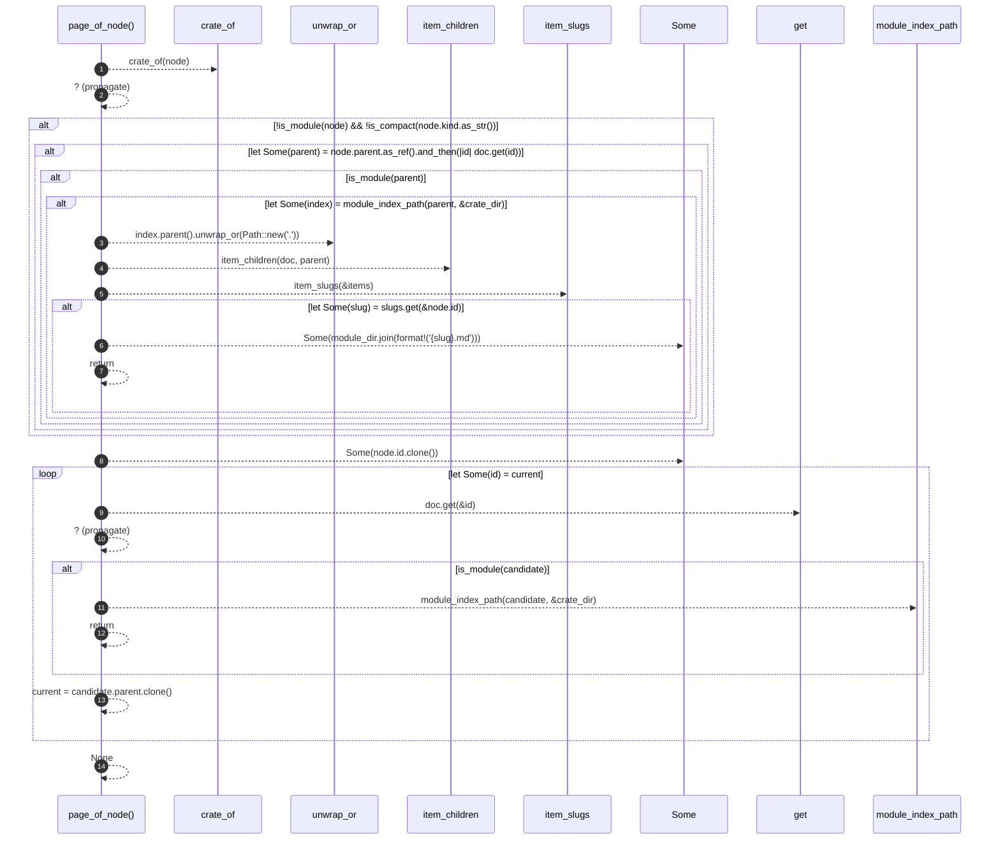

# `robby_render::tree::page_of_node`

[Self-model](../../README.md) · [tree](index.md)

| | |
|---|---|
| kind | `code.function` |
| signature | `fn page_of_node(doc: &Document, node: &Node) -> Option<PathBuf>` |
| location | [`crates/robby-render/src/tree.rs:551`](../../../../crates/robby-render/src/tree.rs#L551) |
| provenance | extractor · confidence 1.00 |

> The most specific page for a node: its item page if it has one.

```rust
/// The most specific page for a node: its item page if it has one.
fn page_of_node(doc: &Document, node: &Node) -> Option<PathBuf> {
    let crate_dir = crate_of(node)?;

    if !is_module(node) && !is_compact(node.kind.as_str()) {
        if let Some(parent) = node.parent.as_ref().and_then(|id| doc.get(id)) {
            if is_module(parent) {
                if let Some(index) = module_index_path(parent, &crate_dir) {
                    let module_dir = index.parent().unwrap_or(Path::new("."));
                    let items = item_children(doc, parent);
                    let slugs = item_slugs(&items);
                    if let Some(slug) = slugs.get(&node.id) {
                        return Some(module_dir.join(format!("{slug}.md")));
                    }
                }
            }
        }
    }

    let mut current = Some(node.id.clone());
    while let Some(id) = current {
        let candidate = doc.get(&id)?;
        if is_module(candidate) {
            return module_index_path(candidate, &crate_dir);
        }
        current = candidate.parent.clone();
    }
    None
}
```



14 steps · 0 observed · 14 possible only

**Edges**

- calls → [`robby_render::tree::crate_of`](crate-of.md)
- calls → [`robby_render::tree::item_children`](item-children.md)
- calls → [`robby_render::tree::item_slugs`](item-slugs.md)
- calls → [`robby_ir::model::impl Document::get`](../../robby_ir/model/index.md)
- calls → [`robby_render::tree::module_index_path`](module-index-path.md)

