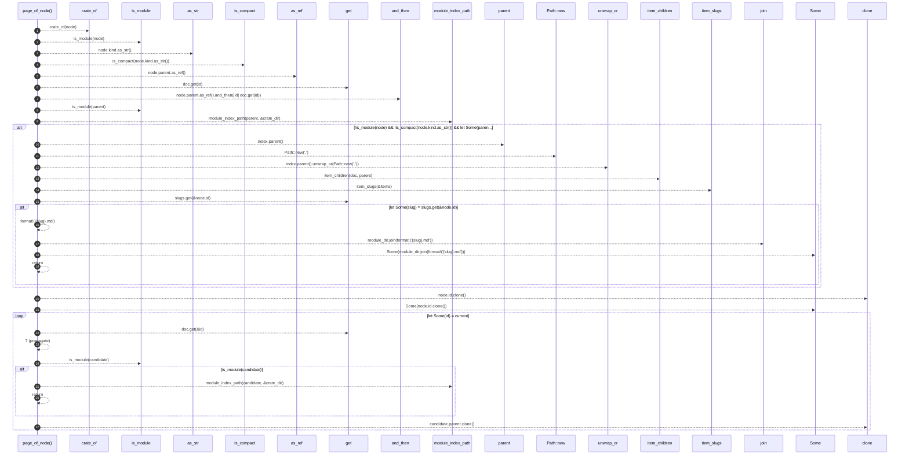

# `robby_render::tree::page_of_node`

[Self-model](../../README.md) · [tree](index.md)

| | |
|---|---|
| kind | `code.function` |
| signature | `fn page_of_node(doc: &Document, node: &Node) -> Option<PathBuf>` |
| location | [`crates/robby-render/src/tree.rs:723`](../../../../crates/robby-render/src/tree.rs#L723) |
| provenance | extractor · confidence 1.00 |

> The most specific page for a node: its item page if it has one.

```rust
/// The most specific page for a node: its item page if it has one.
fn page_of_node(doc: &Document, node: &Node) -> Option<PathBuf> {
    let crate_dir = crate_of(node);

    if !is_module(node)
        && !is_compact(node.kind.as_str())
        && let Some(parent) = node.parent.as_ref().and_then(|id| doc.get(id))
        && is_module(parent)
        && let Some(index) = module_index_path(parent, &crate_dir)
    {
        let module_dir = index.parent().unwrap_or(Path::new("."));
        let items = item_children(doc, parent);
        let slugs = item_slugs(&items);
        if let Some(slug) = slugs.get(&node.id) {
            return Some(module_dir.join(format!("{slug}.md")));
        }
    }

    let mut current = Some(node.id.clone());
    while let Some(id) = current {
        let candidate = doc.get(&id)?;
        if is_module(candidate) {
            return module_index_path(candidate, &crate_dir);
        }
        // `while let` moves `current`, so this has to be a fresh assignment.
        #[allow(clippy::assigning_clones)]
        {
            current = candidate.parent.clone();
        }
    }
    None
}
```



27 steps · 0 observed · 27 possible only

**Edges**

- calls → [`robby_render::tree::crate_of`](crate-of.md)
- calls → [`robby_render::tree::is_module`](is-module.md)
- calls → [`robby_render::view::comments::impl CommentKind::as_str`](../view/comments/index.md)
- calls → [`robby_render::tree::is_compact`](is-compact.md)
- calls → [`robby_ir::run::RecipeCatalog::get`](../../robby_ir/run/index.md)
- calls → [`robby_render::tree::is_module`](is-module.md)
- calls → [`robby_render::tree::module_index_path`](module-index-path.md)
- calls → [`robby_render::report::impl Report::new`](../report/index.md)
- calls → [`robby_render::tree::item_children`](item-children.md)
- calls → [`robby_render::tree::item_slugs`](item-slugs.md)
- calls → [`robby_ir::run::RecipeCatalog::get`](../../robby_ir/run/index.md)
- calls → [`robby_ir::run::RecipeCatalog::get`](../../robby_ir/run/index.md)
- calls → [`robby_render::tree::is_module`](is-module.md)
- calls → [`robby_render::tree::module_index_path`](module-index-path.md)

## References

- calls → [`robby_ir::run`](../../robby_ir/run/index.md) — get
- calls → [`robby_render::report`](../report/index.md) — new
- calls → [`robby_render::tree`](index.md) — 6 items
- calls → [`robby_render::view::comments`](../view/comments/index.md) — as_str

## Referenced by

- calls ← [`robby_render::tree::linked_import`](linked-import.md)
- calls ← [`robby_render::tree::render_links`](render-links.md)
- calls ← [`robby_render::tree::render_node`](render-node.md)

