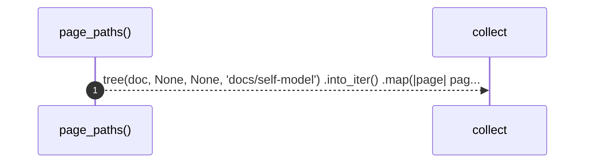

# `robby_render::tree::page_paths`

[Self-model](../../README.md) · [tree](index.md)

| | |
|---|---|
| kind | `code.function` |
| signature | `fn page_paths(doc: &Document) -> Vec<PathBuf>` |
| location | [`crates/robby-render/src/tree.rs:675`](../../../../crates/robby-render/src/tree.rs#L675) |
| provenance | extractor · confidence 1.00 |

> Every page path a document will produce, for tests and stale-file cleanup.

```rust
/// Every page path a document will produce, for tests and stale-file cleanup.
pub fn page_paths(doc: &Document) -> Vec<PathBuf> {
    tree(doc, None, None, "docs/self-model")
        .into_iter()
        .map(|page| page.path)
        .collect()
}
```



1 steps · 0 observed · 1 possible only

