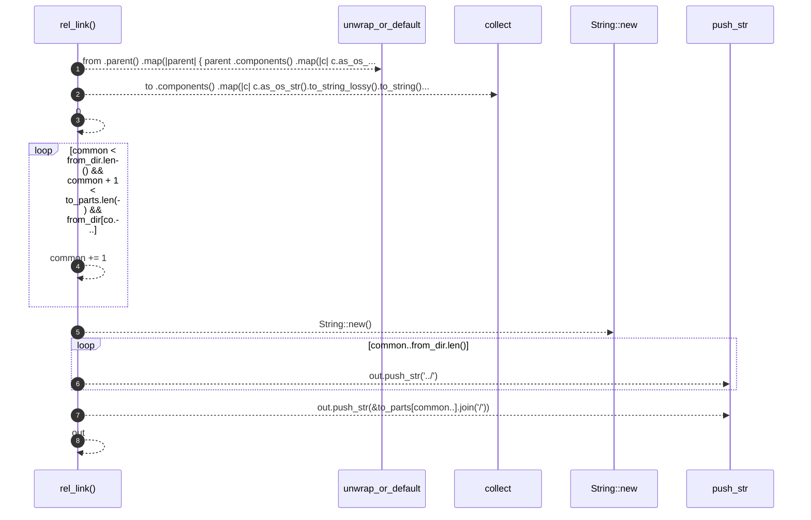

# `robby_render::tree::rel_link`

[Self-model](../../README.md) · [tree](index.md)

| | |
|---|---|
| kind | `code.function` |
| signature | `fn rel_link(from: &Path, to: &Path) -> String` |
| location | [`crates/robby-render/src/tree.rs:581`](../../../../crates/robby-render/src/tree.rs#L581) |
| provenance | extractor · confidence 1.00 |

> Relative link from one page to another. Both are relative to the output root.

```rust
/// Relative link from one page to another. Both are relative to the output root.
fn rel_link(from: &Path, to: &Path) -> String {
    let from_dir: Vec<String> = from
        .parent()
        .map(|parent| {
            parent
                .components()
                .map(|c| c.as_os_str().to_string_lossy().to_string())
                .collect()
        })
        .unwrap_or_default();
    let to_parts: Vec<String> = to
        .components()
        .map(|c| c.as_os_str().to_string_lossy().to_string())
        .collect();

    let mut common = 0;
    while common < from_dir.len()
        && common + 1 < to_parts.len()
        && from_dir[common] == to_parts[common]
    {
        common += 1;
    }

    let mut out = String::new();
    for _ in common..from_dir.len() {
        out.push_str("../");
    }
    out.push_str(&to_parts[common..].join("/"));
    out
}
```



8 steps · 0 observed · 8 possible only

**Edges**

- calls → [`robby_extract::impl LineIndex::new`](../../robby_extract/index.md)

