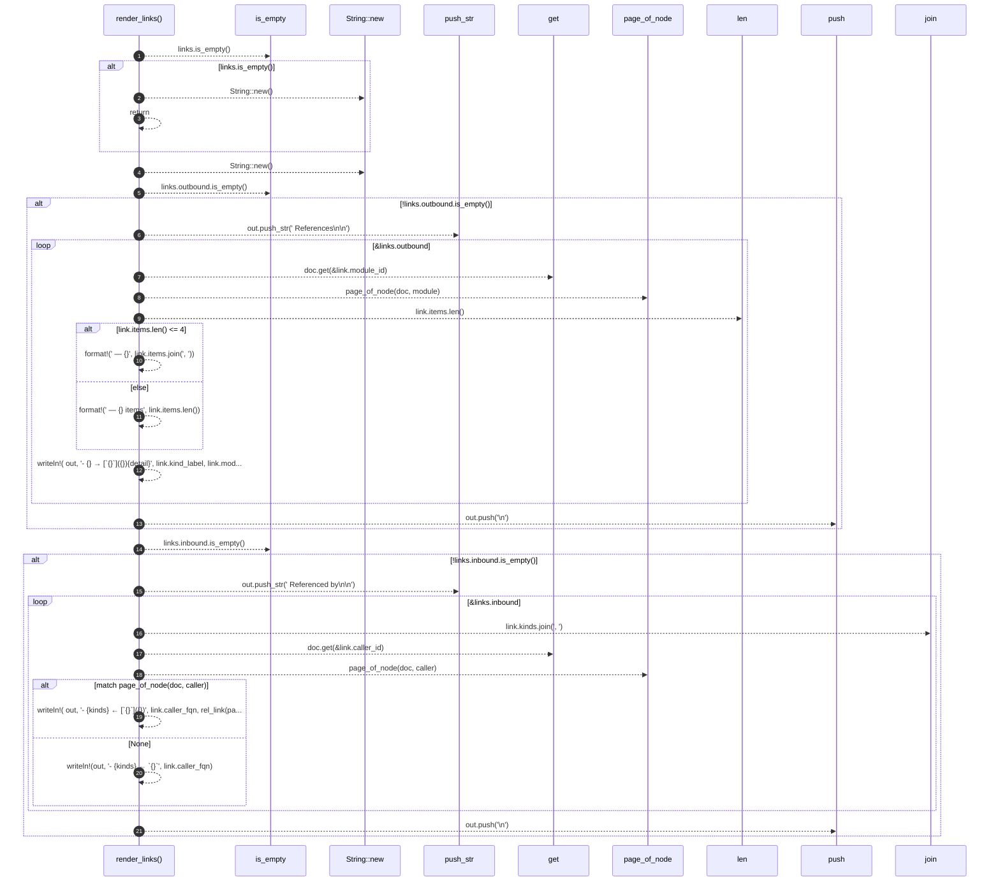

# `robby_render::tree::render_links`

[Self-model](../../README.md) · [tree](index.md)

| | |
|---|---|
| kind | `code.function` |
| signature | `fn render_links(doc: &Document, links: &LinkGraph, page: &Path) -> String` |
| location | [`crates/robby-render/src/tree.rs:564`](../../../../crates/robby-render/src/tree.rs#L564) |
| provenance | extractor · confidence 1.00 |

> Render a [`LinkGraph`] as markdown with resolved page paths.

```rust
/// Render a [`LinkGraph`] as markdown with resolved page paths.
fn render_links(doc: &Document, links: &LinkGraph, page: &Path) -> String {
    if links.is_empty() {
        return String::new();
    }

    let mut out = String::new();
    if !links.outbound.is_empty() {
        out.push_str("## References\n\n");
        for link in &links.outbound {
            let Some(module) = doc.get(&link.module_id) else {
                continue;
            };
            let Some(target_page) = page_of_node(doc, module) else {
                continue;
            };
            let detail = if link.items.len() <= 4 {
                format!(" — {}", link.items.join(", "))
            } else {
                format!(" — {} items", link.items.len())
            };
            let _ = writeln!(
                out,
                "- {} → [`{}`]({}){detail}",
                link.kind_label,
                link.module_fqn,
                rel_link(page, &target_page)
            );
        }
        out.push('\n');
    }

    if !links.inbound.is_empty() {
        out.push_str("## Referenced by\n\n");
        for link in &links.inbound {
            let kinds = link.kinds.join(", ");
            let Some(caller) = doc.get(&link.caller_id) else {
                let _ = writeln!(out, "- {kinds} ← `{}`", link.caller_fqn);
                continue;
            };
            match page_of_node(doc, caller) {
                Some(target_page) => {
                    let _ = writeln!(
                        out,
                        "- {kinds} ← [`{}`]({})",
                        link.caller_fqn,
                        rel_link(page, &target_page)
                    );
                }
                None => {
                    let _ = writeln!(out, "- {kinds} ← `{}`", link.caller_fqn);
                }
            }
        }
        out.push('\n');
    }

    out
}
```



21 steps · 0 observed · 21 possible only

**Edges**

- calls → [`robby_render::view::links::impl LinkGraph::is_empty`](../view/links/index.md)
- calls → [`robby_render::report::impl Report::new`](../report/index.md)
- calls → [`robby_render::report::impl Report::new`](../report/index.md)
- calls → [`robby_render::view::links::impl LinkGraph::is_empty`](../view/links/index.md)
- calls → [`robby_ir::model::impl Document::get`](../../robby_ir/model/index.md)
- calls → [`robby_render::tree::page_of_node`](page-of-node.md)
- calls → [`robby_render::report::impl Report::push`](../report/index.md)
- calls → [`robby_render::view::links::impl LinkGraph::is_empty`](../view/links/index.md)
- calls → [`robby_ir::model::impl Document::get`](../../robby_ir/model/index.md)
- calls → [`robby_render::tree::page_of_node`](page-of-node.md)
- calls → [`robby_render::report::impl Report::push`](../report/index.md)

## References

- calls → [`robby_ir::model`](../../robby_ir/model/index.md) — get
- calls → [`robby_render::report`](../report/index.md) — new, push
- calls → [`robby_render::tree`](index.md) — page_of_node
- calls → [`robby_render::view::links`](../view/links/index.md) — is_empty

## Referenced by

- calls ← [`robby_render::tree::module_page`](module-page.md)
- calls ← [`robby_render::tree::render_node`](render-node.md)

