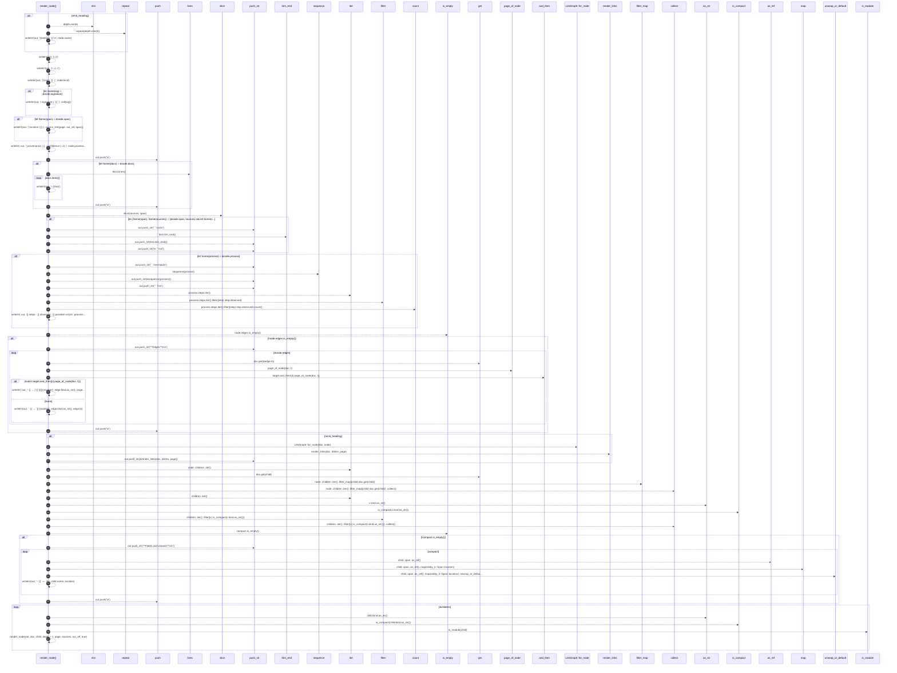

# `robby_render::tree::render_node`

[Self-model](../../README.md) · [tree](index.md)

| | |
|---|---|
| kind | `code.function` |
| signature | `fn render_node(     out: &mut String,     doc: &Document,     node: &Node,     depth: usize,     page: &Path,     sources: Option<&BTreeMap<String, String>>,     out_rel: &str,     emit_heading: bool, )` |
| location | [`crates/robby-render/src/tree.rs:436`](../../../../crates/robby-render/src/tree.rs#L436) |
| provenance | extractor · confidence 1.00 |

```rust
#[allow(clippy::too_many_arguments)]
fn render_node(
    out: &mut String,
    doc: &Document,
    node: &Node,
    depth: usize,
    page: &Path,
    sources: Option<&BTreeMap<String, String>>,
    out_rel: &str,
    emit_heading: bool,
) {
    if emit_heading {
        let hashes = "#".repeat(depth.min(6));
        let _ = writeln!(out, "{hashes} `{}`\n", node.name);
    }

    let _ = writeln!(out, "| | |");
    let _ = writeln!(out, "|---|---|");
    let _ = writeln!(out, "| kind | `{}` |", node.kind);
    if let Some(sig) = &node.signature {
        let _ = writeln!(out, "| signature | `{}` |", cell(sig));
    }
    if let Some(span) = &node.span {
        let _ = writeln!(out, "| location | {} |", source_link(page, out_rel, span));
    }
    let _ = writeln!(
        out,
        "| provenance | {} · confidence {:.2} |",
        node.provenance.source.as_str(),
        node.provenance.confidence
    );
    out.push('\n');

    if let Some(docs) = &node.docs {
        for line in docs.lines() {
            let _ = writeln!(out, "> {line}");
        }
        out.push('\n');
    }

    if let (Some(span), Some(sources)) = (&node.span, sources)
        && let Some(text) = slice(sources, span)
    {
        out.push_str("```rust\n");
        out.push_str(text.trim_end());
        out.push_str("\n```\n\n");
    }

    if let Some(process) = &node.process {
        out.push_str("```mermaid\n");
        out.push_str(&sequence(process));
        out.push_str("```\n\n");

        let observed = process.steps.iter().filter(|step| step.observed).count();
        let _ = writeln!(
            out,
            "{} steps · {} observed · {} possible only\n",
            process.steps.len(),
            observed,
            process.steps.len() - observed
        );
    }

    if !node.edges.is_empty() {
        out.push_str("**Edges**\n\n");
        for edge in &node.edges {
            let marker = if edge.resolved { "" } else { " (unresolved)" };
            let target = doc.get(&edge.to);
            match target.and_then(|t| page_of_node(doc, t)) {
                Some(target_page) => {
                    let _ = writeln!(
                        out,
                        "- {} → [`{}`]({}){marker}",
                        edge.kind.as_str(),
                        target.map_or(edge.to.as_str(), |t| t.fqn.as_str()),
                        rel_link(page, &target_page)
                    );
                }
                None => {
                    let _ = writeln!(out, "- {} → `{}`{marker}", edge.kind.as_str(), edge.to);
                }
            }
        }
        out.push('\n');
    }

    if !emit_heading {
        let links = LinkGraph::for_node(doc, node);
        out.push_str(&render_links(doc, &links, page));
    }

    let children: Vec<&Node> = node
        .children
        .iter()
        .filter_map(|child| doc.get(child))
        .collect();

    let compact: Vec<&&Node> = children
        .iter()
        .filter(|c| is_compact(c.kind.as_str()))
        .collect();
    if !compact.is_empty() {
        out.push_str("**Fields and variants**\n\n");
        for child in compact {
            let location = child
                .span
                .as_ref()
                .map(robby_ir::Span::location)
                .unwrap_or_default();
            let _ = writeln!(out, "- `{}` — `{}`", child.name, location);
        }
        out.push('\n');
    }

    for child in &children {
        if is_compact(child.kind.as_str()) || is_module(child) {
            continue;
        }
        render_node(out, doc, child, depth + 1, page, sources, out_rel, true);
    }
}
```



57 steps · 0 observed · 57 possible only

**Edges**

- calls → [`robby_render::report::impl Report::push`](../report/index.md)
- calls → [`robby_render::report::impl Report::push`](../report/index.md)
- calls → [`robby_render::tree::slice`](slice.md)
- calls → [`robby_render::sequence`](../sequence.md)
- calls → [`robby_render::view::links::impl LinkGraph::is_empty`](../view/links/index.md)
- calls → [`robby_ir::run::RecipeCatalog::get`](../../robby_ir/run/index.md)
- calls → [`robby_render::tree::page_of_node`](page-of-node.md)
- calls → [`robby_render::report::impl Report::push`](../report/index.md)
- calls → [`robby_render::view::links::impl LinkGraph::for_node`](../view/links/index.md)
- calls → [`robby_render::tree::render_links`](render-links.md)
- calls → [`robby_ir::run::RecipeCatalog::get`](../../robby_ir/run/index.md)
- calls → [`robby_render::view::select::collect`](../view/select/collect.md)
- calls → [`robby_render::view::comments::impl CommentKind::as_str`](../view/comments/index.md)
- calls → [`robby_render::tree::is_compact`](is-compact.md)
- calls → [`robby_render::view::select::collect`](../view/select/collect.md)
- calls → [`robby_render::view::links::impl LinkGraph::is_empty`](../view/links/index.md)
- calls → [`robby_render::report::impl Report::push`](../report/index.md)
- calls → [`robby_render::view::comments::impl CommentKind::as_str`](../view/comments/index.md)
- calls → [`robby_render::tree::is_compact`](is-compact.md)
- calls → [`robby_render::tree::is_module`](is-module.md)
- calls → [`robby_render::tree::render_node`](render-node.md)

## References

- calls → [`robby_ir::run`](../../robby_ir/run/index.md) — get
- calls → [`robby_render`](../index.md) — sequence
- calls → [`robby_render::report`](../report/index.md) — push
- calls → [`robby_render::tree`](index.md) — 5 items
- calls → [`robby_render::view::comments`](../view/comments/index.md) — as_str
- calls → [`robby_render::view::links`](../view/links/index.md) — for_node, is_empty
- calls → [`robby_render::view::select`](../view/select/index.md) — collect

## Referenced by

- calls ← [`robby_render::tree::item_page`](item-page.md)

