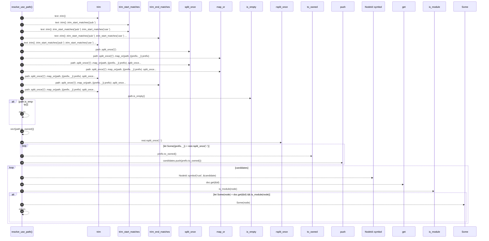

# `robby_render::tree::resolve_use_path`

[Self-model](../../README.md) · [tree](index.md)

| | |
|---|---|
| kind | `code.function` |
| signature | `fn resolve_use_path<'a>(doc: &'a Document, text: &str) -> Option<&'a Node>` |
| location | [`crates/robby-render/src/tree.rs:629`](../../../../crates/robby-render/src/tree.rs#L629) |
| provenance | extractor · confidence 1.00 |

```rust
fn resolve_use_path<'a>(doc: &'a Document, text: &str) -> Option<&'a Node> {
    let path = text
        .trim()
        .trim_start_matches("pub ")
        .trim_start_matches("use ")
        .trim_end_matches(';')
        .trim();
    let path = path
        .split_once('{')
        .map_or(path, |(prefix, _)| prefix)
        .split_once(" as ")
        .map_or(path, |(prefix, _)| prefix)
        .trim()
        .trim_end_matches("::")
        .trim();
    if path.is_empty() {
        return None;
    }

    let mut candidates = vec![path.to_owned()];
    let mut rest = path;
    while let Some((prefix, _)) = rest.rsplit_once("::") {
        candidates.push(prefix.to_owned());
        rest = prefix;
    }

    for candidate in candidates {
        let id = NodeId::symbol("rust", &candidate);
        if let Some(node) = doc.get(&id)
            && is_module(node)
        {
            return Some(node);
        }
    }
    None
}
```



23 steps · 0 observed · 23 possible only

**Edges**

- calls → [`robby_render::view::links::impl LinkGraph::is_empty`](../view/links/index.md)
- calls → [`robby_render::report::impl Report::push`](../report/index.md)
- calls → [`robby_ir::model::impl NodeId::symbol`](../../robby_ir/model/index.md)
- calls → [`robby_ir::model::impl Document::get`](../../robby_ir/model/index.md)
- calls → [`robby_render::tree::is_module`](is-module.md)

## References

- calls → [`robby_ir::model`](../../robby_ir/model/index.md) — get, symbol
- calls → [`robby_render::report`](../report/index.md) — push
- calls → [`robby_render::tree`](index.md) — is_module
- calls → [`robby_render::view::links`](../view/links/index.md) — is_empty

## Referenced by

- calls ← [`robby_render::tree::linked_import`](linked-import.md)

