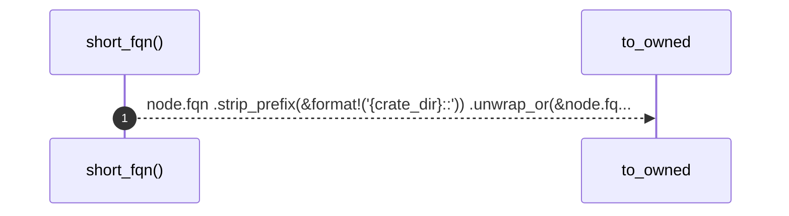

# `robby_render::tree::short_fqn`

[Self-model](../../README.md) · [tree](index.md)

| | |
|---|---|
| kind | `code.function` |
| signature | `fn short_fqn(node: &Node, crate_dir: &str) -> String` |
| location | [`crates/robby-render/src/tree.rs:641`](../../../../crates/robby-render/src/tree.rs#L641) |
| provenance | extractor · confidence 1.00 |

```rust
fn short_fqn(node: &Node, crate_dir: &str) -> String {
    node.fqn
        .strip_prefix(&format!("{crate_dir}::"))
        .unwrap_or(&node.fqn)
        .to_owned()
}
```



1 steps · 0 observed · 1 possible only

