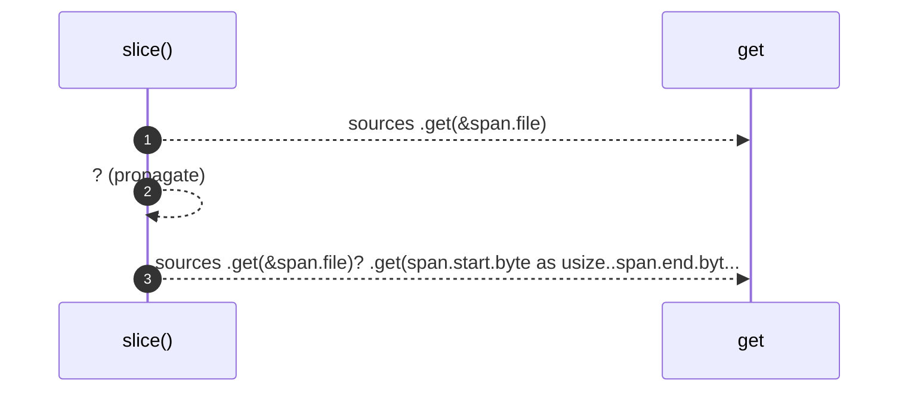

# `robby_render::tree::slice`

[Self-model](../../README.md) · [tree](index.md)

| | |
|---|---|
| kind | `code.function` |
| signature | `fn slice<'a>(sources: &'a BTreeMap<String, String>, span: &robby_ir::Span) -> Option<&'a str>` |
| location | [`crates/robby-render/src/tree.rs:799`](../../../../crates/robby-render/src/tree.rs#L799) |
| provenance | extractor · confidence 1.00 |

```rust
fn slice<'a>(sources: &'a BTreeMap<String, String>, span: &robby_ir::Span) -> Option<&'a str> {
    sources
        .get(&span.file)?
        .get(span.start.byte as usize..span.end.byte as usize)
}
```



3 steps · 0 observed · 3 possible only

**Edges**

- calls → [`robby_ir::run::RecipeCatalog::get`](../../robby_ir/run/index.md)
- calls → [`robby_ir::run::RecipeCatalog::get`](../../robby_ir/run/index.md)

## References

- calls → [`robby_ir::run`](../../robby_ir/run/index.md) — get

## Referenced by

- calls ← [`robby_render::tree::module_page`](module-page.md)
- calls ← [`robby_render::tree::render_node`](render-node.md)

