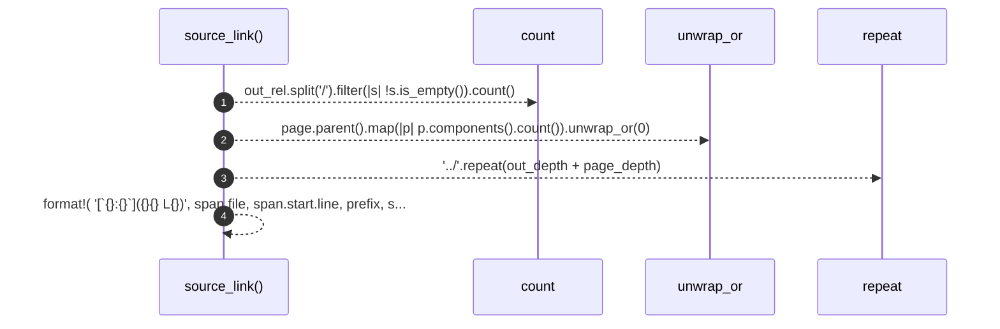

# `robby_render::tree::source_link`

[Self-model](../../README.md) · [tree](index.md)

| | |
|---|---|
| kind | `code.function` |
| signature | `fn source_link(page: &Path, out_rel: &str, span: &robby_ir::Span) -> String` |
| location | [`crates/robby-render/src/tree.rs:613`](../../../../crates/robby-render/src/tree.rs#L613) |
| provenance | extractor · confidence 1.00 |

> A link from a generated page back to the exact source span.

```rust
/// A link from a generated page back to the exact source span.
fn source_link(page: &Path, out_rel: &str, span: &robby_ir::Span) -> String {
    let out_depth = out_rel.split('/').filter(|s| !s.is_empty()).count();
    let page_depth = page.parent().map(|p| p.components().count()).unwrap_or(0);
    let prefix = "../".repeat(out_depth + page_depth);
    format!(
        "[`{}:{}`]({}{}#L{})",
        span.file, span.start.line, prefix, span.file, span.start.line
    )
}
```



4 steps · 0 observed · 4 possible only

