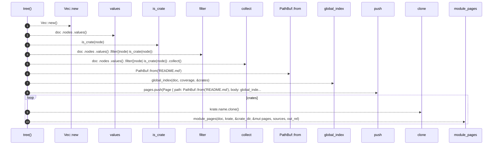

# `robby_render::tree::tree`

[Self-model](../../README.md) · [tree](index.md)

| | |
|---|---|
| kind | `code.function` |
| signature | `fn tree(     doc: &Document,     coverage: Option<&CoverageReport>,     sources: Option<&BTreeMap<String, String>>,     out_rel: &str, ) -> Vec<Page>` |
| location | [`crates/robby-render/src/tree.rs:35`](../../../../crates/robby-render/src/tree.rs#L35) |
| provenance | extractor · confidence 1.00 |

> Build every page of the self-model.
> 
> `out_rel` is the output directory relative to the workspace root, e.g.
> `docs/self-model`. It is only used to compute links back to source files.

```rust
/// Build every page of the self-model.
///
/// `out_rel` is the output directory relative to the workspace root, e.g.
/// `docs/self-model`. It is only used to compute links back to source files.
pub fn tree(
    doc: &Document,
    coverage: Option<&CoverageReport>,
    sources: Option<&BTreeMap<String, String>>,
    out_rel: &str,
) -> Vec<Page> {
    let mut pages = Vec::new();

    let crates: Vec<&Node> = doc
        .nodes
        .values()
        .filter(|node| is_crate(node))
        .collect();

    pages.push(Page {
        path: PathBuf::from("README.md"),
        body: global_index(doc, coverage, &crates),
    });

    for krate in crates {
        let crate_dir = krate.name.clone();
        module_pages(doc, krate, &crate_dir, &mut pages, sources, out_rel);
    }

    pages
}
```



10 steps · 0 observed · 10 possible only

**Edges**

- calls → [`robby_render::report::impl Report::new`](../report/index.md)
- calls → [`robby_render::tree::is_crate`](is-crate.md)
- calls → [`robby_render::view::select::collect`](../view/select/collect.md)
- calls → [`robby_ir::kind::impl From<&str> for Kind::from`](../../robby_ir/kind/index.md)
- calls → [`robby_render::tree::global_index`](global-index.md)
- calls → [`robby_render::report::impl Report::push`](../report/index.md)
- calls → [`robby_render::tree::module_pages`](module-pages.md)

## References

- calls → [`robby_ir::kind`](../../robby_ir/kind/index.md) — from
- calls → [`robby_render::report`](../report/index.md) — new, push
- calls → [`robby_render::tree`](index.md) — global_index, is_crate, module_pages
- calls → [`robby_render::view::select`](../view/select/index.md) — collect

## Referenced by

- calls ← [`robby_render::tree::page_paths`](page-paths.md)

