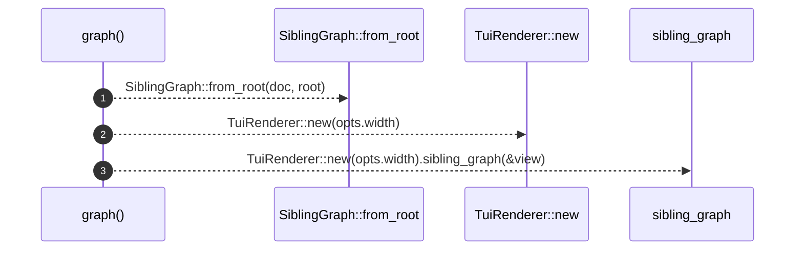

# `robby_render::tui::graph`

[Self-model](../../README.md) · [tui](index.md)

| | |
|---|---|
| kind | `code.function` |
| signature | `fn graph(doc: &Document, root: &NodeId, opts: &ShowOptions) -> String` |
| location | [`crates/robby-render/src/tui.rs:30`](../../../../crates/robby-render/src/tui.rs#L30) |
| provenance | extractor · confidence 1.00 |

> Legacy sibling ASCII DAG.

```rust
/// Legacy sibling ASCII DAG.
pub fn graph(doc: &Document, root: &NodeId, opts: &ShowOptions) -> String {
    let view = SiblingGraph::from_root(doc, root);
    TuiRenderer::new(opts.width).sibling_graph(&view)
}
```



3 steps · 0 observed · 3 possible only

**Edges**

- calls → [`robby_render::view::deps::impl CouplingGraph::from_root`](../view/deps/index.md)
- calls → [`robby_render::report::impl Report::new`](../report/index.md)
- calls → [`robby_render::render::Renderer::sibling_graph`](../render/index.md)

## References

- calls → [`robby_render::render`](../render/index.md) — sibling_graph
- calls → [`robby_render::report`](../report/index.md) — new
- calls → [`robby_render::view::deps`](../view/deps/index.md) — from_root

