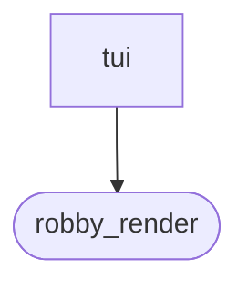
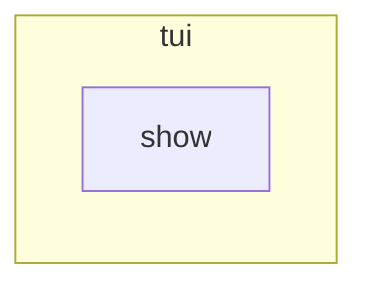

# `robby_render::tui`

[Self-model](../../README.md) · [robby_render](../index.md)

| | |
|---|---|
| kind | `code.module` |
| declared at | [`crates/robby-render/src/lib.rs:16`](../../../../crates/robby-render/src/lib.rs#L16) |
| provenance | extractor · confidence 1.00 |
| nodes | 11 |

## Package diagram



## Module coupling



## Dependency matrix

| | tui | robby_render |
|---|---:|---:|
| **tui** | · | 14 |
| **robby_render** | | · |

## Comments

- `crates/robby-render/src/tui.rs:14:1` (docs, `robby_render::tui::show`): "Render one node as a complete terminal report artifact."
  ```
  /// Render one node as a complete terminal report artifact.
  pub fn show(
      doc: &Document,
      node: &Node,
      sources: Option<&BTreeMap<String, String>>,
      opts: &ShowOptions,
  ) -> String {
      TuiRenderer::new(opts.width).show(doc, node, sources, opts)
  }
  ```
- `crates/robby-render/src/tui.rs:24:1` (docs, `robby_render::tui::tree`): "Box-drawing hierarchy."
  ```
  /// Box-drawing hierarchy.
  pub fn tree(doc: &Document, root: &NodeId, opts: &ShowOptions) -> String {
      let view = HierarchyView::from_node(doc, root, opts.depth, opts.all);
      TuiRenderer::new(opts.width).hierarchy(&view)
  }
  ```
- `crates/robby-render/src/tui.rs:30:1` (docs, `robby_render::tui::graph`): "Legacy sibling ASCII DAG."
  ```
  /// Legacy sibling ASCII DAG.
  pub fn graph(doc: &Document, root: &NodeId, opts: &ShowOptions) -> String {
      let view = SiblingGraph::from_root(doc, root);
      TuiRenderer::new(opts.width).sibling_graph(&view)
  }
  ```
- `crates/robby-render/src/tui.rs:36:1` (docs, `robby_render::tui::timeline`): "Process timeline."
  ```
  /// Process timeline.
  pub fn timeline(process: &Process) -> String {
      TuiRenderer::default().process(&ProcessView::from_process(process))
  }
  ```
- `crates/robby-render/src/tui.rs:41:1` (docs, `robby_render::tui::show_collected`): "Collect + render convenience."
  ```
  /// Collect + render convenience.
  pub fn show_collected(
      doc: &Document,
      node: &Node,
      sources: Option<&BTreeMap<String, String>>,
      opts: &ShowOptions,
  ) -> String {
      let views = collect(doc, node, sources, &opts.select_opts());
      TuiRenderer::new(opts.width).render_report(&views)
  }
  ```
## References

- calls → [`robby_render::render`](../render/index.md) — hierarchy, sibling_graph
- calls → [`robby_render::render::tui`](../render/tui/index.md) — default, render_report, select_opts
- calls → [`robby_render::report`](../report/index.md) — new
- calls → [`robby_render::test_render`](../test_render/index.md) — process
- calls → [`robby_render::view::deps`](../view/deps/index.md) — from_root
- calls → [`robby_render::view::process`](../view/process/index.md) — from_process
- calls → [`robby_render::view::select`](../view/select/index.md) — collect
- calls → [`robby_render::web`](../web/index.md) — from_node

## Referenced by

- calls ← [`robby_cli::workspace`](../../robby_cli/workspace.md)
- calls ← [`robby_render::pipeline::write_report`](../pipeline/write-report.md)
- calls ← [`robby_render::test_tree::pages`](../test_tree/pages.md)

## Items

| Item | Kind | Steps | Location |
|---|---|---:|---|
| [`show`](show.md) | `code.function` | 2 | `crates/robby-render/src/tui.rs:14:1` |
| [`tree`](tree.md) | `code.function` | 3 | `crates/robby-render/src/tui.rs:24:1` |
| [`graph`](graph.md) | `code.function` | 3 | `crates/robby-render/src/tui.rs:30:1` |
| [`timeline`](timeline.md) | `code.function` | 3 | `crates/robby-render/src/tui.rs:36:1` |
| [`show_collected`](show-collected.md) | `code.function` | 4 | `crates/robby-render/src/tui.rs:41:1` |

## Imports

- `pub use crate::render::tui::{ShowOptions, TuiRenderer};`
- `use std::collections::BTreeMap;`
- [`use robby_ir::{Document, Node, NodeId, Process};`](../../robby_ir/index.md)
- `use crate::render::Renderer;`
- `use crate::view::{HierarchyView, ProcessView, SiblingGraph, collect};`

