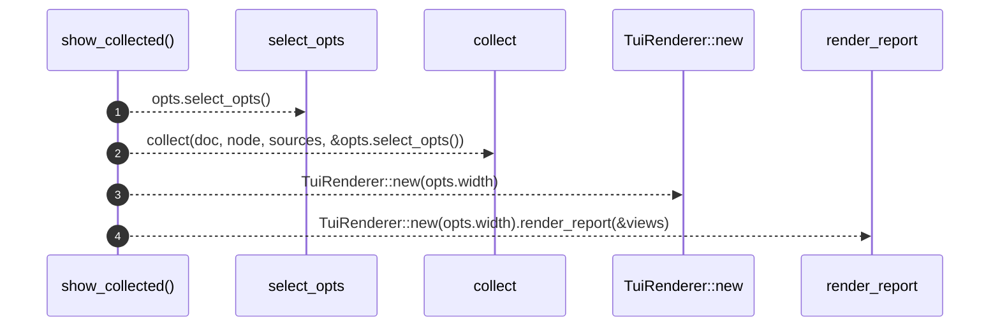

# `robby_render::tui::show_collected`

[Self-model](../../README.md) · [tui](index.md)

| | |
|---|---|
| kind | `code.function` |
| signature | `fn show_collected(     doc: &Document,     node: &Node,     sources: Option<&BTreeMap<String, String>>,     opts: &ShowOptions, ) -> String` |
| location | [`crates/robby-render/src/tui.rs:41`](../../../../crates/robby-render/src/tui.rs#L41) |
| provenance | extractor · confidence 1.00 |

> Collect + render convenience.

```rust
/// Collect + render convenience.
pub fn show_collected(
    doc: &Document,
    node: &Node,
    sources: Option<&BTreeMap<String, String>>,
    opts: &ShowOptions,
) -> String {
    let views = collect(doc, node, sources, &opts.select_opts());
    TuiRenderer::new(opts.width).render_report(&views)
}
```



4 steps · 0 observed · 4 possible only

**Edges**

- calls → [`robby_render::render::tui::impl ShowOptions::select_opts`](../render/tui/index.md)
- calls → [`robby_render::view::select::collect`](../view/select/collect.md)
- calls → [`robby_render::report::impl Report::new`](../report/index.md)
- calls → [`robby_render::render::tui::impl TuiRenderer::render_report`](../render/tui/index.md)

## References

- calls → [`robby_render::render::tui`](../render/tui/index.md) — render_report, select_opts
- calls → [`robby_render::report`](../report/index.md) — new
- calls → [`robby_render::view::select`](../view/select/index.md) — collect

