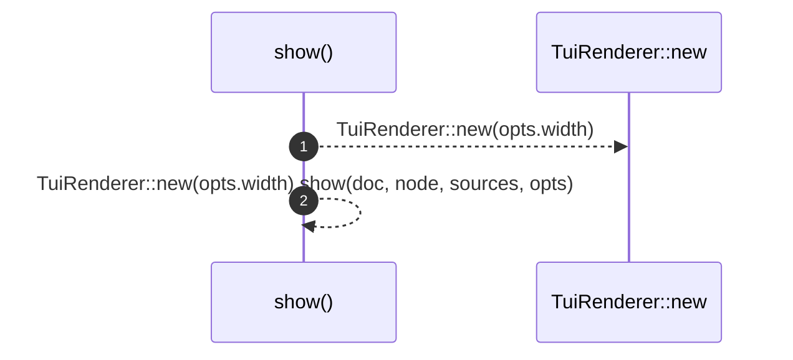

# `robby_render::tui::show`

[Self-model](../../README.md) · [tui](index.md)

| | |
|---|---|
| kind | `code.function` |
| signature | `fn show(     doc: &Document,     node: &Node,     sources: Option<&BTreeMap<String, String>>,     opts: &ShowOptions, ) -> String` |
| location | [`crates/robby-render/src/tui.rs:14`](../../../../crates/robby-render/src/tui.rs#L14) |
| provenance | extractor · confidence 1.00 |

> Render one node as a complete terminal report artifact.

```rust
/// Render one node as a complete terminal report artifact.
pub fn show(
    doc: &Document,
    node: &Node,
    sources: Option<&BTreeMap<String, String>>,
    opts: &ShowOptions,
) -> String {
    TuiRenderer::new(opts.width).show(doc, node, sources, opts)
}
```



2 steps · 0 observed · 2 possible only

**Edges**

- calls → [`robby_render::report::impl Report::new`](../report/index.md)
- calls → [`robby_render::tui::show`](show.md)

## References

- calls → [`robby_render::report`](../report/index.md) — new

