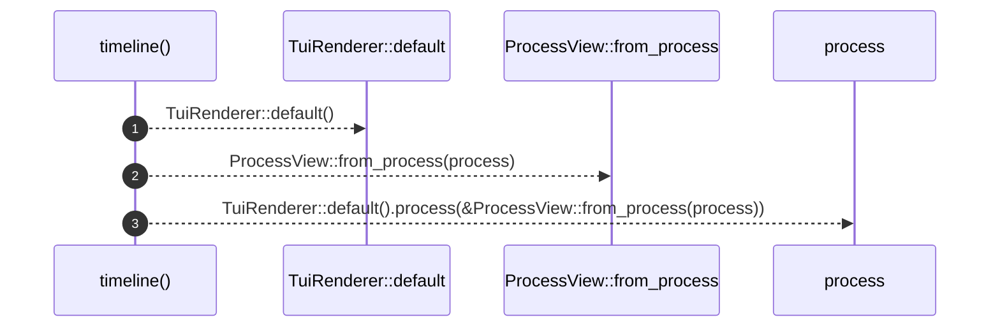

# `robby_render::tui::timeline`

[Self-model](../../README.md) · [tui](index.md)

| | |
|---|---|
| kind | `code.function` |
| signature | `fn timeline(process: &Process) -> String` |
| location | [`crates/robby-render/src/tui.rs:36`](../../../../crates/robby-render/src/tui.rs#L36) |
| provenance | extractor · confidence 1.00 |

> Process timeline.

```rust
/// Process timeline.
pub fn timeline(process: &Process) -> String {
    TuiRenderer::default().process(&ProcessView::from_process(process))
}
```



3 steps · 0 observed · 3 possible only

**Edges**

- calls → [`robby_render::render::tui::impl Default for ShowOptions::default`](../render/tui/index.md)
- calls → [`robby_render::view::process::impl ProcessView::from_process`](../view/process/index.md)
- calls → [`robby_render::test_render::process`](../test_render/process.md)

## References

- calls → [`robby_render::render::tui`](../render/tui/index.md) — default
- calls → [`robby_render::test_render`](../test_render/index.md) — process
- calls → [`robby_render::view::process`](../view/process/index.md) — from_process

