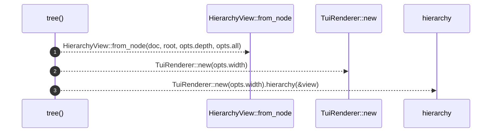

# `robby_render::tui::tree`

[Self-model](../../README.md) · [tui](index.md)

| | |
|---|---|
| kind | `code.function` |
| signature | `fn tree(doc: &Document, root: &NodeId, opts: &ShowOptions) -> String` |
| location | [`crates/robby-render/src/tui.rs:24`](../../../../crates/robby-render/src/tui.rs#L24) |
| provenance | extractor · confidence 1.00 |

> Box-drawing hierarchy.

```rust
/// Box-drawing hierarchy.
pub fn tree(doc: &Document, root: &NodeId, opts: &ShowOptions) -> String {
    let view = HierarchyView::from_node(doc, root, opts.depth, opts.all);
    TuiRenderer::new(opts.width).hierarchy(&view)
}
```



3 steps · 0 observed · 3 possible only

**Edges**

- calls → [`robby_render::web::impl FrameDetail::from_node`](../web/index.md)
- calls → [`robby_render::report::impl Report::new`](../report/index.md)
- calls → [`robby_render::render::Renderer::hierarchy`](../render/index.md)

## References

- calls → [`robby_render::render`](../render/index.md) — hierarchy
- calls → [`robby_render::report`](../report/index.md) — new
- calls → [`robby_render::web`](../web/index.md) — from_node

## Referenced by

- calls ← [`robby_cli::workspace`](../../robby_cli/workspace.md)
- calls ← [`robby_render::pipeline::write_report`](../pipeline/write-report.md)
- calls ← [`robby_render::test_tree::pages`](../test_tree/pages.md)

