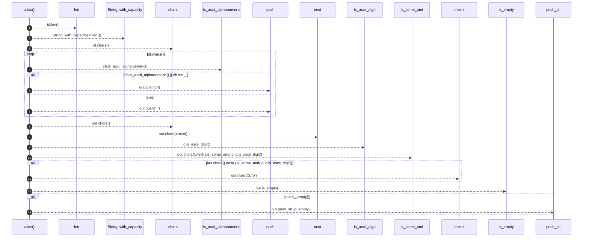

# `robby_render::util::alias`

[Self-model](../../README.md) · [util](index.md)

| | |
|---|---|
| kind | `code.function` |
| signature | `fn alias(id: &str) -> String` |
| location | [`crates/robby-render/src/util.rs:15`](../../../../crates/robby-render/src/util.rs#L15) |
| provenance | extractor · confidence 1.00 |

> Mermaid participant and node ids allow only a restricted alphabet.

```rust
/// Mermaid participant and node ids allow only a restricted alphabet.
pub fn alias(id: &str) -> String {
    let mut out = String::with_capacity(id.len());
    for ch in id.chars() {
        if ch.is_ascii_alphanumeric() || ch == '_' {
            out.push(ch);
        } else {
            out.push('_');
        }
    }
    if out.chars().next().is_some_and(|c| c.is_ascii_digit()) {
        out.insert(0, 'p');
    }
    if out.is_empty() {
        out.push_str("p_empty");
    }
    out
}
```



13 steps · 0 observed · 13 possible only

**Edges**

- calls → [`robby_render::report::impl Report::push`](../report/index.md)
- calls → [`robby_render::report::impl Report::push`](../report/index.md)
- calls → [`robby_ir::model::impl Document::insert`](../../robby_ir/model/index.md)
- calls → [`robby_render::view::links::impl LinkGraph::is_empty`](../view/links/index.md)

## References

- calls → [`robby_ir::model`](../../robby_ir/model/index.md) — insert
- calls → [`robby_render::report`](../report/index.md) — push
- calls → [`robby_render::view::links`](../view/links/index.md) — is_empty

## Referenced by

- calls ← [`robby_render::util::class_id`](class-id.md)
- calls ← [`robby_render::view::execution::from_code_path`](../view/execution/from-code-path.md)
- calls ← [`robby_render::view::execution::participant_id`](../view/execution/participant-id.md)

