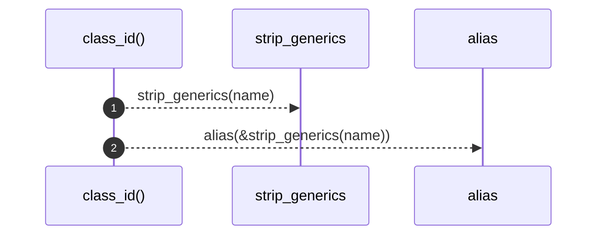

# `robby_render::util::class_id`

[Self-model](../../README.md) · [util](index.md)

| | |
|---|---|
| kind | `code.function` |
| signature | `fn class_id(name: &str) -> String` |
| location | [`crates/robby-render/src/util.rs:99`](../../../../crates/robby-render/src/util.rs#L99) |
| provenance | extractor · confidence 1.00 |

```rust
pub fn class_id(name: &str) -> String {
    alias(&strip_generics(name))
}
```



2 steps · 0 observed · 2 possible only

**Edges**

- calls → [`robby_render::util::strip_generics`](strip-generics.md)
- calls → [`robby_render::util::alias`](alias.md)

## References

- calls → [`robby_render::util`](index.md) — alias, strip_generics

## Referenced by

- calls ← [`robby_render::view::types::impl TypeModel::from_module`](../view/types/index.md)

