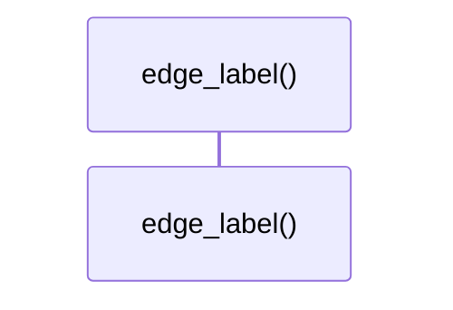

# `robby_render::util::edge_label`

[Self-model](../../README.md) · [util](index.md)

| | |
|---|---|
| kind | `code.function` |
| signature | `fn edge_label(kind: EdgeKind) -> &'static str` |
| location | [`crates/robby-render/src/util.rs:47`](../../../../crates/robby-render/src/util.rs#L47) |
| provenance | extractor · confidence 1.00 |

```rust
pub fn edge_label(kind: EdgeKind) -> &'static str {
    match kind {
        EdgeKind::Contains => "contains",
        EdgeKind::Calls => "calls",
        EdgeKind::Uses => "uses",
        EdgeKind::Imports => "imports",
        EdgeKind::Implements => "implements",
        EdgeKind::Extends => "extends",
        EdgeKind::Returns => "returns",
        EdgeKind::Field => "field",
        EdgeKind::References => "refs",
    }
}
```



0 steps · 0 observed · 0 possible only

## Referenced by

- calls ← [`robby_render::view::links::inbound`](../view/links/inbound.md)
- calls ← [`robby_render::view::links::outbound`](../view/links/outbound.md)
- calls ← [`robby_render::view::scene::build_call_frame`](../view/scene/build-call-frame.md)
- calls ← [`robby_render::view::scene::portals_for`](../view/scene/portals-for.md)
- calls ← [`robby_render::view::sibling::impl SiblingGraph::from_root`](../view/sibling/index.md)

