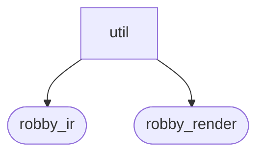
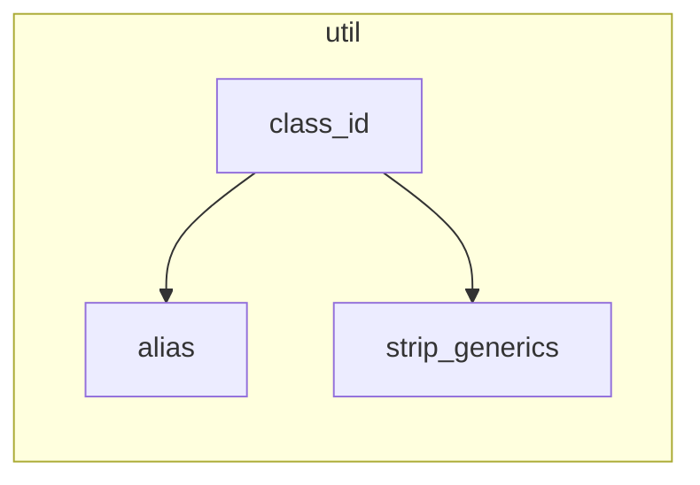

# `robby_render::util`

[Self-model](../../README.md) · [robby_render](../index.md)

| | |
|---|---|
| kind | `code.module` |
| declared at | [`crates/robby-render/src/lib.rs:16`](../../../../crates/robby-render/src/lib.rs#L16) |
| provenance | extractor · confidence 1.00 |
| nodes | 13 |

## Package diagram



## Module coupling



## Dependency matrix

| | util | robby_ir | robby_render |
|---|---:|---:|---:|
| **util** | · | 2 | 10 |
| **robby_ir** | | · | |
| **robby_render** | | | · |

## Comments

- `crates/robby-render/src/util.rs:15:1` (docs, `robby_render::util::alias`): "Mermaid participant and node ids allow only a restricted alphabet."
  ```
  /// Mermaid participant and node ids allow only a restricted alphabet.
  pub fn alias(id: &str) -> String {
      let mut out = String::with_capacity(id.len());
      for ch in id.chars() {
          if ch.is_ascii_alphanumeric() || ch == '_' {
              out.push(ch);
          } else {
              out.push('_');
          }
      }
      if out.chars().next().is_some_and(|c| c.is_ascii_digit()) {
          out.insert(0, 'p');
      }
      if out.is_empty() {
          out.push_str("p_empty");
      }
      out
  }
  ```
- `crates/robby-render/src/util.rs:34:1` (docs, `robby_render::util::text`): "Sanitize text for a Mermaid label or message."
  ```
  /// Sanitize text for a Mermaid label or message.
  pub fn text(input: &str) -> String {
      let mut out = String::with_capacity(input.len());
      for ch in input.chars() {
          match ch {
              '\n' | '\r' | '\t' => out.push(' '),
              ';' | '#' => out.push(' '),
              '"' => out.push('\''),
              _ => out.push(ch),
          }
      }
      out.split_whitespace().collect::<Vec<_>>().join(" ")
  }
  ```
- `crates/robby-render/src/util.rs:5:1` (docs, `robby_render::util::stable_id`): "FNV-1a stable id for Mermaid / layout keys."
  ```
  /// FNV-1a stable id for Mermaid / layout keys.
  pub fn stable_id(input: &str) -> String {
      let mut hash: u64 = 0xcbf2_9ce4_8422_2325;
      for byte in input.as_bytes() {
          hash ^= u64::from(*byte);
          hash = hash.wrapping_mul(0x0000_0100_0000_01b3);
      }
      format!("n_{hash:016x}")
  }
  ```
## References

- calls → [`robby_ir::kind`](../../robby_ir/kind/index.md) — from
- calls → [`robby_ir::model`](../../robby_ir/model/index.md) — insert
- calls → [`robby_render::report`](../report/index.md) — push
- calls → [`robby_render::view::comments`](../view/comments/index.md) — as_str
- calls → [`robby_render::view::links`](../view/links/index.md) — is_empty
- calls → [`robby_render::view::select`](../view/select/index.md) — collect

## Referenced by

- calls ← [`robby_agent::openrouter::impl ChatClient for OpenRouterClient::chat`](../../robby_agent/openrouter/index.md)
- calls ← [`robby_render::view::deps::container_of`](../view/deps/container-of.md)
- calls ← [`robby_render::view::deps::impl CouplingGraph::from_root`](../view/deps/index.md)
- calls ← [`robby_render::view::deps::impl CouplingGraph::workspace`](../view/deps/index.md)
- calls ← [`robby_render::view::deps::impl PackageStructure::from_root`](../view/deps/index.md)
- calls ← [`robby_render::view::deps::insert_module`](../view/deps/insert-module.md)
- calls ← [`robby_render::view::execution::from_code_path`](../view/execution/from-code-path.md)
- calls ← [`robby_render::view::execution::participant_id`](../view/execution/participant-id.md)
- calls ← [`robby_render::view::links::inbound`](../view/links/inbound.md)
- calls ← [`robby_render::view::links::outbound`](../view/links/outbound.md)
- calls ← [`robby_render::view::links::owning_module`](../view/links/owning-module.md)
- calls ← [`robby_render::view::process::impl ProcessView::from_process`](../view/process/index.md)
- calls ← [`robby_render::view::scene::build_call_frame`](../view/scene/build-call-frame.md)
- calls ← [`robby_render::view::scene::build_frame`](../view/scene/build-frame.md)
- calls ← [`robby_render::view::scene::crate_roots`](../view/scene/crate-roots.md)
- calls ← [`robby_render::view::scene::portals_for`](../view/scene/portals-for.md)
- calls ← [`robby_render::view::sibling::impl SiblingGraph::from_root`](../view/sibling/index.md)
- calls ← [`robby_render::view::types::class_from_node`](../view/types/class-from-node.md)
- calls ← [`robby_render::view::types::impl TypeModel::from_module`](../view/types/index.md)
- calls ← [`robby_render::view::types::impl_methods`](../view/types/impl-methods.md)

## Items

| Item | Kind | Steps | Location |
|---|---|---:|---|
| [`stable_id`](stable-id.md) | `code.function` | 4 | `crates/robby-render/src/util.rs:5:1` |
| [`alias`](alias.md) | `code.function` | 13 | `crates/robby-render/src/util.rs:15:1` |
| [`text`](text.md) | `code.function` | 10 | `crates/robby-render/src/util.rs:34:1` |
| [`edge_label`](edge-label.md) | `code.function` | 0 | `crates/robby-render/src/util.rs:48:1` |
| [`short_kind`](short-kind.md) | `code.function` | 5 | `crates/robby-render/src/util.rs:62:1` |
| [`is_structural`](is-structural.md) | `code.function` | 1 | `crates/robby-render/src/util.rs:66:1` |
| [`is_container`](is-container.md) | `code.function` | 1 | `crates/robby-render/src/util.rs:77:1` |
| [`is_type`](is-type.md) | `code.function` | 1 | `crates/robby-render/src/util.rs:84:1` |
| [`strip_generics`](strip-generics.md) | `code.function` | 5 | `crates/robby-render/src/util.rs:96:1` |
| [`class_id`](class-id.md) | `code.function` | 2 | `crates/robby-render/src/util.rs:100:1` |
| [`keyword`](keyword.md) | `code.function` | 0 | `crates/robby-render/src/util.rs:104:1` |

## Imports

- [`use robby_ir::{EdgeKind, Kind, Node, kind};`](../../robby_ir/index.md)

