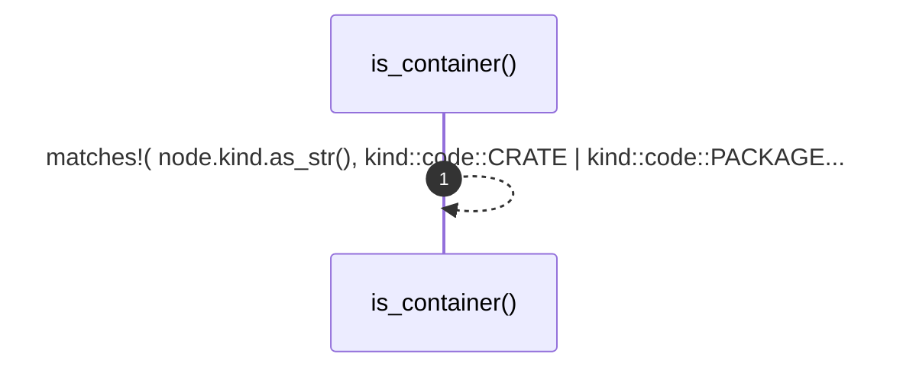

# `robby_render::util::is_container`

[Self-model](../../README.md) · [util](index.md)

| | |
|---|---|
| kind | `code.function` |
| signature | `fn is_container(node: &Node) -> bool` |
| location | [`crates/robby-render/src/util.rs:76`](../../../../crates/robby-render/src/util.rs#L76) |
| provenance | extractor · confidence 1.00 |

```rust
pub fn is_container(node: &Node) -> bool {
    matches!(
        node.kind.as_str(),
        kind::code::CRATE | kind::code::PACKAGE | kind::code::MODULE
    )
}
```



1 steps · 0 observed · 1 possible only

## Referenced by

- calls ← [`robby_render::view::deps::container_of`](../view/deps/container-of.md)
- calls ← [`robby_render::view::deps::impl CouplingGraph::from_root`](../view/deps/index.md)
- calls ← [`robby_render::view::deps::impl CouplingGraph::workspace`](../view/deps/index.md)
- calls ← [`robby_render::view::deps::impl PackageStructure::from_root`](../view/deps/index.md)
- calls ← [`robby_render::view::links::owning_module`](../view/links/owning-module.md)

