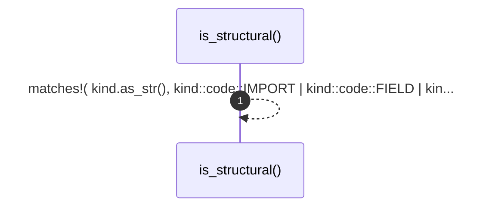

# `robby_render::util::is_structural`

[Self-model](../../README.md) · [util](index.md)

| | |
|---|---|
| kind | `code.function` |
| signature | `fn is_structural(kind: &Kind) -> bool` |
| location | [`crates/robby-render/src/util.rs:66`](../../../../crates/robby-render/src/util.rs#L66) |
| provenance | extractor · confidence 1.00 |

```rust
pub fn is_structural(kind: &Kind) -> bool {
    !matches!(
        kind.as_str(),
        kind::code::IMPORT
            | kind::code::FIELD
            | kind::code::VARIANT
            | kind::code::VERBATIM
            | kind::code::IMPL
    )
}
```



1 steps · 0 observed · 1 possible only

## Referenced by

- calls ← [`robby_render::view::scene::build_frame`](../view/scene/build-frame.md)
- calls ← [`robby_render::view::scene::crate_roots`](../view/scene/crate-roots.md)
- calls ← [`robby_render::view::sibling::impl SiblingGraph::from_root`](../view/sibling/index.md)

