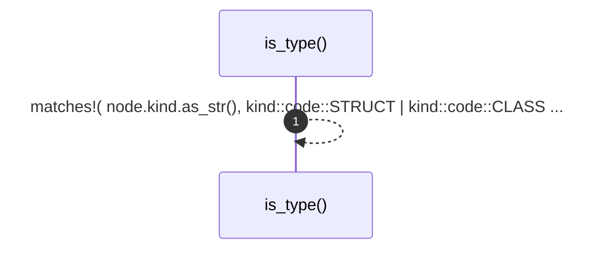

# `robby_render::util::is_type`

[Self-model](../../README.md) · [util](index.md)

| | |
|---|---|
| kind | `code.function` |
| signature | `fn is_type(node: &Node) -> bool` |
| location | [`crates/robby-render/src/util.rs:83`](../../../../crates/robby-render/src/util.rs#L83) |
| provenance | extractor · confidence 1.00 |

```rust
pub fn is_type(node: &Node) -> bool {
    matches!(
        node.kind.as_str(),
        kind::code::STRUCT
            | kind::code::CLASS
            | kind::code::ENUM
            | kind::code::TRAIT
            | kind::code::INTERFACE
            | kind::code::UNION
    )
}
```



1 steps · 0 observed · 1 possible only

## Referenced by

- calls ← [`robby_render::view::types::impl TypeModel::from_module`](../view/types/index.md)

