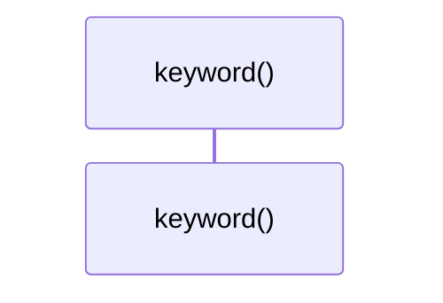

# `robby_render::util::keyword`

[Self-model](../../README.md) · [util](index.md)

| | |
|---|---|
| kind | `code.function` |
| signature | `fn keyword(kind: robby_ir::BlockKind) -> &'static str` |
| location | [`crates/robby-render/src/util.rs:104`](../../../../crates/robby-render/src/util.rs#L104) |
| provenance | extractor · confidence 1.00 |

```rust
pub fn keyword(kind: robby_ir::BlockKind) -> &'static str {
    match kind {
        robby_ir::BlockKind::Alt => "alt",
        robby_ir::BlockKind::Opt => "opt",
        robby_ir::BlockKind::Loop => "loop",
        robby_ir::BlockKind::Par => "par",
        robby_ir::BlockKind::Break => "break",
    }
}
```



0 steps · 0 observed · 0 possible only

## Referenced by

- calls ← [`robby_render::view::process::impl ProcessView::from_process`](../view/process/index.md)

