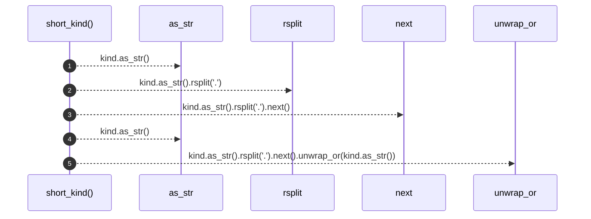

# `robby_render::util::short_kind`

[Self-model](../../README.md) · [util](index.md)

| | |
|---|---|
| kind | `code.function` |
| signature | `fn short_kind(kind: &Kind) -> &str` |
| location | [`crates/robby-render/src/util.rs:62`](../../../../crates/robby-render/src/util.rs#L62) |
| provenance | extractor · confidence 1.00 |

```rust
pub fn short_kind(kind: &Kind) -> &str {
    kind.as_str().rsplit('.').next().unwrap_or(kind.as_str())
}
```



5 steps · 0 observed · 5 possible only

**Edges**

- calls → [`robby_render::view::comments::impl NoteKind::as_str`](../view/comments/index.md)
- calls → [`robby_render::view::comments::impl NoteKind::as_str`](../view/comments/index.md)

## References

- calls → [`robby_render::view::comments`](../view/comments/index.md) — as_str

## Referenced by

- calls ← [`robby_render::view::scene::build_call_frame`](../view/scene/build-call-frame.md)
- calls ← [`robby_render::view::scene::build_frame`](../view/scene/build-frame.md)
- calls ← [`robby_render::view::sibling::impl SiblingGraph::from_root`](../view/sibling/index.md)

