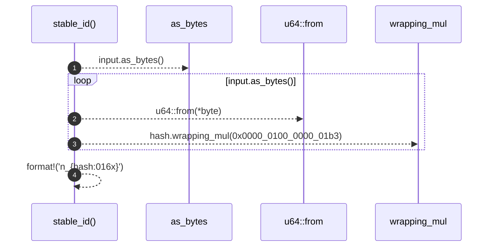

# `robby_render::util::stable_id`

[Self-model](../../README.md) · [util](index.md)

| | |
|---|---|
| kind | `code.function` |
| signature | `fn stable_id(input: &str) -> String` |
| location | [`crates/robby-render/src/util.rs:5`](../../../../crates/robby-render/src/util.rs#L5) |
| provenance | extractor · confidence 1.00 |

> FNV-1a stable id for Mermaid / layout keys.

```rust
/// FNV-1a stable id for Mermaid / layout keys.
pub fn stable_id(input: &str) -> String {
    let mut hash: u64 = 0xcbf2_9ce4_8422_2325;
    for byte in input.as_bytes() {
        hash ^= u64::from(*byte);
        hash = hash.wrapping_mul(0x0000_0100_0000_01b3);
    }
    format!("n_{hash:016x}")
}
```



4 steps · 0 observed · 4 possible only

**Edges**

- calls → [`robby_ir::kind::impl From<&str> for Kind::from`](../../robby_ir/kind/index.md)

## References

- calls → [`robby_ir::kind`](../../robby_ir/kind/index.md) — from

