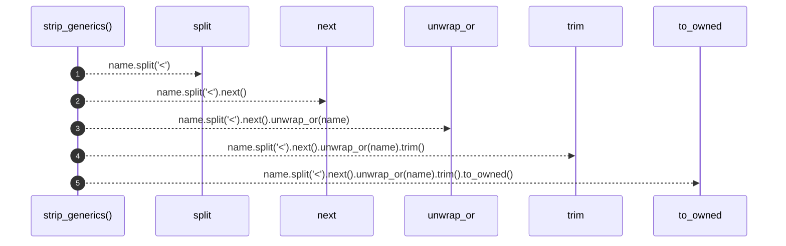

# `robby_render::util::strip_generics`

[Self-model](../../README.md) · [util](index.md)

| | |
|---|---|
| kind | `code.function` |
| signature | `fn strip_generics(name: &str) -> String` |
| location | [`crates/robby-render/src/util.rs:95`](../../../../crates/robby-render/src/util.rs#L95) |
| provenance | extractor · confidence 1.00 |

```rust
pub fn strip_generics(name: &str) -> String {
    name.split('<').next().unwrap_or(name).trim().to_owned()
}
```



5 steps · 0 observed · 5 possible only

## Referenced by

- calls ← [`robby_render::util::class_id`](class-id.md)
- calls ← [`robby_render::view::types::impl TypeModel::from_module`](../view/types/index.md)

