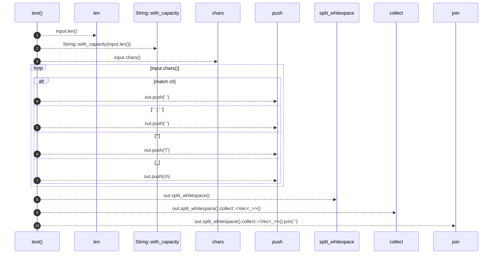

# `robby_render::util::text`

[Self-model](../../README.md) · [util](index.md)

| | |
|---|---|
| kind | `code.function` |
| signature | `fn text(input: &str) -> String` |
| location | [`crates/robby-render/src/util.rs:34`](../../../../crates/robby-render/src/util.rs#L34) |
| provenance | extractor · confidence 1.00 |

> Sanitize text for a Mermaid label or message.

```rust
/// Sanitize text for a Mermaid label or message.
pub fn text(input: &str) -> String {
    let mut out = String::with_capacity(input.len());
    for ch in input.chars() {
        match ch {
            '\n' | '\r' | '\t' => out.push(' '),
            ';' | '#' => out.push(' '),
            '"' => out.push('\''),
            _ => out.push(ch),
        }
    }
    out.split_whitespace().collect::<Vec<_>>().join(" ")
}
```



10 steps · 0 observed · 10 possible only

**Edges**

- calls → [`robby_render::report::impl Report::push`](../report/index.md)
- calls → [`robby_render::report::impl Report::push`](../report/index.md)
- calls → [`robby_render::report::impl Report::push`](../report/index.md)
- calls → [`robby_render::report::impl Report::push`](../report/index.md)
- calls → [`robby_render::view::select::collect`](../view/select/collect.md)

## References

- calls → [`robby_render::report`](../report/index.md) — push
- calls → [`robby_render::view::select`](../view/select/index.md) — collect

## Referenced by

- calls ← [`robby_agent::openrouter::impl ChatClient for OpenRouterClient::chat`](../../robby_agent/openrouter/index.md)
- calls ← [`robby_render::view::deps::insert_module`](../view/deps/insert-module.md)
- calls ← [`robby_render::view::sibling::impl SiblingGraph::from_root`](../view/sibling/index.md)
- calls ← [`robby_render::view::types::class_from_node`](../view/types/class-from-node.md)
- calls ← [`robby_render::view::types::impl_methods`](../view/types/impl-methods.md)

