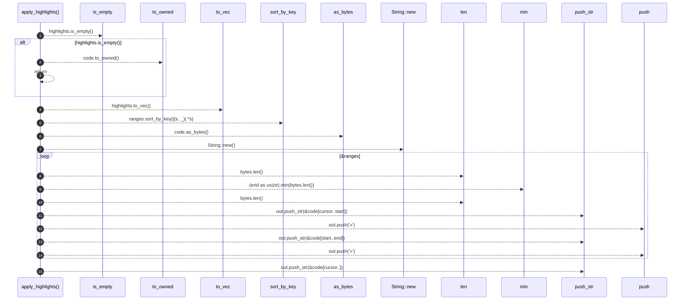

# `robby_render::view::comments::apply_highlights`

[Self-model](../../../README.md) · [view::comments](index.md)

| | |
|---|---|
| kind | `code.function` |
| signature | `fn apply_highlights(code: &str, highlights: &[(u32, u32)]) -> String` |
| location | [`crates/robby-render/src/view/comments.rs:289`](../../../../../crates/robby-render/src/view/comments.rs#L289) |
| provenance | extractor · confidence 1.00 |

> Apply «…» markers around highlight ranges in `code` (byte offsets).

```rust
/// Apply «…» markers around highlight ranges in `code` (byte offsets).
pub fn apply_highlights(code: &str, highlights: &[(u32, u32)]) -> String {
    if highlights.is_empty() {
        return code.to_owned();
    }
    let mut ranges = highlights.to_vec();
    ranges.sort_by_key(|(s, _)| *s);
    let bytes = code.as_bytes();
    let mut out = String::new();
    let mut cursor = 0usize;
    for &(start, end) in &ranges {
        let start = start as usize;
        let end = (end as usize).min(bytes.len());
        if start < cursor || start >= end || start > bytes.len() {
            continue;
        }
        out.push_str(&code[cursor..start]);
        out.push('«');
        out.push_str(&code[start..end]);
        out.push('»');
        cursor = end;
    }
    out.push_str(&code[cursor..]);
    out
}
```



15 steps · 0 observed · 15 possible only

**Edges**

- calls → [`robby_render::view::comments::impl CommentsView::is_empty`](index.md)
- calls → [`robby_render::view::scene::impl Rect::new`](../scene/index.md)
- calls → [`robby_render::report::impl Report::push`](../../report/index.md)
- calls → [`robby_render::report::impl Report::push`](../../report/index.md)

## References

- calls → [`robby_render::report`](../../report/index.md) — push
- calls → [`robby_render::view::comments`](index.md) — is_empty
- calls → [`robby_render::view::scene`](../scene/index.md) — new

## Referenced by

- calls ← [`robby_render::render::markdown::impl Renderer for MarkdownRenderer::comments`](../../render/markdown/index.md)
- calls ← [`robby_render::render::tui::impl Renderer for TuiRenderer::comments`](../../render/tui/index.md)

