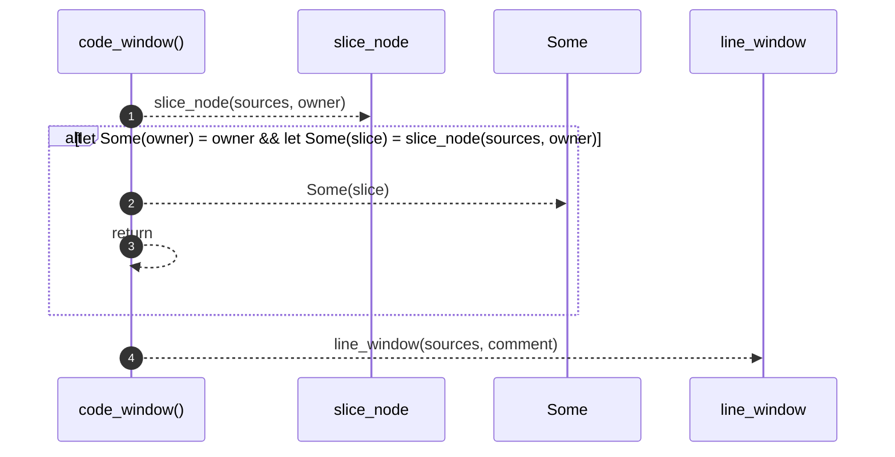

# `robby_render::view::comments::code_window`

[Self-model](../../../README.md) · [view::comments](index.md)

| | |
|---|---|
| kind | `code.function` |
| signature | `fn code_window(     sources: &BTreeMap<String, String>,     comment: &Node,     owner: Option<&Node>, ) -> Option<String>` |
| location | [`crates/robby-render/src/view/comments.rs:204`](../../../../../crates/robby-render/src/view/comments.rs#L204) |
| provenance | extractor · confidence 1.00 |

```rust
fn code_window(
    sources: &BTreeMap<String, String>,
    comment: &Node,
    owner: Option<&Node>,
) -> Option<String> {
    if let Some(owner) = owner
        && let Some(slice) = slice_node(sources, owner)
    {
        return Some(slice);
    }
    line_window(sources, comment)
}
```



4 steps · 0 observed · 4 possible only

**Edges**

- calls → [`robby_render::view::comments::slice_node`](slice-node.md)
- calls → [`robby_render::view::comments::line_window`](line-window.md)

## References

- calls → [`robby_render::view::comments`](index.md) — line_window, slice_node

## Referenced by

- calls ← [`robby_render::view::comments::impl CommentsView::from_root`](index.md)

