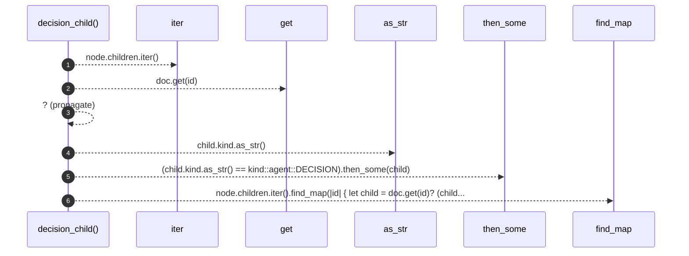

# `robby_render::view::comments::decision_child`

[Self-model](../../../README.md) · [view::comments](index.md)

| | |
|---|---|
| kind | `code.function` |
| signature | `fn decision_child<'a>(doc: &'a Document, node: &Node) -> Option<&'a Node>` |
| location | [`crates/robby-render/src/view/comments.rs:144`](../../../../../crates/robby-render/src/view/comments.rs#L144) |
| provenance | extractor · confidence 1.00 |

```rust
fn decision_child<'a>(doc: &'a Document, node: &Node) -> Option<&'a Node> {
    node.children.iter().find_map(|id| {
        let child = doc.get(id)?;
        (child.kind.as_str() == kind::agent::DECISION).then_some(child)
    })
}
```



6 steps · 0 observed · 6 possible only

**Edges**

- calls → [`robby_ir::run::RecipeCatalog::get`](../../../robby_ir/run/index.md)
- calls → [`robby_render::view::comments::impl CommentKind::as_str`](index.md)

## References

- calls → [`robby_ir::run`](../../../robby_ir/run/index.md) — get
- calls → [`robby_render::view::comments`](index.md) — as_str

## Referenced by

- calls ← [`robby_render::view::comments::impl CommentsView::from_root`](index.md)

