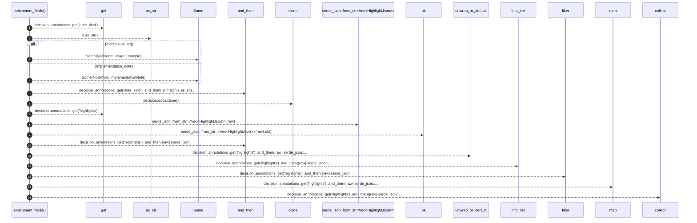

# `robby_render::view::comments::enrichment_fields`

[Self-model](../../../README.md) · [view::comments](index.md)

| | |
|---|---|
| kind | `code.function` |
| signature | `fn enrichment_fields(     decision: &Node,     _code: Option<&str>, ) -> (Option<NoteKind>, Option<String>, Vec<(u32, u32)>)` |
| location | [`crates/robby-render/src/view/comments.rs:183`](../../../../../crates/robby-render/src/view/comments.rs#L183) |
| provenance | extractor · confidence 1.00 |

```rust
fn enrichment_fields(
    decision: &Node,
    _code: Option<&str>,
) -> (Option<NoteKind>, Option<String>, Vec<(u32, u32)>) {
    let note_kind = decision
        .annotations
        .get("note_kind")
        .and_then(|s| match s.as_str() {
            "usage_example" => Some(NoteKind::UsageExample),
            "implementation_note" => Some(NoteKind::ImplementationNote),
            _ => None,
        });
    let note = decision.docs.clone();
    let highlights = decision
        .annotations
        .get("highlights")
        .and_then(|raw| serde_json::from_str::<Vec<HighlightJson>>(raw).ok())
        .unwrap_or_default()
        .into_iter()
        .filter(|h| h.start < h.end)
        .map(|h| (h.start, h.end))
        .collect();
    (note_kind, note, highlights)
}
```



15 steps · 0 observed · 15 possible only

**Edges**

- calls → [`robby_ir::model::impl Document::get`](../../../robby_ir/model/index.md)
- calls → [`robby_render::view::comments::impl NoteKind::as_str`](index.md)
- calls → [`robby_ir::model::impl Document::get`](../../../robby_ir/model/index.md)
- calls → [`robby_render::view::select::collect`](../select/collect.md)

## References

- calls → [`robby_ir::model`](../../../robby_ir/model/index.md) — get
- calls → [`robby_render::view::comments`](index.md) — as_str
- calls → [`robby_render::view::select`](../select/index.md) — collect

## Referenced by

- calls ← [`robby_render::view::comments::impl CommentsView::from_root`](index.md)

