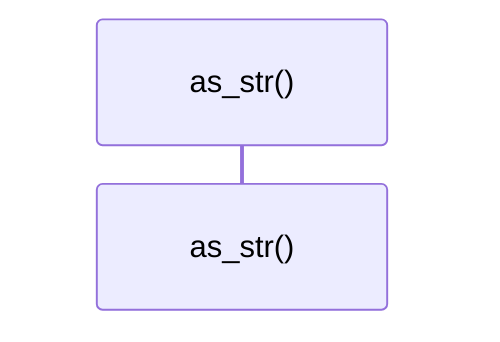

# `robby_render::view::comments::impl CommentKind`

[Self-model](../../../README.md) · [view::comments](index.md)

| | |
|---|---|
| kind | `code.impl` |
| location | [`crates/robby-render/src/view/comments.rs:134`](../../../../../crates/robby-render/src/view/comments.rs#L134) |
| provenance | extractor · confidence 1.00 |

```rust
impl CommentKind {
    pub fn as_str(self) -> &'static str {
        match self {
            Self::Line => "line",
            Self::Block => "block",
            Self::Docs => "docs",
        }
    }
}
```

## Referenced by

- calls ← [`robby_render::markdown::anchor`](../../markdown/anchor.md)
- calls ← [`robby_render::render::markdown::impl Renderer for MarkdownRenderer::comments`](../../render/markdown/index.md)
- calls ← [`robby_render::render::mermaid::dsm_markdown_table`](../../render/mermaid/dsm-markdown-table.md)
- calls ← [`robby_render::render::mermaid::emit_coupling_subgraph`](../../render/mermaid/emit-coupling-subgraph.md)
- calls ← [`robby_render::render::mermaid::impl Renderer for MermaidRenderer::coupling_deps`](../../render/mermaid/index.md)
- calls ← [`robby_render::render::tui::ascii_coupling`](../../render/tui/ascii-coupling.md)
- calls ← [`robby_render::render::tui::ascii_package_structure`](../../render/tui/ascii-package-structure.md)
- calls ← [`robby_render::render::tui::impl Renderer for TuiRenderer::comments`](../../render/tui/index.md)
- calls ← [`robby_render::render::tui::impl Renderer for TuiRenderer::process`](../../render/tui/index.md)
- calls ← [`robby_render::render::tui::impl Renderer for TuiRenderer::sibling_graph`](../../render/tui/index.md)
- calls ← [`robby_render::test_web::entrypoints_scene_roots_mains_and_nests_callees`](../../test_web/entrypoints-scene-roots-mains-and-nests-callees.md)
- calls ← [`robby_render::tree::count_modules`](../../tree/count-modules.md)
- calls ← [`robby_render::tree::is_module`](../../tree/is-module.md)
- calls ← [`robby_render::tree::item_children`](../../tree/item-children.md)
- calls ← [`robby_render::tree::item_slug`](../../tree/item-slug.md)
- calls ← [`robby_render::tree::module_page`](../../tree/module-page.md)
- calls ← [`robby_render::tree::page_of_node`](../../tree/page-of-node.md)
- calls ← [`robby_render::tree::render_node`](../../tree/render-node.md)
- calls ← [`robby_render::util::short_kind`](../../util/short-kind.md)
- calls ← [`robby_render::view::comments::decision_child`](decision-child.md)
- calls ← [`robby_render::view::comments::impl CommentsView::from_root`](index.md)
- calls ← [`robby_render::view::comments::parse_verdict`](parse-verdict.md)
- calls ← [`robby_render::view::deps::build_package_tree`](../deps/build-package-tree.md)
- calls ← [`robby_render::view::deps::impl CouplingGraph::from_root`](../deps/index.md)
- calls ← [`robby_render::view::deps::impl CouplingGraph::workspace`](../deps/index.md)
- calls ← [`robby_render::view::deps::insert_module`](../deps/insert-module.md)
- calls ← [`robby_render::view::deps::package_edges`](../deps/package-edges.md)
- calls ← [`robby_render::view::deps::package_leaf`](../deps/package-leaf.md)
- calls ← [`robby_render::view::entrypoints::collect_cross_edges`](../entrypoints/collect-cross-edges.md)
- calls ← [`robby_render::view::execution::owning_type_label`](../execution/owning-type-label.md)
- calls ← [`robby_render::view::execution::participant_id`](../execution/participant-id.md)
- calls ← [`robby_render::view::externals::impl ExternalsView::from_root`](../externals/index.md)
- calls ← [`robby_render::view::externals::is_external_package`](../externals/is-external-package.md)
- calls ← [`robby_render::view::externals::owning_container_fqn`](../externals/owning-container-fqn.md)
- calls ← [`robby_render::view::hierarchy::build`](../hierarchy/build.md)
- calls ← [`robby_render::view::hierarchy::kind_tag`](../hierarchy/kind-tag.md)
- calls ← [`robby_render::view::process::impl ProcessView::from_process`](../process/index.md)
- calls ← [`robby_render::view::scene::attach_call_portals`](../scene/attach-call-portals.md)
- calls ← [`robby_render::view::scene::build_call_frame`](../scene/build-call-frame.md)
- calls ← [`robby_render::view::scene::build_frame`](../scene/build-frame.md)
- calls ← [`robby_render::view::scene::portals_for`](../scene/portals-for.md)
- calls ← [`robby_render::view::select::collect`](../select/collect.md)
- calls ← [`robby_render::view::select::is_binary_module`](../select/is-binary-module.md)
- calls ← [`robby_render::view::select::main_process`](../select/main-process.md)
- calls ← [`robby_render::view::sibling::impl SiblingGraph::from_root`](../sibling/index.md)
- calls ← [`robby_render::view::types::class_from_node`](../types/class-from-node.md)
- calls ← [`robby_render::view::types::impl TypeModel::from_module`](../types/index.md)
- calls ← [`robby_render::view::types::impl_methods`](../types/impl-methods.md)
- calls ← [`robby_render::web::impl FrameDetail::for_workspace`](../../web/index.md)
- calls ← [`robby_render::web::impl FrameDetail::from_node_in_doc`](../../web/index.md)
- calls ← [`robby_render::web::write_site`](../../web/write-site.md)

### `as_str`

| | |
|---|---|
| kind | `code.method` |
| signature | `fn as_str(1)` |
| location | [`crates/robby-render/src/view/comments.rs:135`](../../../../../crates/robby-render/src/view/comments.rs#L135) |
| provenance | extractor · confidence 1.00 |

```rust
pub fn as_str(self) -> &'static str {
        match self {
            Self::Line => "line",
            Self::Block => "block",
            Self::Docs => "docs",
        }
    }
```



0 steps · 0 observed · 0 possible only

