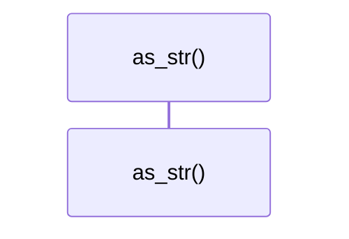

# `robby_render::view::comments::impl CommentKind`

[Self-model](../../../README.md) · [view::comments](index.md)

| | |
|---|---|
| kind | `code.impl` |
| location | [`crates/robby-render/src/view/comments.rs:142`](../../../../../crates/robby-render/src/view/comments.rs#L142) |
| provenance | extractor · confidence 1.00 |

```rust
impl CommentKind {
    pub fn as_str(self) -> &'static str {
        match self {
            Self::Line => "line",
            Self::Block => "block",
            Self::Docs => "docs",
        }
    }
}
```

### `as_str`

| | |
|---|---|
| kind | `code.method` |
| signature | `fn as_str(1)` |
| location | [`crates/robby-render/src/view/comments.rs:143`](../../../../../crates/robby-render/src/view/comments.rs#L143) |
| provenance | extractor · confidence 1.00 |

```rust
pub fn as_str(self) -> &'static str {
        match self {
            Self::Line => "line",
            Self::Block => "block",
            Self::Docs => "docs",
        }
    }
```



0 steps · 0 observed · 0 possible only

