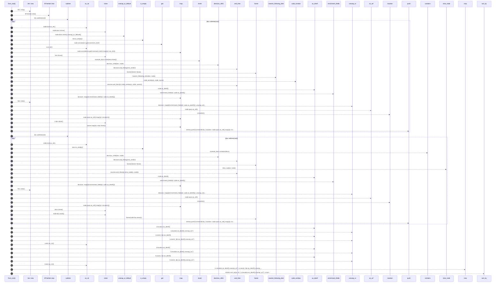
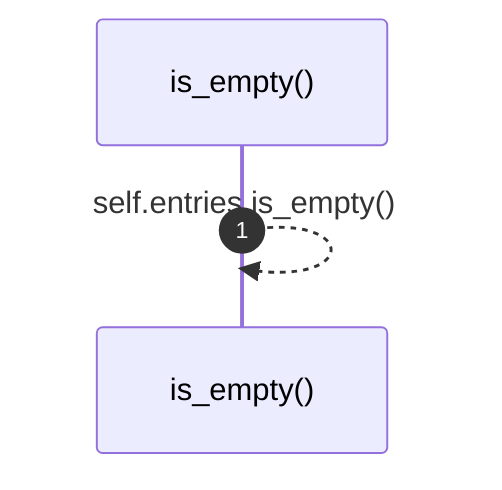

# `robby_render::view::comments::impl CommentsView`

[Self-model](../../../README.md) · [view::comments](index.md)

| | |
|---|---|
| kind | `code.impl` |
| location | [`crates/robby-render/src/view/comments.rs:45`](../../../../../crates/robby-render/src/view/comments.rs#L45) |
| provenance | extractor · confidence 1.00 |

```rust
impl CommentsView {
    pub fn from_root(
        doc: &Document,
        root: &NodeId,
        sources: Option<&BTreeMap<String, String>>,
    ) -> Self {
        let mut entries = Vec::new();
        let mut covered_docs: BTreeSet<String> = BTreeSet::new();

        for node in doc.subtree(root) {
            if node.kind.as_str() != kind::code::COMMENT {
                continue;
            }
            let text = node.docs.clone().unwrap_or_default();
            if text.is_empty() {
                continue;
            }
            let kind = match node.annotations.get("comment_kind").map(|s| s.as_str()) {
                Some("line") => CommentKind::Line,
                _ => CommentKind::Block,
            };
            covered_docs.insert(text.clone());
            let decision = decision_child(doc, node);
            let verdict = decision.and_then(parse_verdict);
            if verdict == Some(Verdict::Noise) {
                continue;
            }
            let owner = nearest_following_item(doc, node);
            let code = sources.and_then(|s| code_window(s, node, owner));
            let (note_kind, note, highlights) = decision
                .map(|d| enrichment_fields(d, code.as_deref()))
                .unwrap_or((None, None, Vec::new()));
            entries.push(CommentEntry {
                location: node.span.as_ref().map(|s| s.location()),
                kind,
                text,
                owner_fqn: owner.map(|n| n.fqn.clone()),
                code,
                verdict,
                note_kind,
                note,
                highlights,
            });
        }

        for node in doc.subtree(root) {
            if node.kind.as_str() == kind::code::COMMENT {
                continue;
            }
            let Some(docs) = &node.docs else {
                continue;
            };
            if docs.is_empty() || covered_docs.contains(docs) {
                continue;
            }
            let decision = decision_child(doc, node);
            let verdict = decision.and_then(parse_verdict);
            if verdict == Some(Verdict::Noise) {
                continue;
            }
            let code = sources.and_then(|s| slice_node(s, node));
            let (note_kind, note, highlights) = decision
                .map(|d| enrichment_fields(d, code.as_deref()))
                .unwrap_or((None, None, Vec::new()));
            entries.push(CommentEntry {
                location: node.span.as_ref().map(|s| s.location()),
                kind: CommentKind::Docs,
                text: docs.clone(),
                owner_fqn: Some(node.fqn.clone()),
                code,
                verdict,
                note_kind,
                note,
                highlights,
            });
        }

        entries.sort_by(|a, b| {
            (
                a.location.as_deref().unwrap_or(""),
                a.owner_fqn.as_deref().unwrap_or(""),
                a.text.as_str(),
            )
                .cmp(&(
                    b.location.as_deref().unwrap_or(""),
                    b.owner_fqn.as_deref().unwrap_or(""),
                    b.text.as_str(),
                ))
        });
        Self { entries }
    }

    pub fn is_empty(&self) -> bool {
        self.entries.is_empty()
    }
}
```

## References

- calls → [`robby_ir::model`](../../../robby_ir/model/index.md) — get, insert, subtree
- calls → [`robby_ir::span`](../../../robby_ir/span/index.md) — location
- calls → [`robby_render::report`](../../report/index.md) — push
- calls → [`robby_render::view::comments`](index.md) — 6 items
- calls → [`robby_render::view::scene`](../scene/index.md) — contains, new

## Referenced by

- calls ← [`robby_render::view::comments::apply_highlights`](apply-highlights.md)
- calls ← [`robby_render::view::comments::line_window`](line-window.md)

### `from_root`

| | |
|---|---|
| kind | `code.method` |
| signature | `fn from_root(3)` |
| location | [`crates/robby-render/src/view/comments.rs:46`](../../../../../crates/robby-render/src/view/comments.rs#L46) |
| provenance | extractor · confidence 1.00 |

```rust
pub fn from_root(
        doc: &Document,
        root: &NodeId,
        sources: Option<&BTreeMap<String, String>>,
    ) -> Self {
        let mut entries = Vec::new();
        let mut covered_docs: BTreeSet<String> = BTreeSet::new();

        for node in doc.subtree(root) {
            if node.kind.as_str() != kind::code::COMMENT {
                continue;
            }
            let text = node.docs.clone().unwrap_or_default();
            if text.is_empty() {
                continue;
            }
            let kind = match node.annotations.get("comment_kind").map(|s| s.as_str()) {
                Some("line") => CommentKind::Line,
                _ => CommentKind::Block,
            };
            covered_docs.insert(text.clone());
            let decision = decision_child(doc, node);
            let verdict = decision.and_then(parse_verdict);
            if verdict == Some(Verdict::Noise) {
                continue;
            }
            let owner = nearest_following_item(doc, node);
            let code = sources.and_then(|s| code_window(s, node, owner));
            let (note_kind, note, highlights) = decision
                .map(|d| enrichment_fields(d, code.as_deref()))
                .unwrap_or((None, None, Vec::new()));
            entries.push(CommentEntry {
                location: node.span.as_ref().map(|s| s.location()),
                kind,
                text,
                owner_fqn: owner.map(|n| n.fqn.clone()),
                code,
                verdict,
                note_kind,
                note,
                highlights,
            });
        }

        for node in doc.subtree(root) {
            if node.kind.as_str() == kind::code::COMMENT {
                continue;
            }
            let Some(docs) = &node.docs else {
                continue;
            };
            if docs.is_empty() || covered_docs.contains(docs) {
                continue;
            }
            let decision = decision_child(doc, node);
            let verdict = decision.and_then(parse_verdict);
            if verdict == Some(Verdict::Noise) {
                continue;
            }
            let code = sources.and_then(|s| slice_node(s, node));
            let (note_kind, note, highlights) = decision
                .map(|d| enrichment_fields(d, code.as_deref()))
                .unwrap_or((None, None, Vec::new()));
            entries.push(CommentEntry {
                location: node.span.as_ref().map(|s| s.location()),
                kind: CommentKind::Docs,
                text: docs.clone(),
                owner_fqn: Some(node.fqn.clone()),
                code,
                verdict,
                note_kind,
                note,
                highlights,
            });
        }

        entries.sort_by(|a, b| {
            (
                a.location.as_deref().unwrap_or(""),
                a.owner_fqn.as_deref().unwrap_or(""),
                a.text.as_str(),
            )
                .cmp(&(
                    b.location.as_deref().unwrap_or(""),
                    b.owner_fqn.as_deref().unwrap_or(""),
                    b.text.as_str(),
                ))
        });
        Self { entries }
    }
```



62 steps · 0 observed · 62 possible only

**Edges**

- calls → [`robby_render::view::scene::impl Rect::new`](../scene/index.md)
- calls → [`robby_render::view::scene::impl Rect::new`](../scene/index.md)
- calls → [`robby_ir::model::impl Document::subtree`](../../../robby_ir/model/index.md)
- calls → [`robby_render::view::comments::impl NoteKind::as_str`](index.md)
- calls → [`robby_render::view::comments::impl CommentsView::is_empty`](index.md)
- calls → [`robby_ir::model::impl Document::get`](../../../robby_ir/model/index.md)
- calls → [`robby_render::view::comments::impl NoteKind::as_str`](index.md)
- calls → [`robby_ir::model::impl Document::insert`](../../../robby_ir/model/index.md)
- calls → [`robby_render::view::comments::decision_child`](decision-child.md)
- calls → [`robby_render::view::comments::nearest_following_item`](nearest-following-item.md)
- calls → [`robby_render::view::comments::code_window`](code-window.md)
- calls → [`robby_render::view::comments::enrichment_fields`](enrichment-fields.md)
- calls → [`robby_render::view::scene::impl Rect::new`](../scene/index.md)
- calls → [`robby_ir::span::impl Span::location`](../../../robby_ir/span/index.md)
- calls → [`robby_render::report::impl Report::push`](../../report/index.md)
- calls → [`robby_ir::model::impl Document::subtree`](../../../robby_ir/model/index.md)
- calls → [`robby_render::view::comments::impl NoteKind::as_str`](index.md)
- calls → [`robby_render::view::comments::impl CommentsView::is_empty`](index.md)
- calls → [`robby_render::view::scene::impl WorldRect::contains`](../scene/index.md)
- calls → [`robby_render::view::comments::decision_child`](decision-child.md)
- calls → [`robby_render::view::comments::slice_node`](slice-node.md)
- calls → [`robby_render::view::comments::enrichment_fields`](enrichment-fields.md)
- calls → [`robby_render::view::scene::impl Rect::new`](../scene/index.md)
- calls → [`robby_ir::span::impl Span::location`](../../../robby_ir/span/index.md)
- calls → [`robby_render::report::impl Report::push`](../../report/index.md)
- calls → [`robby_render::view::comments::impl NoteKind::as_str`](index.md)
- calls → [`robby_render::view::comments::impl NoteKind::as_str`](index.md)

### `is_empty`

| | |
|---|---|
| kind | `code.method` |
| signature | `fn is_empty(1)` |
| location | [`crates/robby-render/src/view/comments.rs:137`](../../../../../crates/robby-render/src/view/comments.rs#L137) |
| provenance | extractor · confidence 1.00 |

```rust
pub fn is_empty(&self) -> bool {
        self.entries.is_empty()
    }
```



1 steps · 0 observed · 1 possible only

**Edges**

- calls → [`robby_render::view::comments::impl CommentsView::is_empty`](index.md)

