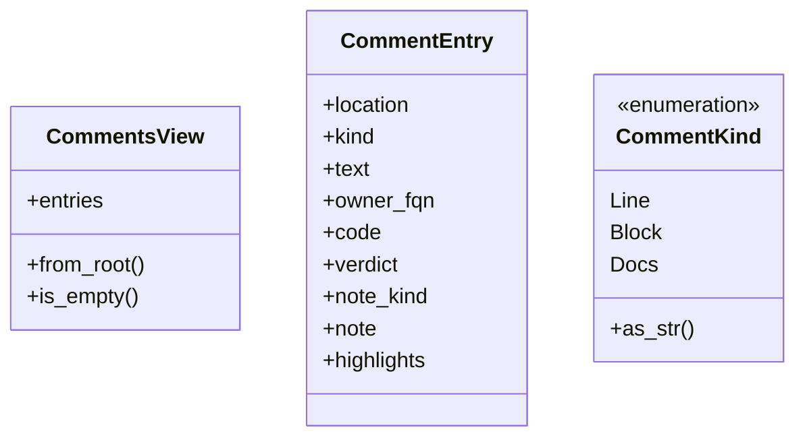
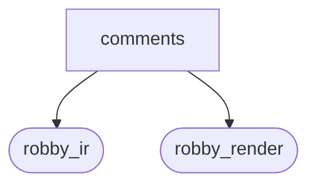
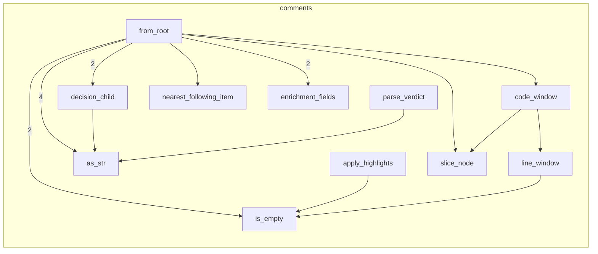

# `robby_render::view::comments`

[Self-model](../../../README.md) · [robby_render](../../index.md)

| | |
|---|---|
| kind | `code.module` |
| declared at | [`crates/robby-render/src/view/mod.rs:6`](../../../../../crates/robby-render/src/view/mod.rs#L6) |
| provenance | extractor · confidence 1.00 |
| nodes | 32 |

## Types



## Package diagram



## Module coupling



## Dependency matrix

| | comments | robby_ir | robby_render |
|---|---:|---:|---:|
| **comments** | · | 15 | 13 |
| **robby_ir** | | · | |
| **robby_render** | | | · |

## Comments

- `crates/robby-render/src/view/comments.rs:247:1` (docs, `robby_render::view::comments::apply_highlights`): "Apply «…» markers around highlight ranges in `code` (byte offsets)."
  ```
  /// Apply «…» markers around highlight ranges in `code` (byte offsets).
  pub fn apply_highlights(code: &str, highlights: &[(u32, u32)]) -> String {
      if highlights.is_empty() {
          return code.to_owned();
      }
      let mut ranges = highlights.to_vec();
      ranges.sort_by_key(|(s, _)| *s);
      let bytes = code.as_bytes();
      let mut out = String::new();
      let mut cursor = 0usize;
      for &(start, end) in &ranges {
          let start = start as usize;
          let end = (end as usize).min(bytes.len());
          if start < cursor || start >= end || start > bytes.len() {
              continue;
          }
          out.push_str(&code[cursor..start]);
          out.push('«');
          out.push_str(&code[start..end]);
          out.push('»');
          cursor = end;
      }
      out.push_str(&code[cursor..]);
      out
  }
  ```
## References

- calls → [`robby_ir::model`](../../../robby_ir/model/index.md) — get, insert, subtree
- calls → [`robby_ir::vocab`](../../../robby_ir/vocab/index.md) — parse
- calls → [`robby_render::report`](../../report/index.md) — push
- calls → [`robby_render::view::scene`](../scene/index.md) — contains, new
- calls → [`robby_render::view::select`](../select/index.md) — collect

## Referenced by

- calls ← [`robby_render::markdown::anchor`](../../markdown/anchor.md)
- calls ← [`robby_render::render::markdown::impl Renderer for MarkdownRenderer::comments`](../../render/markdown/index.md)
- calls ← [`robby_render::render::mermaid::dsm_markdown_table`](../../render/mermaid/dsm-markdown-table.md)
- calls ← [`robby_render::render::mermaid::emit_coupling_subgraph`](../../render/mermaid/emit-coupling-subgraph.md)
- calls ← [`robby_render::render::mermaid::impl Renderer for MermaidRenderer::coupling_deps`](../../render/mermaid/index.md)
- calls ← [`robby_render::render::tui::ascii_coupling`](../../render/tui/ascii-coupling.md)
- calls ← [`robby_render::render::tui::ascii_package_structure`](../../render/tui/ascii-package-structure.md)
- calls ← [`robby_render::render::tui::impl Renderer for TuiRenderer::comments`](../../render/tui/index.md)
- calls ← [`robby_render::render::tui::impl Renderer for TuiRenderer::process`](../../render/tui/index.md)
- calls ← [`robby_render::render::tui::impl Renderer for TuiRenderer::sibling_graph`](../../render/tui/index.md)
- calls ← [`robby_render::test_web::entrypoints_scene_roots_mains_and_nests_callees`](../../test_web/entrypoints-scene-roots-mains-and-nests-callees.md)
- calls ← [`robby_render::tree::count_modules`](../../tree/count-modules.md)
- calls ← [`robby_render::tree::is_module`](../../tree/is-module.md)
- calls ← [`robby_render::tree::item_children`](../../tree/item-children.md)
- calls ← [`robby_render::tree::item_slug`](../../tree/item-slug.md)
- calls ← [`robby_render::tree::module_page`](../../tree/module-page.md)
- calls ← [`robby_render::tree::page_of_node`](../../tree/page-of-node.md)
- calls ← [`robby_render::tree::render_node`](../../tree/render-node.md)
- calls ← [`robby_render::util::short_kind`](../../util/short-kind.md)
- calls ← [`robby_render::view::deps::build_package_tree`](../deps/build-package-tree.md)
- calls ← [`robby_render::view::deps::impl CouplingGraph::from_root`](../deps/index.md)
- calls ← [`robby_render::view::deps::impl CouplingGraph::workspace`](../deps/index.md)
- calls ← [`robby_render::view::deps::insert_module`](../deps/insert-module.md)
- calls ← [`robby_render::view::deps::package_edges`](../deps/package-edges.md)
- calls ← [`robby_render::view::deps::package_leaf`](../deps/package-leaf.md)
- calls ← [`robby_render::view::entrypoints::collect_cross_edges`](../entrypoints/collect-cross-edges.md)
- calls ← [`robby_render::view::execution::owning_type_label`](../execution/owning-type-label.md)
- calls ← [`robby_render::view::execution::participant_id`](../execution/participant-id.md)
- calls ← [`robby_render::view::externals::impl ExternalsView::from_root`](../externals/index.md)
- calls ← [`robby_render::view::externals::is_external_package`](../externals/is-external-package.md)
- calls ← [`robby_render::view::externals::owning_container_fqn`](../externals/owning-container-fqn.md)
- calls ← [`robby_render::view::hierarchy::build`](../hierarchy/build.md)
- calls ← [`robby_render::view::hierarchy::kind_tag`](../hierarchy/kind-tag.md)
- calls ← [`robby_render::view::process::impl ProcessView::from_process`](../process/index.md)
- calls ← [`robby_render::view::scene::attach_call_portals`](../scene/attach-call-portals.md)
- calls ← [`robby_render::view::scene::build_call_frame`](../scene/build-call-frame.md)
- calls ← [`robby_render::view::scene::build_frame`](../scene/build-frame.md)
- calls ← [`robby_render::view::scene::portals_for`](../scene/portals-for.md)
- calls ← [`robby_render::view::select::collect`](../select/collect.md)
- calls ← [`robby_render::view::select::is_binary_module`](../select/is-binary-module.md)
- calls ← [`robby_render::view::select::main_process`](../select/main-process.md)
- calls ← [`robby_render::view::sibling::impl SiblingGraph::from_root`](../sibling/index.md)
- calls ← [`robby_render::view::types::class_from_node`](../types/class-from-node.md)
- calls ← [`robby_render::view::types::impl TypeModel::from_module`](../types/index.md)
- calls ← [`robby_render::view::types::impl_methods`](../types/impl-methods.md)
- calls ← [`robby_render::web::impl FrameDetail::for_workspace`](../../web/index.md)
- calls ← [`robby_render::web::impl FrameDetail::from_node_in_doc`](../../web/index.md)
- calls ← [`robby_render::web::write_site`](../../web/write-site.md)

## Items

| Item | Kind | Steps | Location |
|---|---|---:|---|
| [`CommentsView`](commentsview.md) | `code.struct` | — | `crates/robby-render/src/view/comments.rs:7:1` |
| [`CommentEntry`](commententry.md) | `code.struct` | — | `crates/robby-render/src/view/comments.rs:12:1` |
| [`CommentKind`](commentkind.md) | `code.enum` | — | `crates/robby-render/src/view/comments.rs:26:1` |
| [`impl CommentsView`](impl-commentsview.md) | `code.impl` | — | `crates/robby-render/src/view/comments.rs:33:1` |
| [`impl CommentKind`](impl-commentkind.md) | `code.impl` | — | `crates/robby-render/src/view/comments.rs:134:1` |
| [`decision_child`](decision-child.md) | `code.function` | 6 | `crates/robby-render/src/view/comments.rs:144:1` |
| [`parse_verdict`](parse-verdict.md) | `code.function` | 4 | `crates/robby-render/src/view/comments.rs:151:1` |
| [`enrichment_fields`](enrichment-fields.md) | `code.function` | 13 | `crates/robby-render/src/view/comments.rs:155:1` |
| [`nearest_following_item`](nearest-following-item.md) | `code.function` | 10 | `crates/robby-render/src/view/comments.rs:176:1` |
| [`code_window`](code-window.md) | `code.function` | 4 | `crates/robby-render/src/view/comments.rs:204:1` |
| [`slice_node`](slice-node.md) | `code.function` | 6 | `crates/robby-render/src/view/comments.rs:217:1` |
| [`line_window`](line-window.md) | `code.function` | 18 | `crates/robby-render/src/view/comments.rs:225:1` |
| [`apply_highlights`](apply-highlights.md) | `code.function` | 15 | `crates/robby-render/src/view/comments.rs:247:1` |

## Imports

- `use std::collections::{BTreeMap, BTreeSet};`
- [`use robby_ir::{Document, Highlight, Node, NodeId, NoteKind, Verdict, kind};`](../../../robby_ir/index.md)

