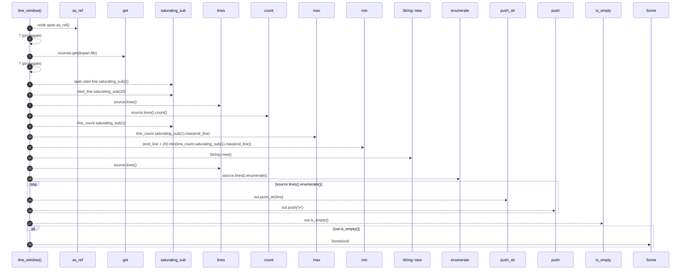

# `robby_render::view::comments::line_window`

[Self-model](../../../README.md) · [view::comments](index.md)

| | |
|---|---|
| kind | `code.function` |
| signature | `fn line_window(sources: &BTreeMap<String, String>, node: &Node) -> Option<String>` |
| location | [`crates/robby-render/src/view/comments.rs:263`](../../../../../crates/robby-render/src/view/comments.rs#L263) |
| provenance | extractor · confidence 1.00 |

```rust
fn line_window(sources: &BTreeMap<String, String>, node: &Node) -> Option<String> {
    let span = node.span.as_ref()?;
    let source = sources.get(&span.file)?;
    let start_line = span.start.line.saturating_sub(1) as usize;
    let end_line = span.end.line as usize;
    let from = start_line.saturating_sub(20);
    let line_count = source.lines().count();
    let to = (end_line + 20).min(line_count.saturating_sub(1).max(end_line));
    let mut out = String::new();
    for (i, line) in source.lines().enumerate() {
        if i < from {
            continue;
        }
        if i > to {
            break;
        }
        out.push_str(line);
        out.push('\n');
    }
    if out.is_empty() {
        None
    } else {
        Some(out)
    }
}
```



18 steps · 0 observed · 18 possible only

**Edges**

- calls → [`robby_ir::model::impl Document::get`](../../../robby_ir/model/index.md)
- calls → [`robby_render::view::scene::impl Rect::new`](../scene/index.md)
- calls → [`robby_render::report::impl Report::push`](../../report/index.md)
- calls → [`robby_render::view::comments::impl CommentsView::is_empty`](index.md)

## References

- calls → [`robby_ir::model`](../../../robby_ir/model/index.md) — get
- calls → [`robby_render::report`](../../report/index.md) — push
- calls → [`robby_render::view::comments`](index.md) — is_empty
- calls → [`robby_render::view::scene`](../scene/index.md) — new

## Referenced by

- calls ← [`robby_render::view::comments::code_window`](code-window.md)

