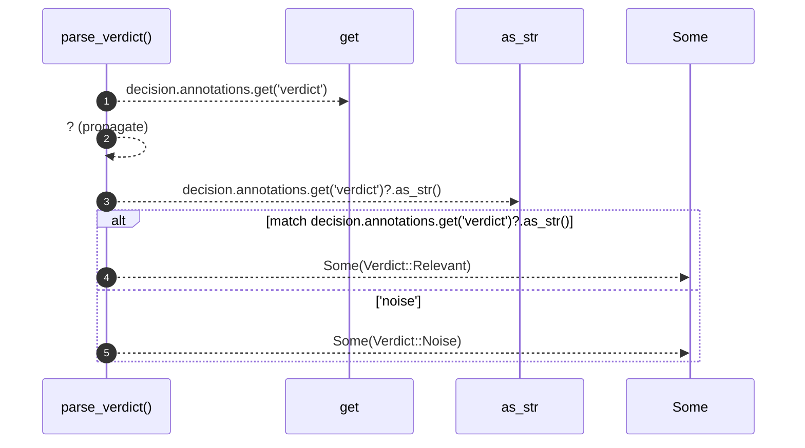

# `robby_render::view::comments::parse_verdict`

[Self-model](../../../README.md) · [view::comments](index.md)

| | |
|---|---|
| kind | `code.function` |
| signature | `fn parse_verdict(decision: &Node) -> Option<Verdict>` |
| location | [`crates/robby-render/src/view/comments.rs:175`](../../../../../crates/robby-render/src/view/comments.rs#L175) |
| provenance | extractor · confidence 1.00 |

```rust
fn parse_verdict(decision: &Node) -> Option<Verdict> {
    match decision.annotations.get("verdict")?.as_str() {
        "relevant" => Some(Verdict::Relevant),
        "noise" => Some(Verdict::Noise),
        _ => None,
    }
}
```



5 steps · 0 observed · 5 possible only

**Edges**

- calls → [`robby_ir::model::impl Document::get`](../../../robby_ir/model/index.md)
- calls → [`robby_render::view::comments::impl NoteKind::as_str`](index.md)

## References

- calls → [`robby_ir::model`](../../../robby_ir/model/index.md) — get
- calls → [`robby_render::view::comments`](index.md) — as_str

