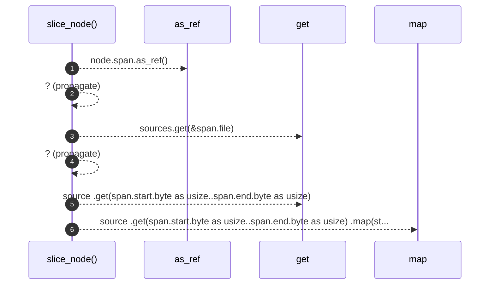

# `robby_render::view::comments::slice_node`

[Self-model](../../../README.md) · [view::comments](index.md)

| | |
|---|---|
| kind | `code.function` |
| signature | `fn slice_node(sources: &BTreeMap<String, String>, node: &Node) -> Option<String>` |
| location | [`crates/robby-render/src/view/comments.rs:217`](../../../../../crates/robby-render/src/view/comments.rs#L217) |
| provenance | extractor · confidence 1.00 |

```rust
fn slice_node(sources: &BTreeMap<String, String>, node: &Node) -> Option<String> {
    let span = node.span.as_ref()?;
    let source = sources.get(&span.file)?;
    source
        .get(span.start.byte as usize..span.end.byte as usize)
        .map(std::borrow::ToOwned::to_owned)
}
```



6 steps · 0 observed · 6 possible only

**Edges**

- calls → [`robby_ir::model::impl Document::get`](../../../robby_ir/model/index.md)
- calls → [`robby_ir::model::impl Document::get`](../../../robby_ir/model/index.md)

## References

- calls → [`robby_ir::model`](../../../robby_ir/model/index.md) — get

## Referenced by

- calls ← [`robby_render::view::comments::code_window`](code-window.md)
- calls ← [`robby_render::view::comments::impl CommentsView::from_root`](index.md)

