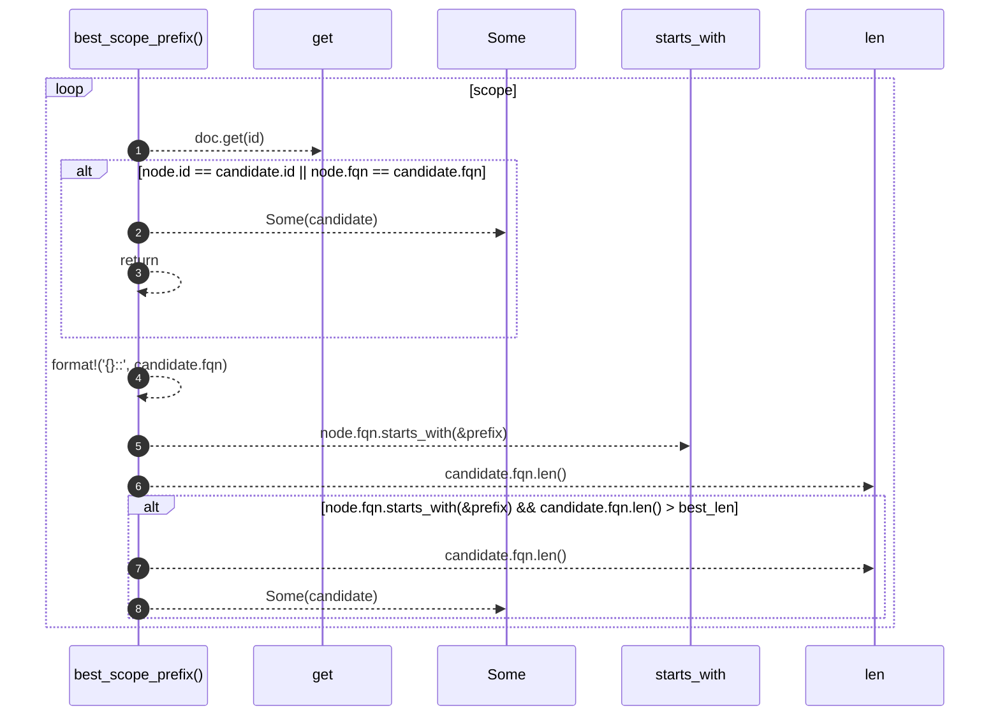

# `robby_render::view::deps::best_scope_prefix`

[Self-model](../../../README.md) · [view::deps](index.md)

| | |
|---|---|
| kind | `code.function` |
| signature | `fn best_scope_prefix<'a>(     doc: &'a Document,     node: &Node,     scope: &BTreeSet<NodeId>, ) -> Option<&'a Node>` |
| location | [`crates/robby-render/src/view/deps.rs:741`](../../../../../crates/robby-render/src/view/deps.rs#L741) |
| provenance | extractor · confidence 1.00 |

```rust
fn best_scope_prefix<'a>(
    doc: &'a Document,
    node: &Node,
    scope: &BTreeSet<NodeId>,
) -> Option<&'a Node> {
    let mut best: Option<&Node> = None;
    let mut best_len = 0usize;
    for id in scope {
        let Some(candidate) = doc.get(id) else {
            continue;
        };
        if node.id == candidate.id || node.fqn == candidate.fqn {
            return Some(candidate);
        }
        let prefix = format!("{}::", candidate.fqn);
        if node.fqn.starts_with(&prefix) && candidate.fqn.len() > best_len {
            best_len = candidate.fqn.len();
            best = Some(candidate);
        }
    }
    best
}
```



8 steps · 0 observed · 8 possible only

**Edges**

- calls → [`robby_ir::model::impl Document::get`](../../../robby_ir/model/index.md)

## References

- calls → [`robby_ir::model`](../../../robby_ir/model/index.md) — get

## Referenced by

- calls ← [`robby_render::view::deps::lift_to_scope`](lift-to-scope.md)
- calls ← [`robby_render::view::deps::owning_in_scope`](owning-in-scope.md)

