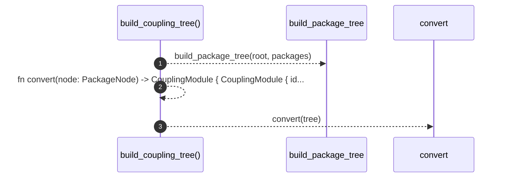

# `robby_render::view::deps::build_coupling_tree`

[Self-model](../../../README.md) · [view::deps](index.md)

| | |
|---|---|
| kind | `code.function` |
| signature | `fn build_coupling_tree(root: &Node, packages: &[&Node]) -> CouplingModule` |
| location | [`crates/robby-render/src/view/deps.rs:639`](../../../../../crates/robby-render/src/view/deps.rs#L639) |
| provenance | extractor · confidence 1.00 |

```rust
fn build_coupling_tree(root: &Node, packages: &[&Node]) -> CouplingModule {
    let tree = build_package_tree(root, packages);
    fn convert(node: PackageNode) -> CouplingModule {
        CouplingModule {
            id: node.id,
            stable_id: node.stable_id,
            name: node.name,
            fqn: node.fqn,
            children: node.children.into_iter().map(convert).collect(),
        }
    }
    convert(tree)
}
```



3 steps · 0 observed · 3 possible only

**Edges**

- calls → [`robby_render::view::deps::build_package_tree`](build-package-tree.md)

## References

- calls → [`robby_render::view::deps`](index.md) — build_package_tree

## Referenced by

- calls ← [`robby_render::view::deps::impl CouplingGraph::from_root`](index.md)

