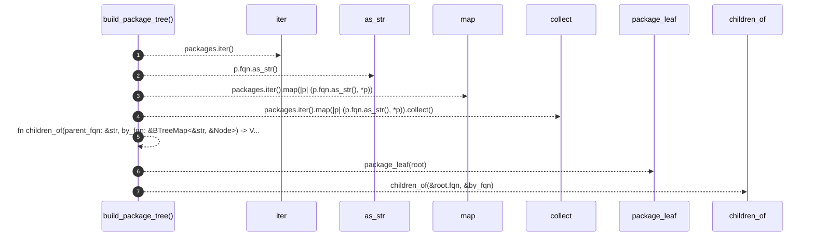

# `robby_render::view::deps::build_package_tree`

[Self-model](../../../README.md) · [view::deps](index.md)

| | |
|---|---|
| kind | `code.function` |
| signature | `fn build_package_tree(root: &Node, packages: &[&Node]) -> PackageNode` |
| location | [`crates/robby-render/src/view/deps.rs:615`](../../../../../crates/robby-render/src/view/deps.rs#L615) |
| provenance | extractor · confidence 1.00 |

```rust
fn build_package_tree(root: &Node, packages: &[&Node]) -> PackageNode {
    let by_fqn: BTreeMap<&str, &Node> = packages.iter().map(|p| (p.fqn.as_str(), *p)).collect();
    fn children_of(parent_fqn: &str, by_fqn: &BTreeMap<&str, &Node>) -> Vec<PackageNode> {
        let prefix = format!("{parent_fqn}::");
        let mut kids = Vec::new();
        for (fqn, node) in by_fqn {
            let Some(rest) = fqn.strip_prefix(&prefix) else {
                continue;
            };
            if rest.is_empty() || rest.contains("::") {
                continue;
            }
            let mut child = package_leaf(node);
            child.children = children_of(fqn, by_fqn);
            kids.push(child);
        }
        kids.sort_by(|a, b| a.name.cmp(&b.name));
        kids
    }
    let mut root_node = package_leaf(root);
    root_node.children = children_of(&root.fqn, &by_fqn);
    root_node
}
```



7 steps · 0 observed · 7 possible only

**Edges**

- calls → [`robby_render::view::comments::impl NoteKind::as_str`](../comments/index.md)
- calls → [`robby_render::view::select::collect`](../select/collect.md)
- calls → [`robby_render::view::deps::package_leaf`](package-leaf.md)
- calls → [`robby_render::view::entrypoints::impl CallTree::children_of`](../entrypoints/index.md)

## References

- calls → [`robby_render::view::comments`](../comments/index.md) — as_str
- calls → [`robby_render::view::deps`](index.md) — package_leaf
- calls → [`robby_render::view::entrypoints`](../entrypoints/index.md) — children_of
- calls → [`robby_render::view::select`](../select/index.md) — collect

## Referenced by

- calls ← [`robby_render::view::deps::build_coupling_tree`](build-coupling-tree.md)
- calls ← [`robby_render::view::deps::impl PackageStructure::from_root`](index.md)

