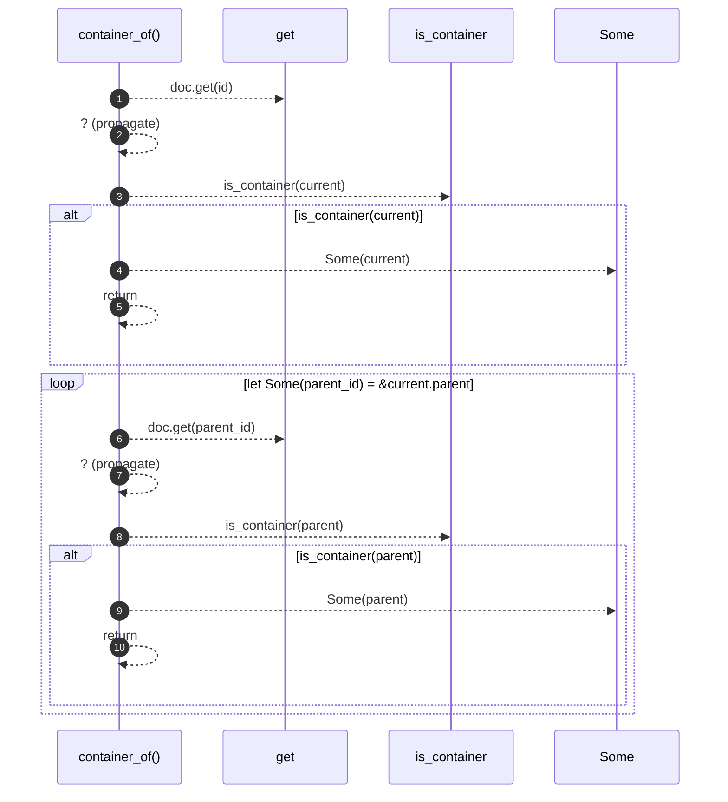

# `robby_render::view::deps::container_of`

[Self-model](../../../README.md) · [view::deps](index.md)

| | |
|---|---|
| kind | `code.function` |
| signature | `fn container_of<'a>(doc: &'a Document, id: &NodeId) -> Option<&'a Node>` |
| location | [`crates/robby-render/src/view/deps.rs:714`](../../../../../crates/robby-render/src/view/deps.rs#L714) |
| provenance | extractor · confidence 1.00 |

```rust
fn container_of<'a>(doc: &'a Document, id: &NodeId) -> Option<&'a Node> {
    let mut current = doc.get(id)?;
    if is_container(current) {
        return Some(current);
    }
    while let Some(parent_id) = &current.parent {
        let parent = doc.get(parent_id)?;
        if is_container(parent) {
            return Some(parent);
        }
        current = parent;
    }
    None
}
```



10 steps · 0 observed · 10 possible only

**Edges**

- calls → [`robby_ir::model::impl Document::get`](../../../robby_ir/model/index.md)
- calls → [`robby_render::util::is_container`](../../util/is-container.md)
- calls → [`robby_ir::model::impl Document::get`](../../../robby_ir/model/index.md)
- calls → [`robby_render::util::is_container`](../../util/is-container.md)

## References

- calls → [`robby_ir::model`](../../../robby_ir/model/index.md) — get
- calls → [`robby_render::util`](../../util/index.md) — is_container

## Referenced by

- calls ← [`robby_render::view::deps::impl CouplingGraph::workspace`](index.md)
- calls ← [`robby_render::view::deps::package_edges`](package-edges.md)

