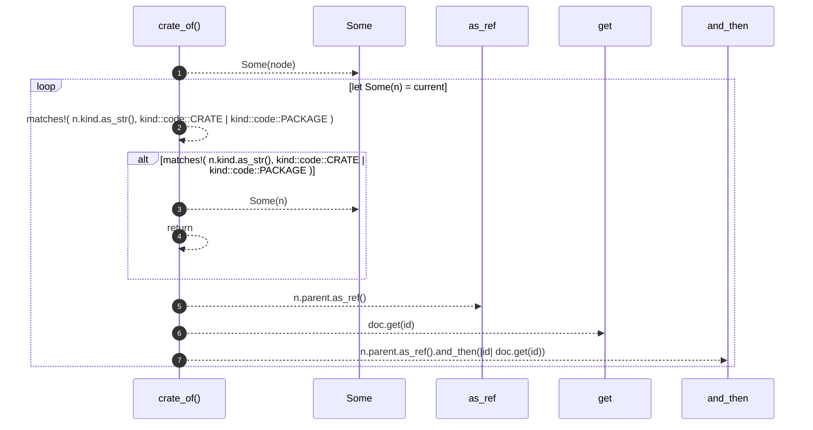

# `robby_render::view::deps::crate_of`

[Self-model](../../../README.md) · [view::deps](index.md)

| | |
|---|---|
| kind | `code.function` |
| signature | `fn crate_of<'a>(doc: &'a Document, node: &'a Node) -> Option<&'a Node>` |
| location | [`crates/robby-render/src/view/deps.rs:729`](../../../../../crates/robby-render/src/view/deps.rs#L729) |
| provenance | extractor · confidence 1.00 |

```rust
fn crate_of<'a>(doc: &'a Document, node: &'a Node) -> Option<&'a Node> {
    let mut current = Some(node);
    while let Some(n) = current {
        if matches!(
            n.kind.as_str(),
            kind::code::CRATE | kind::code::PACKAGE
        ) {
            return Some(n);
        }
        current = n.parent.as_ref().and_then(|id| doc.get(id));
    }
    None
}
```



7 steps · 0 observed · 7 possible only

**Edges**

- calls → [`robby_ir::model::impl Document::get`](../../../robby_ir/model/index.md)

## References

- calls → [`robby_ir::model`](../../../robby_ir/model/index.md) — get

## Referenced by

- calls ← [`robby_render::view::deps::package_edges`](package-edges.md)

