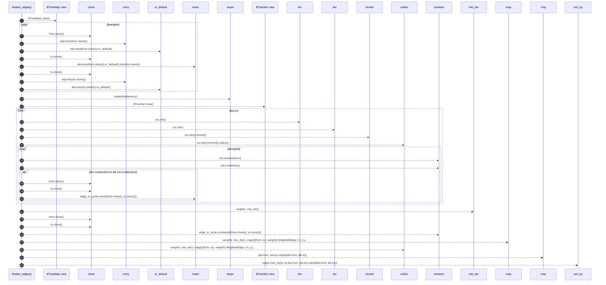

# `robby_render::view::deps::finalize_edges`

[Self-model](../../../README.md) · [view::deps](index.md)

| | |
|---|---|
| kind | `code.function` |
| signature | `fn finalize_edges(weights: BTreeMap<(String, String), usize>) -> Vec<WeightedEdge>` |
| location | [`crates/robby-render/src/view/deps.rs:580`](../../../../../crates/robby-render/src/view/deps.rs#L580) |
| provenance | extractor · confidence 1.00 |

```rust
fn finalize_edges(weights: BTreeMap<(String, String), usize>) -> Vec<WeightedEdge> {
    let adjacency: BTreeMap<String, BTreeSet<String>> = {
        let mut adj: BTreeMap<String, BTreeSet<String>> = BTreeMap::new();
        for ((from, to), _) in &weights {
            adj.entry(from.clone()).or_default().insert(to.clone());
            adj.entry(to.clone()).or_default();
        }
        adj
    };
    let sccs = tarjan(&adjacency);
    let mut edge_in_cycle: BTreeSet<(String, String)> = BTreeSet::new();
    for scc in &sccs {
        if scc.len() < 2 {
            continue;
        }
        let set: BTreeSet<_> = scc.iter().cloned().collect();
        for ((from, to), _) in &weights {
            if set.contains(from) && set.contains(to) {
                edge_in_cycle.insert((from.clone(), to.clone()));
            }
        }
    }
    let mut edges: Vec<WeightedEdge> = weights
        .into_iter()
        .map(|((from, to), weight)| WeightedEdge {
            in_cycle: edge_in_cycle.contains(&(from.clone(), to.clone())),
            from,
            to,
            weight,
        })
        .collect();
    edges.sort_by(|a, b| (&a.from, &a.to).cmp(&(&b.from, &b.to)));
    edges
}
```



28 steps · 0 observed · 28 possible only

**Edges**

- calls → [`robby_render::view::scene::impl Rect::new`](../scene/index.md)
- calls → [`robby_ir::model::impl Document::insert`](../../../robby_ir/model/index.md)
- calls → [`robby_render::view::deps::tarjan`](tarjan.md)
- calls → [`robby_render::view::scene::impl Rect::new`](../scene/index.md)
- calls → [`robby_render::view::select::collect`](../select/collect.md)
- calls → [`robby_render::view::scene::impl WorldRect::contains`](../scene/index.md)
- calls → [`robby_render::view::scene::impl WorldRect::contains`](../scene/index.md)
- calls → [`robby_ir::model::impl Document::insert`](../../../robby_ir/model/index.md)
- calls → [`robby_render::view::scene::impl WorldRect::contains`](../scene/index.md)
- calls → [`robby_render::view::select::collect`](../select/collect.md)

## References

- calls → [`robby_ir::model`](../../../robby_ir/model/index.md) — insert
- calls → [`robby_render::view::deps`](index.md) — tarjan
- calls → [`robby_render::view::scene`](../scene/index.md) — contains, new
- calls → [`robby_render::view::select`](../select/index.md) — collect

## Referenced by

- calls ← [`robby_render::view::deps::impl CouplingGraph::from_root`](index.md)
- calls ← [`robby_render::view::deps::impl CouplingGraph::workspace`](index.md)

