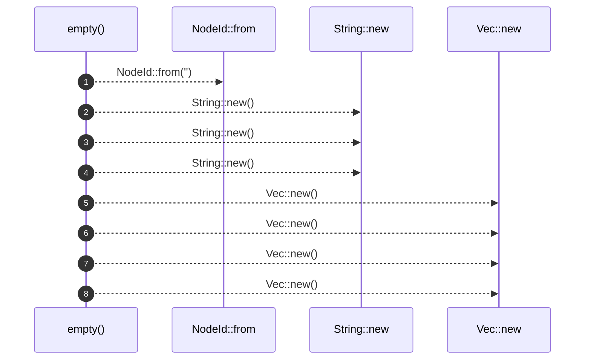
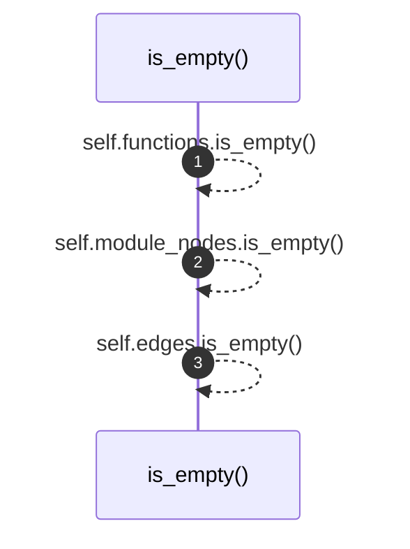
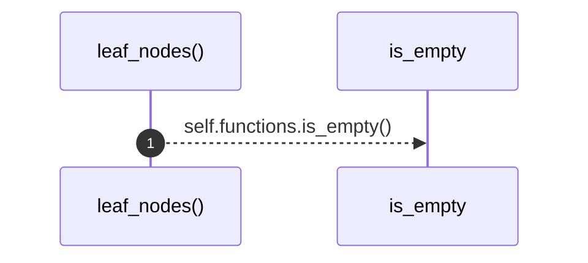

# `robby_render::view::deps::impl CouplingGraph`

[Self-model](../../../README.md) · [view::deps](index.md)

| | |
|---|---|
| kind | `code.impl` |
| location | [`crates/robby-render/src/view/deps.rs:197`](../../../../../crates/robby-render/src/view/deps.rs#L197) |
| provenance | extractor · confidence 1.00 |

```rust
impl CouplingGraph {
    /// Function-level internal Calls under `root`.
    pub fn from_root(doc: &Document, root: &NodeId) -> Self {
        let Some(root_node) = doc.get(root) else {
            return Self::empty();
        };

        let packages: Vec<&Node> = doc
            .nodes
            .values()
            .filter(|node| {
                is_container(node) && (node.id == root_node.id || is_under_fqn(root_node, node))
            })
            .collect();
        let package_scope: BTreeSet<NodeId> = packages.iter().map(|p| p.id.clone()).collect();

        let mut weights: BTreeMap<(String, String), usize> = BTreeMap::new();
        let mut participants: BTreeMap<String, CouplingFn> = BTreeMap::new();

        for node in doc.subtree(root) {
            if !is_callable(node) {
                continue;
            }
            for edge in &node.edges {
                if edge.kind != EdgeKind::Calls {
                    continue;
                }
                let Some(target) = doc.get(&edge.to) else {
                    continue;
                };
                if !is_callable(target) || !under_root_fqn(root_node, target) {
                    continue;
                }

                let Some(from_mod) = owning_in_scope(doc, &node.id, &package_scope) else {
                    continue;
                };
                let Some(to_mod) = owning_in_scope(doc, &target.id, &package_scope) else {
                    continue;
                };

                let from_sid = stable_id(node.id.as_str());
                let to_sid = stable_id(target.id.as_str());
                participants
                    .entry(from_sid.clone())
                    .or_insert_with(|| CouplingFn {
                        id: node.id.clone(),
                        stable_id: from_sid.clone(),
                        name: node.name.clone(),
                        parent_stable_id: stable_id(from_mod.id.as_str()),
                    });
                participants
                    .entry(to_sid.clone())
                    .or_insert_with(|| CouplingFn {
                        id: target.id.clone(),
                        stable_id: to_sid.clone(),
                        name: target.name.clone(),
                        parent_stable_id: stable_id(to_mod.id.as_str()),
                    });
                if from_sid != to_sid {
                    *weights.entry((from_sid, to_sid)).or_default() += 1;
                }
            }
        }

        if participants.is_empty() {
            return Self::empty();
        }

        let owner_fqns: BTreeSet<String> = participants
            .values()
            .filter_map(|f| {
                packages
                    .iter()
                    .find(|m| stable_id(m.id.as_str()) == f.parent_stable_id)
                    .map(|m| m.fqn.clone())
            })
            .collect();

        // Modules that own a participant, plus every ancestor under root.
        let tree_packages: Vec<&Node> = packages
            .iter()
            .copied()
            .filter(|p| {
                owner_fqns
                    .iter()
                    .any(|fqn| fqn == &p.fqn || fqn.starts_with(&format!("{}::", p.fqn)))
            })
            .collect();

        let root_mod = build_coupling_tree(root_node, &tree_packages);
        let edges = finalize_edges(weights);
        let mut functions: Vec<CouplingFn> = participants.into_values().collect();
        functions.sort_by(|a, b| a.name.cmp(&b.name).then(a.stable_id.cmp(&b.stable_id)));

        Self {
            root: root_mod,
            functions,
            edges,
            module_nodes: Vec::new(),
        }
    }

    /// Crates as subgraphs; direct modules as nodes; call-weighted module edges.
    pub fn workspace(doc: &Document) -> Self {
        let crates: Vec<&Node> = doc
            .nodes
            .values()
            .filter(|node| matches!(node.kind.as_str(), kind::code::CRATE | kind::code::PACKAGE))
            .collect();
        if crates.is_empty() {
            return Self::empty();
        }

        let mut module_nodes: BTreeMap<String, CouplingFn> = BTreeMap::new();
        let mut crate_children: BTreeMap<String, Vec<PackageNode>> = BTreeMap::new();

        for krate in &crates {
            let directs: Vec<&Node> = doc
                .nodes
                .values()
                .filter(|node| is_container(node) && is_direct_package(krate, node))
                .collect();
            let mut kids = Vec::new();
            for m in &directs {
                let sid = stable_id(m.id.as_str());
                module_nodes.insert(
                    sid.clone(),
                    CouplingFn {
                        id: m.id.clone(),
                        stable_id: sid.clone(),
                        name: m.name.clone(),
                        parent_stable_id: stable_id(krate.id.as_str()),
                    },
                );
                kids.push(package_leaf(m));
            }
            kids.sort_by(|a, b| a.name.cmp(&b.name));
            crate_children.insert(stable_id(krate.id.as_str()), kids);
        }

        // Scope = all direct modules across crates.
        let scope: BTreeSet<NodeId> = module_nodes.values().map(|m| m.id.clone()).collect();

        let mut weights: BTreeMap<(String, String), usize> = BTreeMap::new();
        for node in doc.nodes.values() {
            for edge in &node.edges {
                if edge.kind != EdgeKind::Calls {
                    continue;
                }
                let Some(from_mod) = owning_in_scope(doc, &node.id, &scope) else {
                    continue;
                };
                let Some(to_owner) = container_of(doc, &edge.to) else {
                    continue;
                };
                let Some(to_mod) = lift_to_scope(doc, to_owner, &scope) else {
                    continue;
                };
                if from_mod.id == to_mod.id {
                    continue;
                }
                let from_sid = stable_id(from_mod.id.as_str());
                let to_sid = stable_id(to_mod.id.as_str());
                *weights.entry((from_sid, to_sid)).or_default() += 1;
            }
        }

        // Only keep modules that participate in an edge.
        let active: BTreeSet<String> = weights
            .keys()
            .flat_map(|(a, b)| [a.clone(), b.clone()])
            .collect();
        module_nodes.retain(|sid, _| active.contains(sid));

        let mut children: Vec<CouplingModule> = crates
            .iter()
            .map(|c| {
                let sid = stable_id(c.id.as_str());
                let kids = crate_children
                    .remove(&sid)
                    .unwrap_or_default()
                    .into_iter()
                    .filter(|k| active.contains(&k.stable_id))
                    .map(|k| CouplingModule {
                        id: k.id,
                        stable_id: k.stable_id,
                        name: k.name,
                        fqn: k.fqn,
                        children: Vec::new(),
                    })
                    .collect();
                CouplingModule {
                    id: c.id.clone(),
                    stable_id: sid,
                    name: c.name.clone(),
                    fqn: c.fqn.clone(),
                    children: kids,
                }
            })
            .filter(|c| !c.children.is_empty())
            .collect();
        children.sort_by(|a, b| a.name.cmp(&b.name));

        let root = CouplingModule {
            id: NodeId::from("workspace://root"),
            stable_id: stable_id("workspace://root"),
            name: "workspace".into(),
            fqn: "workspace".into(),
            children,
        };

        let edges = finalize_edges(weights);
        let mut module_nodes: Vec<CouplingFn> = module_nodes.into_values().collect();
        module_nodes.sort_by(|a, b| a.name.cmp(&b.name).then(a.stable_id.cmp(&b.stable_id)));

        if module_nodes.is_empty() {
            return Self::empty();
        }

        Self {
            root,
            functions: Vec::new(),
            edges,
            module_nodes,
        }
    }

    pub fn empty() -> Self {
        Self {
            root: CouplingModule {
                id: NodeId::from(""),
                stable_id: String::new(),
                name: String::new(),
                fqn: String::new(),
                children: Vec::new(),
            },
            functions: Vec::new(),
            edges: Vec::new(),
            module_nodes: Vec::new(),
        }
    }

    pub fn is_empty(&self) -> bool {
        self.functions.is_empty() && self.module_nodes.is_empty() && self.edges.is_empty()
    }

    pub fn leaf_nodes(&self) -> &[CouplingFn] {
        if self.functions.is_empty() {
            &self.module_nodes
        } else {
            &self.functions
        }
    }
}
```

## References

- calls → [`robby_ir::kind`](../../../robby_ir/kind/index.md) — from
- calls → [`robby_ir::model`](../../../robby_ir/model/index.md) — get, insert, subtree
- calls → [`robby_render`](../../index.md) — stable_id
- calls → [`robby_render::report`](../../report/index.md) — push
- calls → [`robby_render::util`](../../util/index.md) — is_container
- calls → [`robby_render::view::comments`](../comments/index.md) — as_str
- calls → [`robby_render::view::deps`](index.md) — 10 items
- calls → [`robby_render::view::scene`](../scene/index.md) — contains, new
- calls → [`robby_render::view::select`](../select/index.md) — collect

## Referenced by

- calls ← [`robby_render::coupling`](../../coupling.md)
- calls ← [`robby_render::dependencies`](../../dependencies.md)
- calls ← [`robby_render::dependency_report`](../../dependency-report.md)
- calls ← [`robby_render::flowchart`](../../flowchart.md)
- calls ← [`robby_render::render::tui::ascii_coupling`](../../render/tui/ascii-coupling.md)
- calls ← [`robby_render::test_render::externals_and_comments_sections_render`](../../test_render/externals-and-comments-sections-render.md)
- calls ← [`robby_render::tui::graph`](../../tui/graph.md)
- calls ← [`robby_render::view::deps::is_direct_package`](is-direct-package.md)
- calls ← [`robby_render::view::deps::topological_layers`](topological-layers.md)
- calls ← [`robby_render::view::scene::build_frame`](../scene/build-frame.md)
- calls ← [`robby_render::view::select::collect`](../select/collect.md)

### `from_root`

| | |
|---|---|
| kind | `code.method` |
| signature | `fn from_root(2)` |
| location | [`crates/robby-render/src/view/deps.rs:198`](../../../../../crates/robby-render/src/view/deps.rs#L198) |
| provenance | extractor · confidence 1.00 |

> Function-level internal Calls under `root`.

```rust
/// Function-level internal Calls under `root`.
    pub fn from_root(doc: &Document, root: &NodeId) -> Self {
        let Some(root_node) = doc.get(root) else {
            return Self::empty();
        };

        let packages: Vec<&Node> = doc
            .nodes
            .values()
            .filter(|node| {
                is_container(node) && (node.id == root_node.id || is_under_fqn(root_node, node))
            })
            .collect();
        let package_scope: BTreeSet<NodeId> = packages.iter().map(|p| p.id.clone()).collect();

        let mut weights: BTreeMap<(String, String), usize> = BTreeMap::new();
        let mut participants: BTreeMap<String, CouplingFn> = BTreeMap::new();

        for node in doc.subtree(root) {
            if !is_callable(node) {
                continue;
            }
            for edge in &node.edges {
                if edge.kind != EdgeKind::Calls {
                    continue;
                }
                let Some(target) = doc.get(&edge.to) else {
                    continue;
                };
                if !is_callable(target) || !under_root_fqn(root_node, target) {
                    continue;
                }

                let Some(from_mod) = owning_in_scope(doc, &node.id, &package_scope) else {
                    continue;
                };
                let Some(to_mod) = owning_in_scope(doc, &target.id, &package_scope) else {
                    continue;
                };

                let from_sid = stable_id(node.id.as_str());
                let to_sid = stable_id(target.id.as_str());
                participants
                    .entry(from_sid.clone())
                    .or_insert_with(|| CouplingFn {
                        id: node.id.clone(),
                        stable_id: from_sid.clone(),
                        name: node.name.clone(),
                        parent_stable_id: stable_id(from_mod.id.as_str()),
                    });
                participants
                    .entry(to_sid.clone())
                    .or_insert_with(|| CouplingFn {
                        id: target.id.clone(),
                        stable_id: to_sid.clone(),
                        name: target.name.clone(),
                        parent_stable_id: stable_id(to_mod.id.as_str()),
                    });
                if from_sid != to_sid {
                    *weights.entry((from_sid, to_sid)).or_default() += 1;
                }
            }
        }

        if participants.is_empty() {
            return Self::empty();
        }

        let owner_fqns: BTreeSet<String> = participants
            .values()
            .filter_map(|f| {
                packages
                    .iter()
                    .find(|m| stable_id(m.id.as_str()) == f.parent_stable_id)
                    .map(|m| m.fqn.clone())
            })
            .collect();

        // Modules that own a participant, plus every ancestor under root.
        let tree_packages: Vec<&Node> = packages
            .iter()
            .copied()
            .filter(|p| {
                owner_fqns
                    .iter()
                    .any(|fqn| fqn == &p.fqn || fqn.starts_with(&format!("{}::", p.fqn)))
            })
            .collect();

        let root_mod = build_coupling_tree(root_node, &tree_packages);
        let edges = finalize_edges(weights);
        let mut functions: Vec<CouplingFn> = participants.into_values().collect();
        functions.sort_by(|a, b| a.name.cmp(&b.name).then(a.stable_id.cmp(&b.stable_id)));

        Self {
            root: root_mod,
            functions,
            edges,
            module_nodes: Vec::new(),
        }
    }
```



```mermaid
sequenceDiagram
    autonumber
    participant from_root as from_root()
    participant get as get
    participant values as values
    participant is_container as is_container
    participant is_under_fqn as is_under_fqn
    participant filter as filter
    participant collect as collect
    participant iter as iter
    participant clone as clone
    participant map as map
    participant BTreeMap__new as BTreeMap::new
    participant subtree as subtree
    participant is_callable as is_callable
    participant under_root_fqn as under_root_fqn
    participant owning_in_scope as owning_in_scope
    participant as_str as as_str
    participant stable_id as stable_id
    participant entry as entry
    participant or_insert_with as or_insert_with
    participant or_default as or_default
    participant is_empty as is_empty
    participant Self__empty as Self::empty
    participant find as find
    participant filter_map as filter_map
    participant copied as copied
    participant starts_with as starts_with
    participant any as any
    participant build_coupling_tree as build_coupling_tree
    participant finalize_edges as finalize_edges
    participant into_values as into_values
    participant cmp as cmp
    participant then as then
    participant sort_by as sort_by
    participant Vec__new as Vec::new
    from_root-->>get: doc.get(root)
    from_root-->>values: doc .nodes .values()
    from_root-->>is_container: is_container(node)
    from_root-->>is_under_fqn: is_under_fqn(root_node, node)
    from_root-->>filter: doc .nodes .values() .filter(|node| { is_container(node) && (node.id ...
    from_root-->>collect: doc .nodes .values() .filter(|node| { is_container(node) && (node.id ...
    from_root-->>iter: packages.iter()
    from_root-->>clone: p.id.clone()
    from_root-->>map: packages.iter().map(|p| p.id.clone())
    from_root-->>collect: packages.iter().map(|p| p.id.clone()).collect()
    from_root-->>BTreeMap__new: BTreeMap::new()
    from_root-->>BTreeMap__new: BTreeMap::new()
    from_root-->>subtree: doc.subtree(root)
    loop doc.subtree(root)
    from_root-->>is_callable: is_callable(node)
    loop &node.edges
    from_root-->>get: doc.get(&edge.to)
    from_root-->>is_callable: is_callable(target)
    from_root-->>under_root_fqn: under_root_fqn(root_node, target)
    from_root-->>owning_in_scope: owning_in_scope(doc, &node.id, &package_scope)
    from_root-->>owning_in_scope: owning_in_scope(doc, &target.id, &package_scope)
    from_root-->>as_str: node.id.as_str()
    from_root-->>stable_id: stable_id(node.id.as_str())
    from_root-->>as_str: target.id.as_str()
    from_root-->>stable_id: stable_id(target.id.as_str())
    from_root-->>clone: from_sid.clone()
    from_root-->>entry: participants .entry(from_sid.clone())
    from_root-->>clone: node.id.clone()
    from_root-->>clone: from_sid.clone()
    from_root-->>clone: node.name.clone()
    from_root-->>as_str: from_mod.id.as_str()
    from_root-->>stable_id: stable_id(from_mod.id.as_str())
    from_root-->>or_insert_with: participants .entry(from_sid.clone()) .or_insert_with(|| CouplingFn {...
    from_root-->>clone: to_sid.clone()
    from_root-->>entry: participants .entry(to_sid.clone())
    from_root-->>clone: target.id.clone()
    from_root-->>clone: to_sid.clone()
    from_root-->>clone: target.name.clone()
    from_root-->>as_str: to_mod.id.as_str()
    from_root-->>stable_id: stable_id(to_mod.id.as_str())
    from_root-->>or_insert_with: participants .entry(to_sid.clone()) .or_insert_with(|| CouplingFn { i...
    alt from_sid != to_sid
    from_root-->>entry: weights.entry((from_sid, to_sid))
    from_root-->>or_default: weights.entry((from_sid, to_sid)).or_default()
    end
    end
    end
    from_root-->>is_empty: participants.is_empty()
    alt participants.is_empty()
    from_root-->>Self__empty: Self::empty()
    from_root-->>from_root: return
    end
    from_root-->>values: participants .values()
    from_root-->>iter: packages .iter()
    from_root-->>as_str: m.id.as_str()
    from_root-->>stable_id: stable_id(m.id.as_str())
    from_root-->>find: packages .iter() .find(|m| stable_id(m.id.as_str()) == f.parent_stabl...
    from_root-->>clone: m.fqn.clone()
    from_root-->>map: packages .iter() .find(|m| stable_id(m.id.as_str()) == f.parent_stabl...
    from_root-->>filter_map: participants .values() .filter_map(|f| { packages .iter() .find(|m| s...
    from_root-->>collect: participants .values() .filter_map(|f| { packages .iter() .find(|m| s...
    from_root-->>iter: packages .iter()
    from_root-->>copied: packages .iter() .copied()
    from_root-->>iter: owner_fqns .iter()
    from_root-->>from_root: format!('{}::', p.fqn)
    from_root-->>starts_with: fqn.starts_with(&format!('{}::', p.fqn))
    from_root-->>any: owner_fqns .iter() .any(|fqn| fqn == &p.fqn || fqn.starts_with(&forma...
    from_root-->>filter: packages .iter() .copied() .filter(|p| { owner_fqns .iter() .any(|fqn...
    from_root-->>collect: packages .iter() .copied() .filter(|p| { owner_fqns .iter() .any(|fqn...
    from_root-->>build_coupling_tree: build_coupling_tree(root_node, &tree_packages)
    from_root-->>finalize_edges: finalize_edges(weights)
    from_root-->>into_values: participants.into_values()
    from_root-->>collect: participants.into_values().collect()
    from_root-->>cmp: a.name.cmp(&b.name)
    from_root-->>cmp: a.stable_id.cmp(&b.stable_id)
    from_root-->>then: a.name.cmp(&b.name).then(a.stable_id.cmp(&b.stable_id))
    from_root-->>sort_by: functions.sort_by(|a, b| a.name.cmp(&b.name).then(a.stable_id.cmp(&b....
    from_root-->>Vec__new: Vec::new()
```

70 steps · 0 observed · 70 possible only

**Edges**

- calls → [`robby_ir::model::impl Document::get`](../../../robby_ir/model/index.md)
- calls → [`robby_render::util::is_container`](../../util/is-container.md)
- calls → [`robby_render::view::deps::is_under_fqn`](is-under-fqn.md)
- calls → [`robby_render::view::select::collect`](../select/collect.md)
- calls → [`robby_render::view::select::collect`](../select/collect.md)
- calls → [`robby_render::view::scene::impl Rect::new`](../scene/index.md)
- calls → [`robby_render::view::scene::impl Rect::new`](../scene/index.md)
- calls → [`robby_ir::model::impl Document::subtree`](../../../robby_ir/model/index.md)
- calls → [`robby_render::view::deps::is_callable`](is-callable.md)
- calls → [`robby_ir::model::impl Document::get`](../../../robby_ir/model/index.md)
- calls → [`robby_render::view::deps::is_callable`](is-callable.md)
- calls → [`robby_render::view::deps::under_root_fqn`](under-root-fqn.md)
- calls → [`robby_render::view::deps::owning_in_scope`](owning-in-scope.md)
- calls → [`robby_render::view::deps::owning_in_scope`](owning-in-scope.md)
- calls → [`robby_render::view::comments::impl CommentKind::as_str`](../comments/index.md)
- calls → [`robby_render::stable_id`](../../stable-id.md)
- calls → [`robby_render::view::comments::impl CommentKind::as_str`](../comments/index.md)
- calls → [`robby_render::stable_id`](../../stable-id.md)
- calls → [`robby_render::view::comments::impl CommentKind::as_str`](../comments/index.md)
- calls → [`robby_render::stable_id`](../../stable-id.md)
- calls → [`robby_render::view::comments::impl CommentKind::as_str`](../comments/index.md)
- calls → [`robby_render::stable_id`](../../stable-id.md)
- calls → [`robby_render::view::deps::impl CouplingGraph::is_empty`](index.md)
- calls → [`robby_render::view::deps::impl CouplingGraph::empty`](index.md)
- calls → [`robby_render::view::comments::impl CommentKind::as_str`](../comments/index.md)
- calls → [`robby_render::stable_id`](../../stable-id.md)
- calls → [`robby_render::view::select::collect`](../select/collect.md)
- calls → [`robby_render::view::select::collect`](../select/collect.md)
- calls → [`robby_render::view::deps::build_coupling_tree`](build-coupling-tree.md)
- calls → [`robby_render::view::deps::finalize_edges`](finalize-edges.md)
- calls → [`robby_render::view::select::collect`](../select/collect.md)
- calls → [`robby_render::view::scene::impl Rect::new`](../scene/index.md)

### `workspace`

| | |
|---|---|
| kind | `code.method` |
| signature | `fn workspace(1)` |
| location | [`crates/robby-render/src/view/deps.rs:300`](../../../../../crates/robby-render/src/view/deps.rs#L300) |
| provenance | extractor · confidence 1.00 |

> Crates as subgraphs; direct modules as nodes; call-weighted module edges.

```rust
/// Crates as subgraphs; direct modules as nodes; call-weighted module edges.
    pub fn workspace(doc: &Document) -> Self {
        let crates: Vec<&Node> = doc
            .nodes
            .values()
            .filter(|node| matches!(node.kind.as_str(), kind::code::CRATE | kind::code::PACKAGE))
            .collect();
        if crates.is_empty() {
            return Self::empty();
        }

        let mut module_nodes: BTreeMap<String, CouplingFn> = BTreeMap::new();
        let mut crate_children: BTreeMap<String, Vec<PackageNode>> = BTreeMap::new();

        for krate in &crates {
            let directs: Vec<&Node> = doc
                .nodes
                .values()
                .filter(|node| is_container(node) && is_direct_package(krate, node))
                .collect();
            let mut kids = Vec::new();
            for m in &directs {
                let sid = stable_id(m.id.as_str());
                module_nodes.insert(
                    sid.clone(),
                    CouplingFn {
                        id: m.id.clone(),
                        stable_id: sid.clone(),
                        name: m.name.clone(),
                        parent_stable_id: stable_id(krate.id.as_str()),
                    },
                );
                kids.push(package_leaf(m));
            }
            kids.sort_by(|a, b| a.name.cmp(&b.name));
            crate_children.insert(stable_id(krate.id.as_str()), kids);
        }

        // Scope = all direct modules across crates.
        let scope: BTreeSet<NodeId> = module_nodes.values().map(|m| m.id.clone()).collect();

        let mut weights: BTreeMap<(String, String), usize> = BTreeMap::new();
        for node in doc.nodes.values() {
            for edge in &node.edges {
                if edge.kind != EdgeKind::Calls {
                    continue;
                }
                let Some(from_mod) = owning_in_scope(doc, &node.id, &scope) else {
                    continue;
                };
                let Some(to_owner) = container_of(doc, &edge.to) else {
                    continue;
                };
                let Some(to_mod) = lift_to_scope(doc, to_owner, &scope) else {
                    continue;
                };
                if from_mod.id == to_mod.id {
                    continue;
                }
                let from_sid = stable_id(from_mod.id.as_str());
                let to_sid = stable_id(to_mod.id.as_str());
                *weights.entry((from_sid, to_sid)).or_default() += 1;
            }
        }

        // Only keep modules that participate in an edge.
        let active: BTreeSet<String> = weights
            .keys()
            .flat_map(|(a, b)| [a.clone(), b.clone()])
            .collect();
        module_nodes.retain(|sid, _| active.contains(sid));

        let mut children: Vec<CouplingModule> = crates
            .iter()
            .map(|c| {
                let sid = stable_id(c.id.as_str());
                let kids = crate_children
                    .remove(&sid)
                    .unwrap_or_default()
                    .into_iter()
                    .filter(|k| active.contains(&k.stable_id))
                    .map(|k| CouplingModule {
                        id: k.id,
                        stable_id: k.stable_id,
                        name: k.name,
                        fqn: k.fqn,
                        children: Vec::new(),
                    })
                    .collect();
                CouplingModule {
                    id: c.id.clone(),
                    stable_id: sid,
                    name: c.name.clone(),
                    fqn: c.fqn.clone(),
                    children: kids,
                }
            })
            .filter(|c| !c.children.is_empty())
            .collect();
        children.sort_by(|a, b| a.name.cmp(&b.name));

        let root = CouplingModule {
            id: NodeId::from("workspace://root"),
            stable_id: stable_id("workspace://root"),
            name: "workspace".into(),
            fqn: "workspace".into(),
            children,
        };

        let edges = finalize_edges(weights);
        let mut module_nodes: Vec<CouplingFn> = module_nodes.into_values().collect();
        module_nodes.sort_by(|a, b| a.name.cmp(&b.name).then(a.stable_id.cmp(&b.stable_id)));

        if module_nodes.is_empty() {
            return Self::empty();
        }

        Self {
            root,
            functions: Vec::new(),
            edges,
            module_nodes,
        }
    }
```



```mermaid
sequenceDiagram
    autonumber
    participant workspace as workspace()
    participant values as values
    participant filter as filter
    participant collect as collect
    participant is_empty as is_empty
    participant Self__empty as Self::empty
    participant BTreeMap__new as BTreeMap::new
    participant is_container as is_container
    participant is_direct_package as is_direct_package
    participant Vec__new as Vec::new
    participant as_str as as_str
    participant stable_id as stable_id
    participant clone as clone
    participant insert as insert
    participant package_leaf as package_leaf
    participant push as push
    participant cmp as cmp
    participant sort_by as sort_by
    participant map as map
    participant owning_in_scope as owning_in_scope
    participant container_of as container_of
    participant lift_to_scope as lift_to_scope
    participant entry as entry
    participant or_default as or_default
    participant keys as keys
    participant flat_map as flat_map
    participant contains as contains
    participant retain as retain
    participant iter as iter
    participant remove as remove
    participant unwrap_or_default as unwrap_or_default
    participant into_iter as into_iter
    participant NodeId__from as NodeId::from
    participant into as into
    participant finalize_edges as finalize_edges
    participant into_values as into_values
    participant then as then
    workspace-->>values: doc .nodes .values()
    workspace-->>workspace: matches!(node.kind.as_str(), kind::code::CRATE | kind::code::PACKAGE)
    workspace-->>filter: doc .nodes .values() .filter(|node| matches!(node.kind.as_str(), kind...
    workspace-->>collect: doc .nodes .values() .filter(|node| matches!(node.kind.as_str(), kind...
    workspace-->>is_empty: crates.is_empty()
    alt crates.is_empty()
    workspace-->>Self__empty: Self::empty()
    workspace-->>workspace: return
    end
    workspace-->>BTreeMap__new: BTreeMap::new()
    workspace-->>BTreeMap__new: BTreeMap::new()
    loop &crates
    workspace-->>values: doc .nodes .values()
    workspace-->>is_container: is_container(node)
    workspace-->>is_direct_package: is_direct_package(krate, node)
    workspace-->>filter: doc .nodes .values() .filter(|node| is_container(node) && is_direct_p...
    workspace-->>collect: doc .nodes .values() .filter(|node| is_container(node) && is_direct_p...
    workspace-->>Vec__new: Vec::new()
    loop &directs
    workspace-->>as_str: m.id.as_str()
    workspace-->>stable_id: stable_id(m.id.as_str())
    workspace-->>clone: sid.clone()
    workspace-->>clone: m.id.clone()
    workspace-->>clone: sid.clone()
    workspace-->>clone: m.name.clone()
    workspace-->>as_str: krate.id.as_str()
    workspace-->>stable_id: stable_id(krate.id.as_str())
    workspace-->>insert: module_nodes.insert( sid.clone(), CouplingFn { id: m.id.clone(), stab...
    workspace-->>package_leaf: package_leaf(m)
    workspace-->>push: kids.push(package_leaf(m))
    end
    workspace-->>cmp: a.name.cmp(&b.name)
    workspace-->>sort_by: kids.sort_by(|a, b| a.name.cmp(&b.name))
    workspace-->>as_str: krate.id.as_str()
    workspace-->>stable_id: stable_id(krate.id.as_str())
    workspace-->>insert: crate_children.insert(stable_id(krate.id.as_str()), kids)
    end
    workspace-->>values: module_nodes.values()
    workspace-->>clone: m.id.clone()
    workspace-->>map: module_nodes.values().map(|m| m.id.clone())
    workspace-->>collect: module_nodes.values().map(|m| m.id.clone()).collect()
    workspace-->>BTreeMap__new: BTreeMap::new()
    workspace-->>values: doc.nodes.values()
    loop doc.nodes.values()
    loop &node.edges
    workspace-->>owning_in_scope: owning_in_scope(doc, &node.id, &scope)
    workspace-->>container_of: container_of(doc, &edge.to)
    workspace-->>lift_to_scope: lift_to_scope(doc, to_owner, &scope)
    workspace-->>as_str: from_mod.id.as_str()
    workspace-->>stable_id: stable_id(from_mod.id.as_str())
    workspace-->>as_str: to_mod.id.as_str()
    workspace-->>stable_id: stable_id(to_mod.id.as_str())
    workspace-->>entry: weights.entry((from_sid, to_sid))
    workspace-->>or_default: weights.entry((from_sid, to_sid)).or_default()
    end
    end
    workspace-->>keys: weights .keys()
    workspace-->>clone: a.clone()
    workspace-->>clone: b.clone()
    workspace-->>flat_map: weights .keys() .flat_map(|(a, b)| [a.clone(), b.clone()])
    workspace-->>collect: weights .keys() .flat_map(|(a, b)| [a.clone(), b.clone()]) .collect()
    workspace-->>contains: active.contains(sid)
    workspace-->>retain: module_nodes.retain(|sid, _| active.contains(sid))
    workspace-->>iter: crates .iter()
    workspace-->>as_str: c.id.as_str()
    workspace-->>stable_id: stable_id(c.id.as_str())
    workspace-->>remove: crate_children .remove(&sid)
    workspace-->>unwrap_or_default: crate_children .remove(&sid) .unwrap_or_default()
    workspace-->>into_iter: crate_children .remove(&sid) .unwrap_or_default() .into_iter()
    workspace-->>contains: active.contains(&k.stable_id)
    workspace-->>filter: crate_children .remove(&sid) .unwrap_or_default() .into_iter() .filte...
    workspace-->>Vec__new: Vec::new()
    workspace-->>map: crate_children .remove(&sid) .unwrap_or_default() .into_iter() .filte...
    workspace-->>collect: crate_children .remove(&sid) .unwrap_or_default() .into_iter() .filte...
    workspace-->>clone: c.id.clone()
    workspace-->>clone: c.name.clone()
    workspace-->>clone: c.fqn.clone()
    workspace-->>map: crates .iter() .map(|c| { let sid = stable_id(c.id.as_str()) let kid...
    workspace-->>is_empty: c.children.is_empty()
    workspace-->>filter: crates .iter() .map(|c| { let sid = stable_id(c.id.as_str()) let kid...
    workspace-->>collect: crates .iter() .map(|c| { let sid = stable_id(c.id.as_str()) let kid...
    workspace-->>cmp: a.name.cmp(&b.name)
    workspace-->>sort_by: children.sort_by(|a, b| a.name.cmp(&b.name))
    workspace-->>NodeId__from: NodeId::from('workspace://root')
    workspace-->>stable_id: stable_id('workspace://root')
    workspace-->>into: 'workspace'.into()
    workspace-->>into: 'workspace'.into()
    workspace-->>finalize_edges: finalize_edges(weights)
    workspace-->>into_values: module_nodes.into_values()
    workspace-->>collect: module_nodes.into_values().collect()
    workspace-->>cmp: a.name.cmp(&b.name)
    workspace-->>cmp: a.stable_id.cmp(&b.stable_id)
    workspace-->>then: a.name.cmp(&b.name).then(a.stable_id.cmp(&b.stable_id))
    workspace-->>sort_by: module_nodes.sort_by(|a, b| a.name.cmp(&b.name).then(a.stable_id.cmp(...
    workspace-->>is_empty: module_nodes.is_empty()
    alt module_nodes.is_empty()
    workspace-->>Self__empty: Self::empty()
    workspace-->>workspace: return
    end
    workspace-->>Vec__new: Vec::new()
```

88 steps · 0 observed · 88 possible only

**Edges**

- calls → [`robby_render::view::select::collect`](../select/collect.md)
- calls → [`robby_render::view::deps::impl CouplingGraph::is_empty`](index.md)
- calls → [`robby_render::view::deps::impl CouplingGraph::empty`](index.md)
- calls → [`robby_render::view::scene::impl Rect::new`](../scene/index.md)
- calls → [`robby_render::view::scene::impl Rect::new`](../scene/index.md)
- calls → [`robby_render::util::is_container`](../../util/is-container.md)
- calls → [`robby_render::view::deps::is_direct_package`](is-direct-package.md)
- calls → [`robby_render::view::select::collect`](../select/collect.md)
- calls → [`robby_render::view::scene::impl Rect::new`](../scene/index.md)
- calls → [`robby_render::view::comments::impl CommentKind::as_str`](../comments/index.md)
- calls → [`robby_render::stable_id`](../../stable-id.md)
- calls → [`robby_render::view::comments::impl CommentKind::as_str`](../comments/index.md)
- calls → [`robby_render::stable_id`](../../stable-id.md)
- calls → [`robby_ir::model::impl Document::insert`](../../../robby_ir/model/index.md)
- calls → [`robby_render::view::deps::package_leaf`](package-leaf.md)
- calls → [`robby_render::report::impl Report::push`](../../report/index.md)
- calls → [`robby_render::view::comments::impl CommentKind::as_str`](../comments/index.md)
- calls → [`robby_render::stable_id`](../../stable-id.md)
- calls → [`robby_ir::model::impl Document::insert`](../../../robby_ir/model/index.md)
- calls → [`robby_render::view::select::collect`](../select/collect.md)
- calls → [`robby_render::view::scene::impl Rect::new`](../scene/index.md)
- calls → [`robby_render::view::deps::owning_in_scope`](owning-in-scope.md)
- calls → [`robby_render::view::deps::container_of`](container-of.md)
- calls → [`robby_render::view::deps::lift_to_scope`](lift-to-scope.md)
- calls → [`robby_render::view::comments::impl CommentKind::as_str`](../comments/index.md)
- calls → [`robby_render::stable_id`](../../stable-id.md)
- calls → [`robby_render::view::comments::impl CommentKind::as_str`](../comments/index.md)
- calls → [`robby_render::stable_id`](../../stable-id.md)
- calls → [`robby_render::view::select::collect`](../select/collect.md)
- calls → [`robby_render::view::scene::impl WorldRect::contains`](../scene/index.md)
- calls → [`robby_render::view::comments::impl CommentKind::as_str`](../comments/index.md)
- calls → [`robby_render::stable_id`](../../stable-id.md)
- calls → [`robby_render::view::scene::impl WorldRect::contains`](../scene/index.md)
- calls → [`robby_render::view::scene::impl Rect::new`](../scene/index.md)
- calls → [`robby_render::view::select::collect`](../select/collect.md)
- calls → [`robby_render::view::deps::impl CouplingGraph::is_empty`](index.md)
- calls → [`robby_render::view::select::collect`](../select/collect.md)
- calls → [`robby_ir::kind::impl From<&str> for Kind::from`](../../../robby_ir/kind/index.md)
- calls → [`robby_render::stable_id`](../../stable-id.md)
- calls → [`robby_render::view::deps::finalize_edges`](finalize-edges.md)
- calls → [`robby_render::view::select::collect`](../select/collect.md)
- calls → [`robby_render::view::deps::impl CouplingGraph::is_empty`](index.md)
- calls → [`robby_render::view::deps::impl CouplingGraph::empty`](index.md)
- calls → [`robby_render::view::scene::impl Rect::new`](../scene/index.md)

### `empty`

| | |
|---|---|
| kind | `code.method` |
| signature | `fn empty(0)` |
| location | [`crates/robby-render/src/view/deps.rs:425`](../../../../../crates/robby-render/src/view/deps.rs#L425) |
| provenance | extractor · confidence 1.00 |

```rust
pub fn empty() -> Self {
        Self {
            root: CouplingModule {
                id: NodeId::from(""),
                stable_id: String::new(),
                name: String::new(),
                fqn: String::new(),
                children: Vec::new(),
            },
            functions: Vec::new(),
            edges: Vec::new(),
            module_nodes: Vec::new(),
        }
    }
```



8 steps · 0 observed · 8 possible only

**Edges**

- calls → [`robby_ir::kind::impl From<&str> for Kind::from`](../../../robby_ir/kind/index.md)
- calls → [`robby_render::view::scene::impl Rect::new`](../scene/index.md)
- calls → [`robby_render::view::scene::impl Rect::new`](../scene/index.md)
- calls → [`robby_render::view::scene::impl Rect::new`](../scene/index.md)
- calls → [`robby_render::view::scene::impl Rect::new`](../scene/index.md)
- calls → [`robby_render::view::scene::impl Rect::new`](../scene/index.md)
- calls → [`robby_render::view::scene::impl Rect::new`](../scene/index.md)
- calls → [`robby_render::view::scene::impl Rect::new`](../scene/index.md)

### `is_empty`

| | |
|---|---|
| kind | `code.method` |
| signature | `fn is_empty(1)` |
| location | [`crates/robby-render/src/view/deps.rs:440`](../../../../../crates/robby-render/src/view/deps.rs#L440) |
| provenance | extractor · confidence 1.00 |

```rust
pub fn is_empty(&self) -> bool {
        self.functions.is_empty() && self.module_nodes.is_empty() && self.edges.is_empty()
    }
```



3 steps · 0 observed · 3 possible only

**Edges**

- calls → [`robby_render::view::deps::impl CouplingGraph::is_empty`](index.md)
- calls → [`robby_render::view::deps::impl CouplingGraph::is_empty`](index.md)
- calls → [`robby_render::view::deps::impl CouplingGraph::is_empty`](index.md)

### `leaf_nodes`

| | |
|---|---|
| kind | `code.method` |
| signature | `fn leaf_nodes(1)` |
| location | [`crates/robby-render/src/view/deps.rs:444`](../../../../../crates/robby-render/src/view/deps.rs#L444) |
| provenance | extractor · confidence 1.00 |

```rust
pub fn leaf_nodes(&self) -> &[CouplingFn] {
        if self.functions.is_empty() {
            &self.module_nodes
        } else {
            &self.functions
        }
    }
```



1 steps · 0 observed · 1 possible only

**Edges**

- calls → [`robby_render::view::deps::impl CouplingGraph::is_empty`](index.md)

