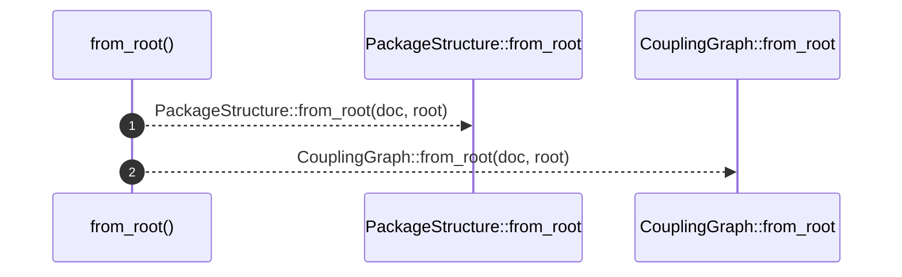
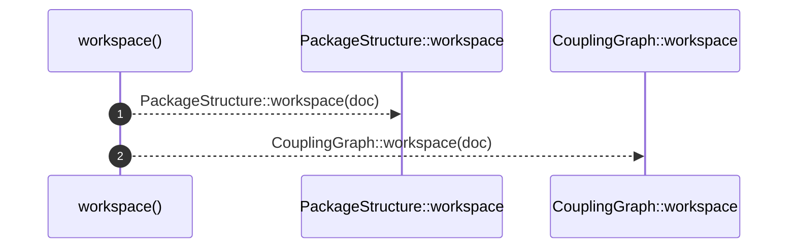
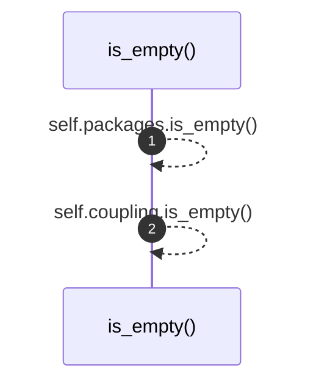

# `robby_render::view::deps::impl DependencyViews`

[Self-model](../../../README.md) · [view::deps](index.md)

| | |
|---|---|
| kind | `code.impl` |
| location | [`crates/robby-render/src/view/deps.rs:16`](../../../../../crates/robby-render/src/view/deps.rs#L16) |
| provenance | extractor · confidence 1.00 |

```rust
impl DependencyViews {
    pub fn from_root(doc: &Document, root: &NodeId) -> Self {
        Self {
            packages: PackageStructure::from_root(doc, root),
            coupling: CouplingGraph::from_root(doc, root),
        }
    }

    pub fn workspace(doc: &Document) -> Self {
        Self {
            packages: PackageStructure::workspace(doc),
            coupling: CouplingGraph::workspace(doc),
        }
    }

    pub fn is_empty(&self) -> bool {
        self.packages.is_empty() && self.coupling.is_empty()
    }
}
```

### `from_root`

| | |
|---|---|
| kind | `code.method` |
| signature | `fn from_root(2)` |
| location | [`crates/robby-render/src/view/deps.rs:17`](../../../../../crates/robby-render/src/view/deps.rs#L17) |
| provenance | extractor · confidence 1.00 |

```rust
pub fn from_root(doc: &Document, root: &NodeId) -> Self {
        Self {
            packages: PackageStructure::from_root(doc, root),
            coupling: CouplingGraph::from_root(doc, root),
        }
    }
```



2 steps · 0 observed · 2 possible only

**Edges**

- calls → [`robby_render::view::deps::impl DependencyViews::from_root`](index.md)
- calls → [`robby_render::view::deps::impl DependencyViews::from_root`](index.md)

### `workspace`

| | |
|---|---|
| kind | `code.method` |
| signature | `fn workspace(1)` |
| location | [`crates/robby-render/src/view/deps.rs:24`](../../../../../crates/robby-render/src/view/deps.rs#L24) |
| provenance | extractor · confidence 1.00 |

```rust
pub fn workspace(doc: &Document) -> Self {
        Self {
            packages: PackageStructure::workspace(doc),
            coupling: CouplingGraph::workspace(doc),
        }
    }
```



2 steps · 0 observed · 2 possible only

**Edges**

- calls → [`robby_render::view::deps::impl DependencyViews::workspace`](index.md)
- calls → [`robby_render::view::deps::impl DependencyViews::workspace`](index.md)

### `is_empty`

| | |
|---|---|
| kind | `code.method` |
| signature | `fn is_empty(1)` |
| location | [`crates/robby-render/src/view/deps.rs:31`](../../../../../crates/robby-render/src/view/deps.rs#L31) |
| provenance | extractor · confidence 1.00 |

```rust
pub fn is_empty(&self) -> bool {
        self.packages.is_empty() && self.coupling.is_empty()
    }
```



2 steps · 0 observed · 2 possible only

**Edges**

- calls → [`robby_render::view::deps::impl DependencyViews::is_empty`](index.md)
- calls → [`robby_render::view::deps::impl DependencyViews::is_empty`](index.md)

