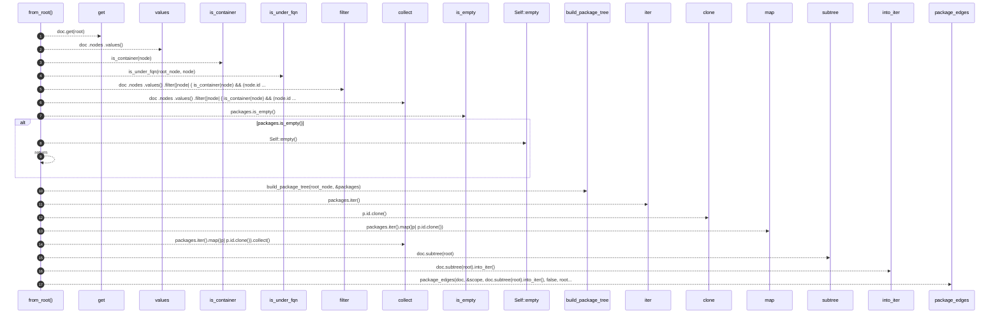
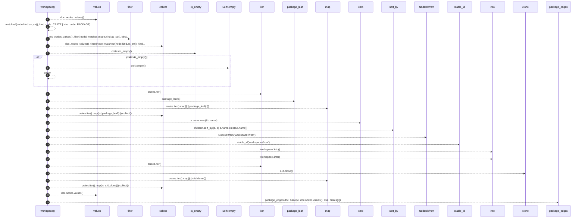
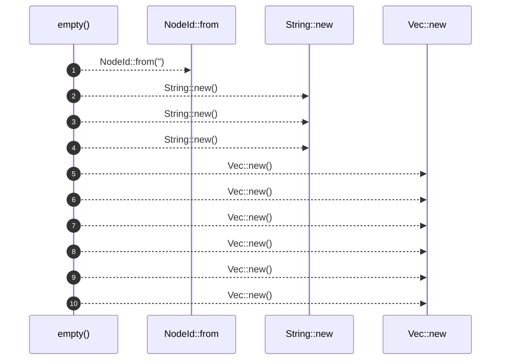
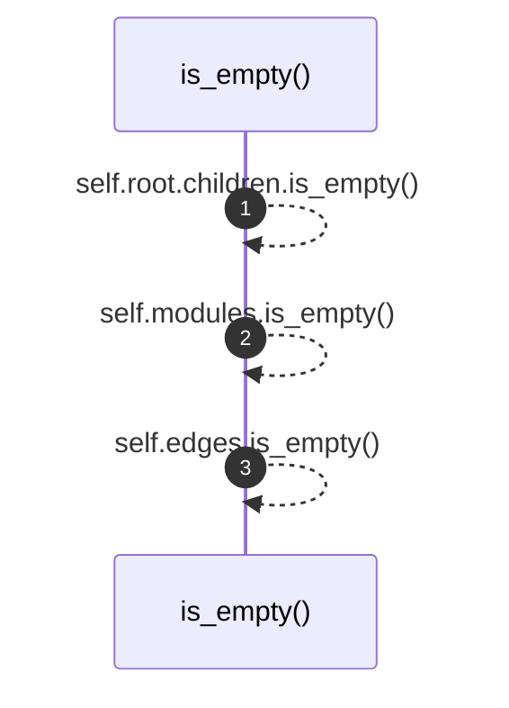
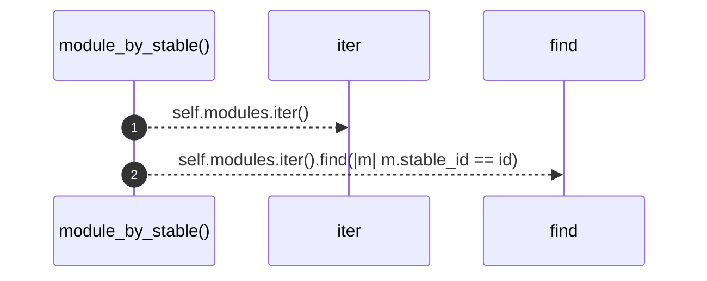

# `robby_render::view::deps::impl PackageStructure`

[Self-model](../../../README.md) · [view::deps](index.md)

| | |
|---|---|
| kind | `code.impl` |
| location | [`crates/robby-render/src/view/deps.rs:103`](../../../../../crates/robby-render/src/view/deps.rs#L103) |
| provenance | extractor · confidence 1.00 |

```rust
impl PackageStructure {
    pub fn from_root(doc: &Document, root: &NodeId) -> Self {
        let Some(root_node) = doc.get(root) else {
            return Self::empty();
        };

        let packages: Vec<&Node> = doc
            .nodes
            .values()
            .filter(|node| {
                is_container(node) && (node.id == root_node.id || is_under_fqn(root_node, node))
            })
            .collect();

        if packages.is_empty() {
            return Self::empty();
        }

        let tree = build_package_tree(root_node, &packages);
        let scope: BTreeSet<NodeId> = packages.iter().map(|p| p.id.clone()).collect();
        let (edges, externals, modules, layers, cycles) =
            package_edges(doc, &scope, doc.subtree(root).into_iter(), false, root_node);

        Self {
            root: tree,
            externals,
            edges,
            layers,
            cycles,
            modules,
        }
    }

    pub fn workspace(doc: &Document) -> Self {
        let crates: Vec<&Node> = doc
            .nodes
            .values()
            .filter(|node| matches!(node.kind.as_str(), kind::code::CRATE | kind::code::PACKAGE))
            .collect();
        if crates.is_empty() {
            return Self::empty();
        }

        let mut children: Vec<PackageNode> = crates.iter().map(|c| package_leaf(c)).collect();
        children.sort_by(|a, b| a.name.cmp(&b.name));

        let root = PackageNode {
            id: NodeId::from("workspace://root"),
            stable_id: stable_id("workspace://root"),
            name: "workspace".into(),
            fqn: "workspace".into(),
            children,
        };

        let scope: BTreeSet<NodeId> = crates.iter().map(|c| c.id.clone()).collect();
        let (edges, externals, modules, layers, cycles) =
            package_edges(doc, &scope, doc.nodes.values(), true, crates[0]);

        Self {
            root,
            externals,
            edges,
            layers,
            cycles,
            modules,
        }
    }

    pub fn empty() -> Self {
        Self {
            root: PackageNode {
                id: NodeId::from(""),
                stable_id: String::new(),
                name: String::new(),
                fqn: String::new(),
                children: Vec::new(),
            },
            externals: Vec::new(),
            edges: Vec::new(),
            layers: Vec::new(),
            cycles: Vec::new(),
            modules: Vec::new(),
        }
    }

    pub fn is_empty(&self) -> bool {
        self.root.children.is_empty() && self.modules.is_empty() && self.edges.is_empty()
    }

    pub fn module_by_stable<'a>(&'a self, id: &str) -> Option<&'a DepModule> {
        self.modules.iter().find(|m| m.stable_id == id)
    }
}
```

## References

- calls → [`robby_ir::kind`](../../../robby_ir/kind/index.md) — from
- calls → [`robby_ir::model`](../../../robby_ir/model/index.md) — subtree
- calls → [`robby_ir::run`](../../../robby_ir/run/index.md) — get
- calls → [`robby_render`](../../index.md) — stable_id
- calls → [`robby_render::util`](../../util/index.md) — is_container
- calls → [`robby_render::view::deps`](index.md) — build_package_tree, is_under_fqn, package_edges, package_leaf
- calls → [`robby_render::view::scene`](../scene/index.md) — new
- calls → [`robby_render::view::select`](../select/index.md) — collect

## Referenced by

- calls ← [`robby_render::render::mermaid::dsm_markdown_table`](../../render/mermaid/dsm-markdown-table.md)
- calls ← [`robby_render::render::tui::ascii_package_structure`](../../render/tui/ascii-package-structure.md)

### `from_root`

| | |
|---|---|
| kind | `code.method` |
| signature | `fn from_root(2)` |
| location | [`crates/robby-render/src/view/deps.rs:104`](../../../../../crates/robby-render/src/view/deps.rs#L104) |
| provenance | extractor · confidence 1.00 |

```rust
pub fn from_root(doc: &Document, root: &NodeId) -> Self {
        let Some(root_node) = doc.get(root) else {
            return Self::empty();
        };

        let packages: Vec<&Node> = doc
            .nodes
            .values()
            .filter(|node| {
                is_container(node) && (node.id == root_node.id || is_under_fqn(root_node, node))
            })
            .collect();

        if packages.is_empty() {
            return Self::empty();
        }

        let tree = build_package_tree(root_node, &packages);
        let scope: BTreeSet<NodeId> = packages.iter().map(|p| p.id.clone()).collect();
        let (edges, externals, modules, layers, cycles) =
            package_edges(doc, &scope, doc.subtree(root).into_iter(), false, root_node);

        Self {
            root: tree,
            externals,
            edges,
            layers,
            cycles,
            modules,
        }
    }
```



17 steps · 0 observed · 17 possible only

**Edges**

- calls → [`robby_ir::run::RecipeCatalog::get`](../../../robby_ir/run/index.md)
- calls → [`robby_render::util::is_container`](../../util/is-container.md)
- calls → [`robby_render::view::deps::is_under_fqn`](is-under-fqn.md)
- calls → [`robby_render::view::select::collect`](../select/collect.md)
- calls → [`robby_render::view::deps::impl PackageStructure::is_empty`](index.md)
- calls → [`robby_render::view::deps::impl PackageStructure::empty`](index.md)
- calls → [`robby_render::view::deps::build_package_tree`](build-package-tree.md)
- calls → [`robby_render::view::select::collect`](../select/collect.md)
- calls → [`robby_ir::model::impl Document::subtree`](../../../robby_ir/model/index.md)
- calls → [`robby_render::view::deps::package_edges`](package-edges.md)

### `workspace`

| | |
|---|---|
| kind | `code.method` |
| signature | `fn workspace(1)` |
| location | [`crates/robby-render/src/view/deps.rs:136`](../../../../../crates/robby-render/src/view/deps.rs#L136) |
| provenance | extractor · confidence 1.00 |

```rust
pub fn workspace(doc: &Document) -> Self {
        let crates: Vec<&Node> = doc
            .nodes
            .values()
            .filter(|node| matches!(node.kind.as_str(), kind::code::CRATE | kind::code::PACKAGE))
            .collect();
        if crates.is_empty() {
            return Self::empty();
        }

        let mut children: Vec<PackageNode> = crates.iter().map(|c| package_leaf(c)).collect();
        children.sort_by(|a, b| a.name.cmp(&b.name));

        let root = PackageNode {
            id: NodeId::from("workspace://root"),
            stable_id: stable_id("workspace://root"),
            name: "workspace".into(),
            fqn: "workspace".into(),
            children,
        };

        let scope: BTreeSet<NodeId> = crates.iter().map(|c| c.id.clone()).collect();
        let (edges, externals, modules, layers, cycles) =
            package_edges(doc, &scope, doc.nodes.values(), true, crates[0]);

        Self {
            root,
            externals,
            edges,
            layers,
            cycles,
            modules,
        }
    }
```



23 steps · 0 observed · 23 possible only

**Edges**

- calls → [`robby_render::view::select::collect`](../select/collect.md)
- calls → [`robby_render::view::deps::impl PackageStructure::is_empty`](index.md)
- calls → [`robby_render::view::deps::impl PackageStructure::empty`](index.md)
- calls → [`robby_render::view::deps::package_leaf`](package-leaf.md)
- calls → [`robby_render::view::select::collect`](../select/collect.md)
- calls → [`robby_ir::kind::impl From<&str> for Kind::from`](../../../robby_ir/kind/index.md)
- calls → [`robby_render::stable_id`](../../stable-id.md)
- calls → [`robby_render::view::select::collect`](../select/collect.md)
- calls → [`robby_render::view::deps::package_edges`](package-edges.md)

### `empty`

| | |
|---|---|
| kind | `code.method` |
| signature | `fn empty(0)` |
| location | [`crates/robby-render/src/view/deps.rs:171`](../../../../../crates/robby-render/src/view/deps.rs#L171) |
| provenance | extractor · confidence 1.00 |

```rust
pub fn empty() -> Self {
        Self {
            root: PackageNode {
                id: NodeId::from(""),
                stable_id: String::new(),
                name: String::new(),
                fqn: String::new(),
                children: Vec::new(),
            },
            externals: Vec::new(),
            edges: Vec::new(),
            layers: Vec::new(),
            cycles: Vec::new(),
            modules: Vec::new(),
        }
    }
```



10 steps · 0 observed · 10 possible only

**Edges**

- calls → [`robby_ir::kind::impl From<&str> for Kind::from`](../../../robby_ir/kind/index.md)
- calls → [`robby_render::view::scene::impl Rect::new`](../scene/index.md)
- calls → [`robby_render::view::scene::impl Rect::new`](../scene/index.md)
- calls → [`robby_render::view::scene::impl Rect::new`](../scene/index.md)
- calls → [`robby_render::view::scene::impl Rect::new`](../scene/index.md)
- calls → [`robby_render::view::scene::impl Rect::new`](../scene/index.md)
- calls → [`robby_render::view::scene::impl Rect::new`](../scene/index.md)
- calls → [`robby_render::view::scene::impl Rect::new`](../scene/index.md)
- calls → [`robby_render::view::scene::impl Rect::new`](../scene/index.md)
- calls → [`robby_render::view::scene::impl Rect::new`](../scene/index.md)

### `is_empty`

| | |
|---|---|
| kind | `code.method` |
| signature | `fn is_empty(1)` |
| location | [`crates/robby-render/src/view/deps.rs:188`](../../../../../crates/robby-render/src/view/deps.rs#L188) |
| provenance | extractor · confidence 1.00 |

```rust
pub fn is_empty(&self) -> bool {
        self.root.children.is_empty() && self.modules.is_empty() && self.edges.is_empty()
    }
```



3 steps · 0 observed · 3 possible only

**Edges**

- calls → [`robby_render::view::deps::impl PackageStructure::is_empty`](index.md)
- calls → [`robby_render::view::deps::impl PackageStructure::is_empty`](index.md)
- calls → [`robby_render::view::deps::impl PackageStructure::is_empty`](index.md)

### `module_by_stable`

| | |
|---|---|
| kind | `code.method` |
| signature | `fn module_by_stable(2)` |
| location | [`crates/robby-render/src/view/deps.rs:192`](../../../../../crates/robby-render/src/view/deps.rs#L192) |
| provenance | extractor · confidence 1.00 |

```rust
pub fn module_by_stable<'a>(&'a self, id: &str) -> Option<&'a DepModule> {
        self.modules.iter().find(|m| m.stable_id == id)
    }
```



2 steps · 0 observed · 2 possible only

