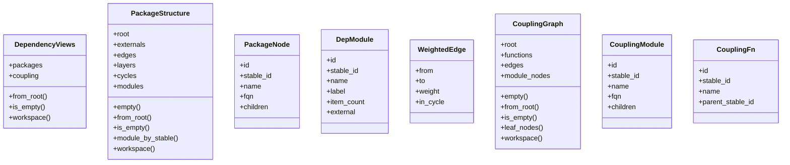
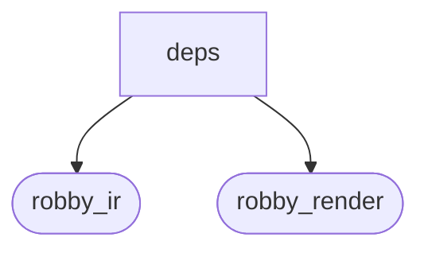

# `robby_render::view::deps`

[Self-model](../../../README.md) · [robby_render](../../index.md)

| | |
|---|---|
| kind | `code.module` |
| declared at | [`crates/robby-render/src/view/mod.rs:7`](../../../../../crates/robby-render/src/view/mod.rs#L7) |
| provenance | extractor · confidence 1.00 |
| nodes | 81 |

## Types



## Package diagram



## Module coupling

```mermaid
flowchart TB
    subgraph n_55531c5d49993a41["deps"]
        direction TB
        n_a073468cddadb161["best_scope_prefix"]
        n_62d508d9fb8ad860["build_coupling_tree"]
        n_c6de9edc70837acd["build_package_tree"]
        n_c94f80bcae6304a4["container_of"]
        n_dccc885fe0a44b04["crate_of"]
        n_ef17956e251a25c9["empty"]
        n_f2067b0bd780c963["empty"]
        n_c10325e57e063de6["finalize_edges"]
        n_ca5056d43b6f5293["from_root"]
        n_d7c80243ebd2831f["from_root"]
        n_e8d7eb06ad230a45["from_root"]
        n_d3c4eb93ce09e101["insert_module"]
        n_f8b93f550ab04ba2["is_callable"]
        n_dfa474318a063404["is_direct_package"]
        n_0e4ac560540b7b74["is_empty"]
        n_8e83bc09f24e66a0["is_empty"]
        n_d9177e73eb024a06["is_empty"]
        n_390bde23d800fb4e["is_under_fqn"]
        n_618f2fb865962654["leaf_nodes"]
        n_fad312efa0272c07["lift_to_scope"]
        n_fa641831e790faa6["owning_in_scope"]
        n_beed62791dc90132["package_edges"]
        n_97d55db8002e6d30["package_leaf"]
        n_e984c401b99e2b91["tarjan"]
        n_f58f9296e7591cf3["topological_layers"]
        n_bcdf29a0a8f79b6c["under_root_fqn"]
        n_6892848a318479b5["workspace"]
        n_a15344ed13186dff["workspace"]
        n_f0f787d7f363627b["workspace"]
    end
    n_618f2fb865962654 --> n_0e4ac560540b7b74
    n_62d508d9fb8ad860 --> n_c6de9edc70837acd
    n_6892848a318479b5 --> n_97d55db8002e6d30
    n_6892848a318479b5 --> n_beed62791dc90132
    n_6892848a318479b5 --> n_d9177e73eb024a06
    n_6892848a318479b5 --> n_ef17956e251a25c9
    n_a15344ed13186dff -->|"3"| n_0e4ac560540b7b74
    n_a15344ed13186dff --> n_97d55db8002e6d30
    n_a15344ed13186dff --> n_c10325e57e063de6
    n_a15344ed13186dff --> n_c94f80bcae6304a4
    n_a15344ed13186dff --> n_dfa474318a063404
    n_a15344ed13186dff -->|"2"| n_f2067b0bd780c963
    n_a15344ed13186dff --> n_fa641831e790faa6
    n_a15344ed13186dff --> n_fad312efa0272c07
    n_bcdf29a0a8f79b6c --> n_390bde23d800fb4e
    n_beed62791dc90132 --> n_c94f80bcae6304a4
    n_beed62791dc90132 -->|"3"| n_d3c4eb93ce09e101
    n_beed62791dc90132 --> n_dccc885fe0a44b04
    n_beed62791dc90132 --> n_e984c401b99e2b91
    n_beed62791dc90132 --> n_f58f9296e7591cf3
    n_beed62791dc90132 --> n_fa641831e790faa6
    n_beed62791dc90132 --> n_fad312efa0272c07
    n_c10325e57e063de6 --> n_e984c401b99e2b91
    n_c6de9edc70837acd --> n_97d55db8002e6d30
    n_ca5056d43b6f5293 --> n_0e4ac560540b7b74
    n_ca5056d43b6f5293 --> n_390bde23d800fb4e
    n_ca5056d43b6f5293 --> n_62d508d9fb8ad860
    n_ca5056d43b6f5293 --> n_bcdf29a0a8f79b6c
    n_ca5056d43b6f5293 --> n_c10325e57e063de6
    n_ca5056d43b6f5293 --> n_f2067b0bd780c963
    n_ca5056d43b6f5293 -->|"2"| n_f8b93f550ab04ba2
    n_ca5056d43b6f5293 -->|"2"| n_fa641831e790faa6
    n_dfa474318a063404 --> n_0e4ac560540b7b74
    n_e8d7eb06ad230a45 --> n_390bde23d800fb4e
    n_e8d7eb06ad230a45 --> n_beed62791dc90132
    n_e8d7eb06ad230a45 --> n_c6de9edc70837acd
    n_e8d7eb06ad230a45 --> n_d9177e73eb024a06
    n_e8d7eb06ad230a45 --> n_ef17956e251a25c9
    n_f58f9296e7591cf3 -->|"2"| n_0e4ac560540b7b74
    n_fa641831e790faa6 --> n_a073468cddadb161
    n_fad312efa0272c07 --> n_a073468cddadb161
```



## Dependency matrix

| | deps | robby_ir | robby_render |
|---|---:|---:|---:|
| **deps** | · | 25 | 130 |
| **robby_ir** | | · | |
| **robby_render** | | | · |

## Comments

- `crates/robby-render/src/view/deps.rs:198:5` (docs, `robby_render::view::deps::impl CouplingGraph::from_root`): "Function-level internal Calls under `root`."
  ```
  /// Function-level internal Calls under `root`.
      pub fn from_root(doc: &Document, root: &NodeId) -> Self {
          let Some(root_node) = doc.get(root) else {
              return Self::empty();
          };
  
          let packages: Vec<&Node> = doc
              .nodes
              .values()
              .filter(|node| {
                  is_container(node) && (node.id == root_node.id || is_under_fqn(root_node, node))
              })
              .collect();
          let package_scope: BTreeSet<NodeId> = packages.iter().map(|p| p.id.clone()).collect();
  
          let mut weights: BTreeMap<(String, String), usize> = BTreeMap::new();
          let mut participants: BTreeMap<String, CouplingFn> = BTreeMap::new();
  
          for node in doc.subtree(root) {
              if !is_callable(node) {
                  continue;
              }
              for edge in &node.edges {
                  if edge.kind != EdgeKind::Calls {
                      continue;
                  }
                  let Some(target) = doc.get(&edge.to) else {
                      continue;
                  };
                  if !is_callable(target) || !under_root_fqn(root_node, target) {
                      continue;
                  }
  
                  let Some(from_mod) = owning_in_scope(doc, &node.id, &package_scope) else {
                      continue;
                  };
                  let Some(to_mod) = owning_in_scope(doc, &target.id, &package_scope) else {
                      continue;
                  };
  
                  let from_sid = stable_id(node.id.as_str());
                  let to_sid = stable_id(target.id.as_str());
                  participants
                      .entry(from_sid.clone())
                      .or_insert_with(|| CouplingFn {
                          id: node.id.clone(),
                          stable_id: from_sid.clone(),
                          name: node.name.clone(),
                          parent_stable_id: stable_id(from_mod.id.as_str()),
                      });
                  participants
                      .entry(to_sid.clone())
                      .or_insert_with(|| CouplingFn {
                          id: target.id.clone(),
                          stable_id: to_sid.clone(),
                          name: target.name.clone(),
                          parent_stable_id: stable_id(to_mod.id.as_str()),
                      });
                  if from_sid != to_sid {
                      *weights.entry((from_sid, to_sid)).or_default() += 1;
                  }
              }
          }
  
          if participants.is_empty() {
              return Self::empty();
          }
  
          let owner_fqns: BTreeSet<String> = participants
              .values()
              .filter_map(|f| {
                  packages
                      .iter()
                      .find(|m| stable_id(m.id.as_str()) == f.parent_stable_id)
                      .map(|m| m.fqn.clone())
              })
              .collect();
  
          // Modules that own a participant, plus every ancestor under root.
          let tree_packages: Vec<&Node> = packages
              .iter()
              .copied()
              .filter(|p| {
                  owner_fqns
                      .iter()
                      .any(|fqn| fqn == &p.fqn || fqn.starts_with(&format!("{}::", p.fqn)))
              })
              .collect();
  
          let root_mod = build_coupling_tree(root_node, &tree_packages);
          let edges = finalize_edges(weights);
          let mut functions: Vec<CouplingFn> = participants.into_values().collect();
          functions.sort_by(|a, b| a.name.cmp(&b.name).then(a.stable_id.cmp(&b.stable_id)));
  
          Self {
              root: root_mod,
              functions,
              edges,
              module_nodes: Vec::new(),
          }
      }
  ```
- `crates/robby-render/src/view/deps.rs:300:5` (docs, `robby_render::view::deps::impl CouplingGraph::workspace`): "Crates as subgraphs; direct modules as nodes; call-weighted module edges."
  ```
  /// Crates as subgraphs; direct modules as nodes; call-weighted module edges.
      pub fn workspace(doc: &Document) -> Self {
          let crates: Vec<&Node> = doc
              .nodes
              .values()
              .filter(|node| matches!(node.kind.as_str(), kind::code::CRATE | kind::code::PACKAGE))
              .collect();
          if crates.is_empty() {
              return Self::empty();
          }
  
          let mut module_nodes: BTreeMap<String, CouplingFn> = BTreeMap::new();
          let mut crate_children: BTreeMap<String, Vec<PackageNode>> = BTreeMap::new();
  
          for krate in &crates {
              let directs: Vec<&Node> = doc
                  .nodes
                  .values()
                  .filter(|node| is_container(node) && is_direct_package(krate, node))
                  .collect();
              let mut kids = Vec::new();
              for m in &directs {
                  let sid = stable_id(m.id.as_str());
                  module_nodes.insert(
                      sid.clone(),
                      CouplingFn {
                          id: m.id.clone(),
                          stable_id: sid.clone(),
                          name: m.name.clone(),
                          parent_stable_id: stable_id(krate.id.as_str()),
                      },
                  );
                  kids.push(package_leaf(m));
              }
              kids.sort_by(|a, b| a.name.cmp(&b.name));
              crate_children.insert(stable_id(krate.id.as_str()), kids);
          }
  
          // Scope = all direct modules across crates.
          let scope: BTreeSet<NodeId> = module_nodes.values().map(|m| m.id.clone()).collect();
  
          let mut weights: BTreeMap<(String, String), usize> = BTreeMap::new();
          for node in doc.nodes.values() {
              for edge in &node.edges {
                  if edge.kind != EdgeKind::Calls {
                      continue;
                  }
                  let Some(from_mod) = owning_in_scope(doc, &node.id, &scope) else {
                      continue;
                  };
                  let Some(to_owner) = container_of(doc, &edge.to) else {
                      continue;
                  };
                  let Some(to_mod) = lift_to_scope(doc, to_owner, &scope) else {
                      continue;
                  };
                  if from_mod.id == to_mod.id {
                      continue;
                  }
                  let from_sid = stable_id(from_mod.id.as_str());
                  let to_sid = stable_id(to_mod.id.as_str());
                  *weights.entry((from_sid, to_sid)).or_default() += 1;
              }
          }
  
          // Only keep modules that participate in an edge.
          let active: BTreeSet<String> = weights
              .keys()
              .flat_map(|(a, b)| [a.clone(), b.clone()])
              .collect();
          module_nodes.retain(|sid, _| active.contains(sid));
  
          let mut children: Vec<CouplingModule> = crates
              .iter()
              .map(|c| {
                  let sid = stable_id(c.id.as_str());
                  let kids = crate_children
                      .remove(&sid)
                      .unwrap_or_default()
                      .into_iter()
                      .filter(|k| active.contains(&k.stable_id))
                      .map(|k| CouplingModule {
                          id: k.id,
                          stable_id: k.stable_id,
                          name: k.name,
                          fqn: k.fqn,
                          children: Vec::new(),
                      })
                      .collect();
                  CouplingModule {
                      id: c.id.clone(),
                      stable_id: sid,
                      name: c.name.clone(),
                      fqn: c.fqn.clone(),
                      children: kids,
                  }
              })
              .filter(|c| !c.children.is_empty())
              .collect();
          children.sort_by(|a, b| a.name.cmp(&b.name));
  
          let root = CouplingModule {
              id: NodeId::from("workspace://root"),
              stable_id: stable_id("workspace://root"),
              name: "workspace".into(),
              fqn: "workspace".into(),
              children,
          };
  
          let edges = finalize_edges(weights);
          let mut module_nodes: Vec<CouplingFn> = module_nodes.into_values().collect();
          module_nodes.sort_by(|a, b| a.name.cmp(&b.name).then(a.stable_id.cmp(&b.stable_id)));
  
          if module_nodes.is_empty() {
              return Self::empty();
          }
  
          Self {
              root,
              functions: Vec::new(),
              edges,
              module_nodes,
          }
      }
  ```
- `crates/robby-render/src/view/deps.rs:36:1` (docs, `robby_render::view::deps::PackageStructure`): "Nested source-structure packages + inter-package deps (and externals)."
  ```
  /// Nested source-structure packages + inter-package deps (and externals).
  #[derive(Debug, Clone, PartialEq, Eq)]
  pub struct PackageStructure {
      pub root: PackageNode,
      pub externals: Vec<DepModule>,
      pub edges: Vec<WeightedEdge>,
      pub layers: Vec<Vec<String>>,
      pub cycles: Vec<Vec<String>>,
      /// Flat index (tree packages + externals) for DSM / lookups.
      pub modules: Vec<DepModule>,
  }
  ```
- `crates/robby-render/src/view/deps.rs:75:1` (docs, `robby_render::view::deps::CouplingGraph`): "Internal call coupling: modules as nested subgraphs, functions as nodes."
  ```
  /// Internal call coupling: modules as nested subgraphs, functions as nodes.
  #[derive(Debug, Clone, PartialEq, Eq)]
  pub struct CouplingGraph {
      pub root: CouplingModule,
      pub functions: Vec<CouplingFn>,
      pub edges: Vec<WeightedEdge>,
      /// Workspace mode: modules are leaf nodes (no functions).
      pub module_nodes: Vec<CouplingFn>,
  }
  ```
- `crates/robby-render/src/view/deps.rs:9:1` (docs, `robby_render::view::deps::DependencyViews`): "Bundle of the three dependency formalisms for one root."
  ```
  /// Bundle of the three dependency formalisms for one root.
  #[derive(Debug, Clone, PartialEq, Eq)]
  pub struct DependencyViews {
      pub packages: PackageStructure,
      pub coupling: CouplingGraph,
  }
  ```
## References

- calls → [`robby_ir::kind`](../../../robby_ir/kind/index.md) — from
- calls → [`robby_ir::model`](../../../robby_ir/model/index.md) — insert, subtree
- calls → [`robby_ir::run`](../../../robby_ir/run/index.md) — get
- calls → [`robby_render`](../../index.md) — stable_id
- calls → [`robby_render::report`](../../report/index.md) — push
- calls → [`robby_render::util`](../../util/index.md) — is_container, text
- calls → [`robby_render::view::comments`](../comments/index.md) — as_str
- calls → [`robby_render::view::entrypoints`](../entrypoints/index.md) — children_of
- calls → [`robby_render::view::scene`](../scene/index.md) — contains, new
- calls → [`robby_render::view::select`](../select/index.md) — collect

## Referenced by

- calls ← [`robby_render::coupling`](../../coupling.md)
- calls ← [`robby_render::dependencies`](../../dependencies.md)
- calls ← [`robby_render::dependency_report`](../../dependency-report.md)
- calls ← [`robby_render::flowchart`](../../flowchart.md)
- calls ← [`robby_render::render::mermaid::dsm_markdown_table`](../../render/mermaid/dsm-markdown-table.md)
- calls ← [`robby_render::render::tui::ascii_coupling`](../../render/tui/ascii-coupling.md)
- calls ← [`robby_render::render::tui::ascii_package_structure`](../../render/tui/ascii-package-structure.md)
- calls ← [`robby_render::test_render::externals_and_comments_sections_render`](../../test_render/externals-and-comments-sections-render.md)
- calls ← [`robby_render::tui::graph`](../../tui/graph.md)
- calls ← [`robby_render::view::scene::build_frame`](../scene/build-frame.md)
- calls ← [`robby_render::view::select::collect`](../select/collect.md)

## Items

| Item | Kind | Steps | Location |
|---|---|---:|---|
| [`DependencyViews`](dependencyviews.md) | `code.struct` | — | `crates/robby-render/src/view/deps.rs:9:1` |
| [`impl DependencyViews`](impl-dependencyviews.md) | `code.impl` | — | `crates/robby-render/src/view/deps.rs:16:1` |
| [`PackageStructure`](packagestructure.md) | `code.struct` | — | `crates/robby-render/src/view/deps.rs:36:1` |
| [`PackageNode`](packagenode.md) | `code.struct` | — | `crates/robby-render/src/view/deps.rs:48:1` |
| [`DepModule`](depmodule.md) | `code.struct` | — | `crates/robby-render/src/view/deps.rs:57:1` |
| [`WeightedEdge`](weightededge.md) | `code.struct` | — | `crates/robby-render/src/view/deps.rs:67:1` |
| [`CouplingGraph`](couplinggraph.md) | `code.struct` | — | `crates/robby-render/src/view/deps.rs:75:1` |
| [`CouplingModule`](couplingmodule.md) | `code.struct` | — | `crates/robby-render/src/view/deps.rs:85:1` |
| [`CouplingFn`](couplingfn.md) | `code.struct` | — | `crates/robby-render/src/view/deps.rs:94:1` |
| [`impl PackageStructure`](impl-packagestructure.md) | `code.impl` | — | `crates/robby-render/src/view/deps.rs:103:1` |
| [`impl CouplingGraph`](impl-couplinggraph.md) | `code.impl` | — | `crates/robby-render/src/view/deps.rs:197:1` |
| [`package_edges`](package-edges.md) | `code.function` | 73 | `crates/robby-render/src/view/deps.rs:453:1` |
| [`finalize_edges`](finalize-edges.md) | `code.function` | 30 | `crates/robby-render/src/view/deps.rs:563:1` |
| [`build_package_tree`](build-package-tree.md) | `code.function` | 7 | `crates/robby-render/src/view/deps.rs:598:1` |
| [`build_coupling_tree`](build-coupling-tree.md) | `code.function` | 3 | `crates/robby-render/src/view/deps.rs:622:1` |
| [`package_leaf`](package-leaf.md) | `code.function` | 6 | `crates/robby-render/src/view/deps.rs:636:1` |
| [`insert_module`](insert-module.md) | `code.function` | 11 | `crates/robby-render/src/view/deps.rs:646:1` |
| [`is_callable`](is-callable.md) | `code.function` | 1 | `crates/robby-render/src/view/deps.rs:663:1` |
| [`is_under_fqn`](is-under-fqn.md) | `code.function` | 2 | `crates/robby-render/src/view/deps.rs:670:1` |
| [`under_root_fqn`](under-root-fqn.md) | `code.function` | 1 | `crates/robby-render/src/view/deps.rs:674:1` |
| [`owning_in_scope`](owning-in-scope.md) | `code.function` | 12 | `crates/robby-render/src/view/deps.rs:678:1` |
| [`container_of`](container-of.md) | `code.function` | 10 | `crates/robby-render/src/view/deps.rs:697:1` |
| [`crate_of`](crate-of.md) | `code.function` | 7 | `crates/robby-render/src/view/deps.rs:712:1` |
| [`lift_to_scope`](lift-to-scope.md) | `code.function` | 10 | `crates/robby-render/src/view/deps.rs:723:1` |
| [`best_scope_prefix`](best-scope-prefix.md) | `code.function` | 8 | `crates/robby-render/src/view/deps.rs:741:1` |
| [`is_direct_package`](is-direct-package.md) | `code.function` | 4 | `crates/robby-render/src/view/deps.rs:764:1` |
| [`tarjan`](tarjan.md) | `code.function` | 9 | `crates/robby-render/src/view/deps.rs:772:1` |
| [`topological_layers`](topological-layers.md) | `code.function` | 45 | `crates/robby-render/src/view/deps.rs:843:1` |

## Imports

- `use std::collections::{BTreeMap, BTreeSet, VecDeque};`
- [`use robby_ir::{Document, EdgeKind, Node, NodeId, kind};`](../../../robby_ir/index.md)
- `use crate::util::{is_container, short_kind, stable_id, text};`

